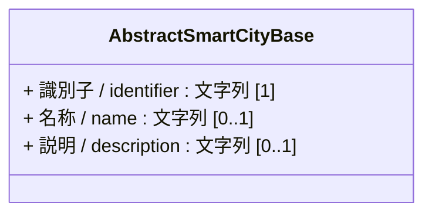
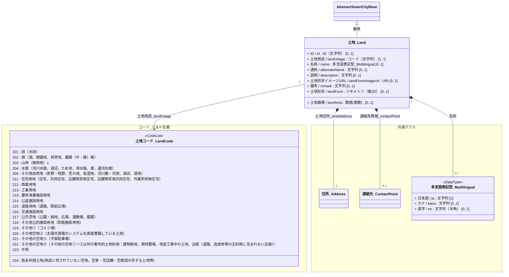

# 4.1 土地クラス図

土地モデルを「共通基盤」と「ドメイン別関係」に分けて定義します。

## 4.1.1 共通基盤（Base & Components）

すべての土地の基底となる共通クラスの定義です。

---

## 4.1.2 ドメイン別関係

### 4.1.2.1 土地モデル

土地の物理的な範囲・形状、用途、付随する住所や連絡先情報、および関連する各種コードリストの定義です。
* 土地の用途区分は、[都市計画基礎調査実施要領](https://www.mlit.go.jp/toshi/tosiko/kisotyousa001.html)の土地利用現況の土地利用分類を参照して定義します。

