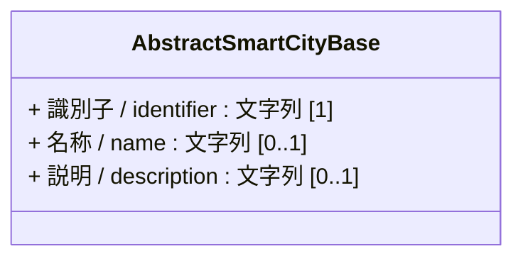
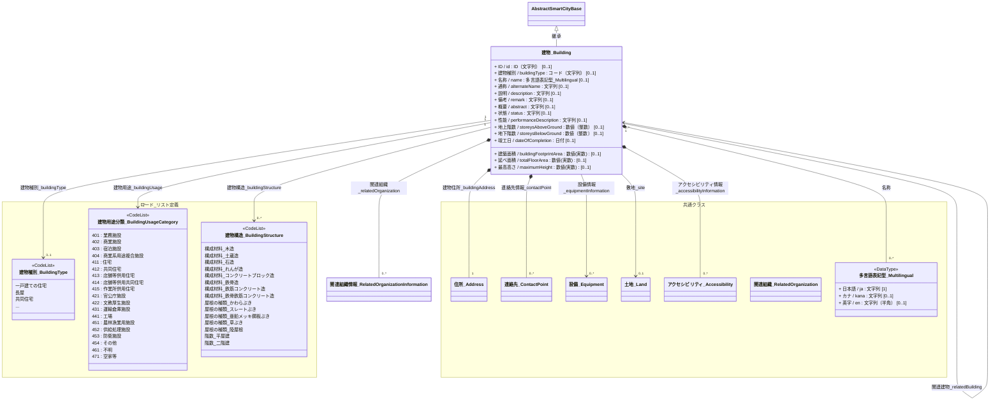

# 4.2 建物クラス図

建物モデルを「共通基盤」と「ドメイン別関係」に分けて定義します。

## 4.2.1 共通基盤（Base & Components）

すべての建物の基底となる共通クラスの定義です。

---

## 4.2.2 ドメイン別関係

### 4.2.2.1 建物モデル

建物の物理的な形状・構造、用途、付随する住所や設備情報、および関連する各種コードリストの定義です。
* 建物種別は、[建築基準法施行規則別記様式](https://www.mlit.go.jp/statistics/details/content/001846694.pdf)の建築物用途区分項目を参照して定義します。
* 建物用途は、[都市計画基礎調査実施要領](https://www.mlit.go.jp/toshi/tosiko/kisotyousa001.html)の建物用途利用現況の用途分類を参照して定義します。
* 構造は、不動産登記規則第114条における「構成材料」「屋根の種類」「階数」の区分に準拠します。

