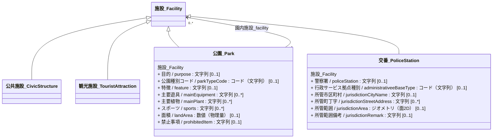
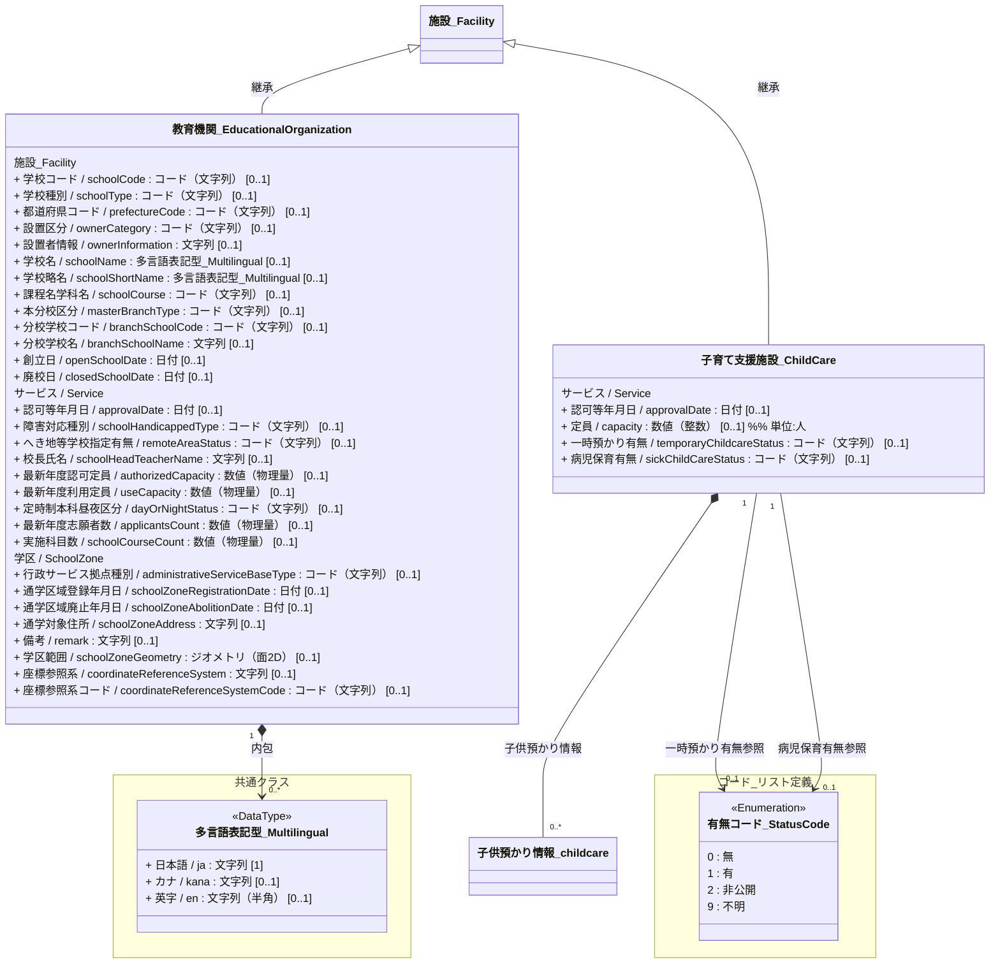
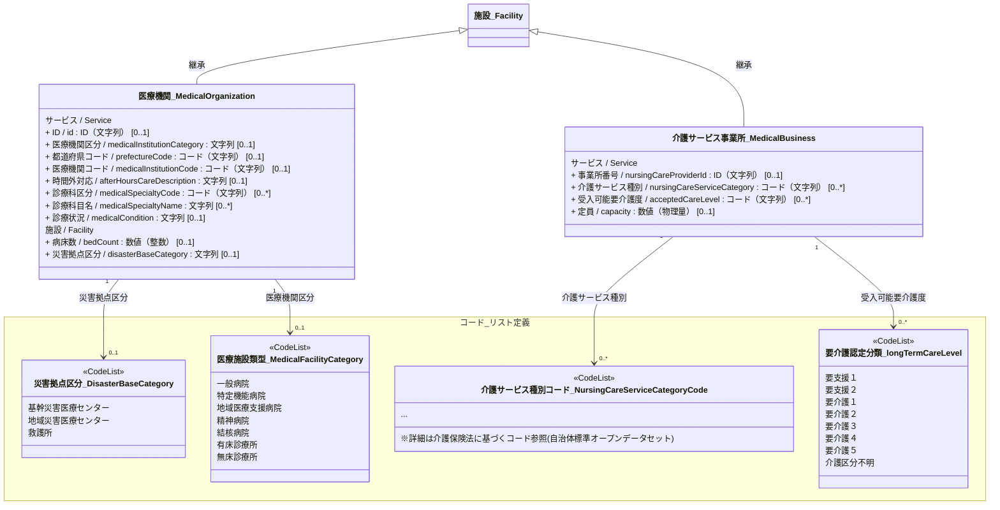
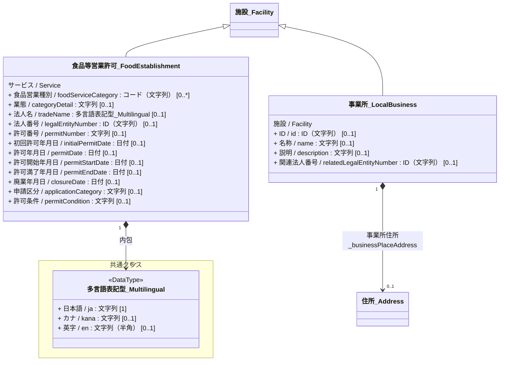
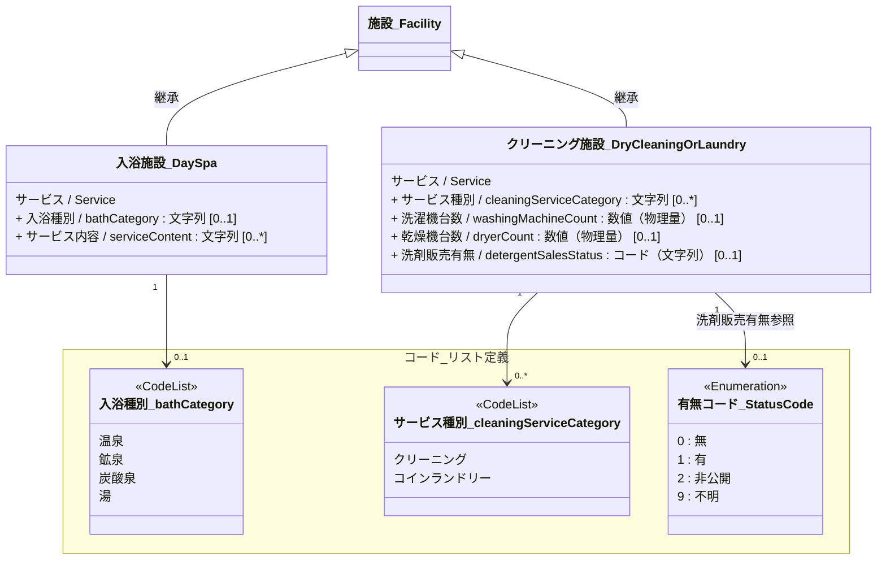

# 4.3 施設クラス図

施設モデルを「共通基盤」と「ドメイン別継承関係」に分けて定義します。

## 4.3.1 共通基盤（Base & Components）

すべての施設の基底となるクラスと、その構成要素となるクラスの定義です。

```mermaid
classDiagram
    direction TB   

    %% ---------------------------------------------------------
    %% 共通基底クラス
    %% ---------------------------------------------------------
    class AbstractSmartCityBase {
        + 識別子 / identifier : 文字列 [1]
        + 名称 / name : 文字列 [0..1]
        + 説明 / description : 文字列 [0..1]
    }

    %% ---------------------------------------------------------
    %% 施設共通（Base Class）
    %% ---------------------------------------------------------
    class 施設_Facility {
        + ID / id : ID（文字列） [0..1]
        + 施設種別 / facilityTpye : コード（文字列） [0..1]
          %% デジタル庁 POIコード（地理的目標物分類コード）
        + 名称 / name : 多言語表記型_Multilingual [0..1]
        + 通称 / alternateName : 文字列 [0..1]
        + 説明 / description : 文字列 [0..1]
        + アクセス方法 / accessMethod : 文字列 [0..1]
        + 駐車場有無 / parkingStatus : コード（文字列） [0..1]
        + 概要 / abstract : 文字列 [0..1]
        + 状態 / status : 文字列 [0..1]
        + 防災情報 / shelterInformation : 文字列 [0..1]
        + 利用可能曜日 / availableDay : 文字列 [0..1]
        + 開始時刻 / startTime : 時刻 [0..1]
        + 終了時刻 / endTime : 時刻 [0..1]
        + 利用可能日時説明 / availableDateTimeDescription : 文字列 [0..1]
        + 利用可能日時 / availableDateTime : 期間 [0..*]
        + 一般利用可否 / generalUserAvailability : コード（文字列） [0..1]
        + 料金有無 / feeStatus : コード（文字列） [0..1]
        + 収容人数 / capacity : 数値（物理量） [0..1]
          %% 単位:人
        施設の利用日時がサービスの利用日時になっているため、分離の必要があるか要検討
    }

    %% ---------------------------------------------------------
    %% 共通パーツ（Components）
    %% ---------------------------------------------------------
    namespace 共通クラス {
        class 住所_Address
        class 連絡先_ContactPoint
        class 設備_Equipment
        class アクセシビリティ_Accessibility

        %% class 子供預かり情報_childcare{
        %%     子育て支援施設か施設の配下か要検討
        %% }

        class 関連組織_RelatedOrganization

        class 料金情報_FeeInformation{
            各サービスか施設の配下か要検討
        }

        class 駐車場_ParkingFacility

        %% 共通の構造体（言語）
        class 多言語表記型_Multilingual <<DataType>> {
            + 日本語 / ja : 文字列 [1]
            + カナ / kana : 文字列 [0..1]
            + 英字 / en : 文字列（半角） [0..1]
        }
    }

    %% ---------------------------------------------------------
    %% コード定義クラス
    %% ---------------------------------------------------------
    namespace コード定義 {
        class 有無コード_StatusCode <<Enumeration>> {
            0 : 無
            1 : 有
            2 : 非公開
            9 : 不明
        }

        class 可否コード_AvailabilityCode <<Enumeration>> {
            0 : 否
            1 : 可
            2 : 非公開
            9 : 不明
        }
    }

    %% 汎化（継承）
    AbstractSmartCityBase <|-- 施設_Facility

    %% コンポジション
    施設_Facility *-- "1" 住所_Address : 施設住所_facilityAddress
    施設_Facility *-- "0..*" 連絡先_ContactPoint : 連絡先情報_contactPoint
    施設_Facility *-- "0..*" 設備_Equipment : 設備情報_equipmentInformation
    施設_Facility *-- "0..*" アクセシビリティ_Accessibility : アクセシビリティ情報_accessibilityInformation
    %% 施設_Facility *-- "0..*" 子供預かり情報_childcare : 子供預かり情報_childcareInformation
    施設_Facility *-- "0..*" 関連組織情報_RelatedOrganizationInformation : 関連組織_relatedOrganization
    施設_Facility *-- "0..*" 駐車場_ParkingFacility : 駐車場情報_parkingInformation
    施設_Facility *-- "0..1" 料金情報_FeeInformation : 施設料金一覧_facilityFeeList

    %% リレーション
    施設_Facility --> "0..1" 施設_Facility : 関連施設_relatedFacility
    施設_Facility "1" --> "0..1" 有無コード_StatusCode : 有無参照
    施設_Facility "1" --> "0..1" 可否コード_AvailabilityCode : 可否参照
    施設_Facility "1" *--> "0..*" 多言語表記型_Multilingual : 内包
```

## 4.3.2 ドメイン別継承関係

### 4.3.2.1 公共サービス・観光

---
### 4.3.2.2 教育・子育て
教育機関・学校のデータモデルは文部科学省・学校教育標準の`学校`、`学校設置者`とする。

---

### 4.3.2.3 医療・福祉

### 4.3.2.4 産業・ビジネス

### 4.3.2.5 生活サービス

