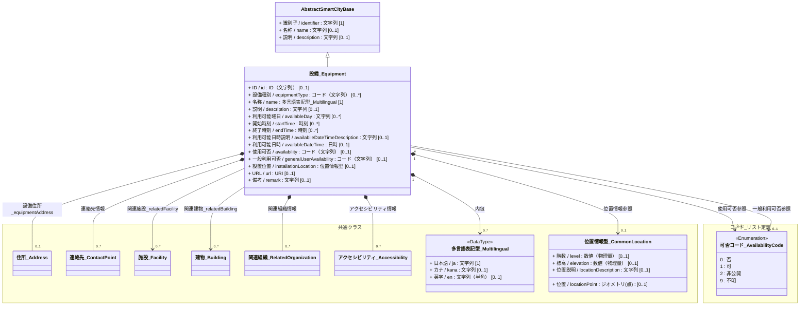
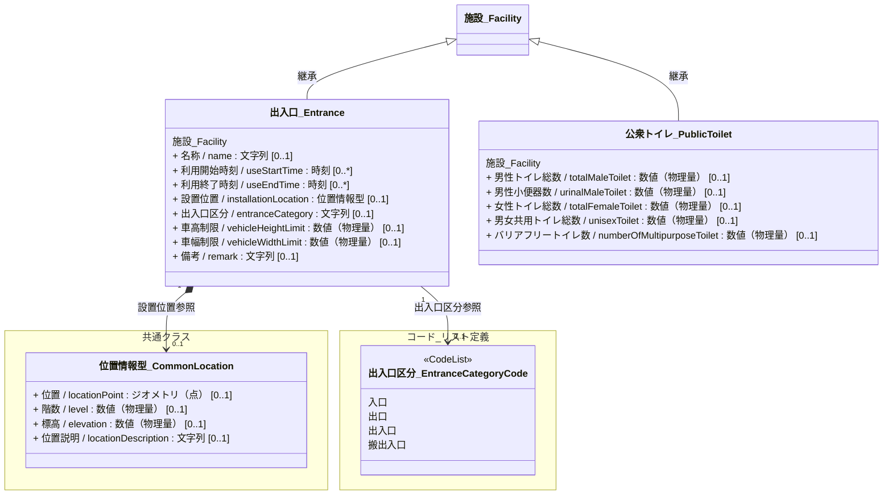
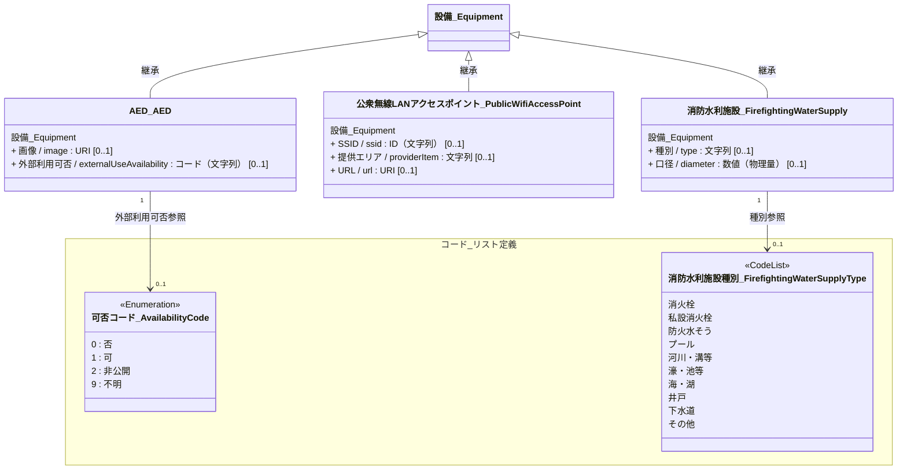

# 4.4 設備クラス図

設備モデルを「共通基盤」と「ドメイン別継承関係」に分けて定義します。

## 4.4.1 共通基盤（Base & Components）

すべての設備の基底となるクラスと、その構成要素となるクラスの定義です。

## 4.4.2 ドメイン別継承関係

### 4.4.2.1 施設系設備　出入口、公衆トイレ

---
### 4.4.2.2 設備　AED、公衆無線LANアクセスポイント、消防水利施設

