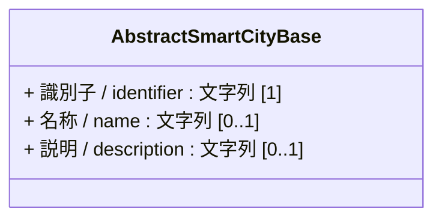
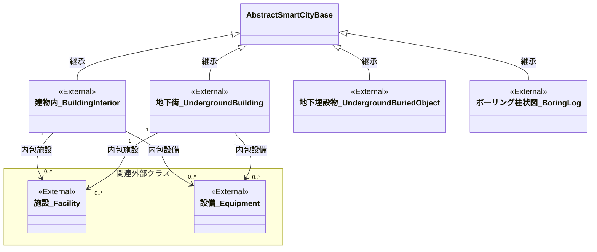

# 4.5 建物内・地下街・地下埋設物クラス図

建物内・地下街・地下埋設物モデルを「共通基盤」および「ドメイン別継承関係」に分けて定義します。

## 4.5.1 共通基盤

本モデルに特化した固有の共通基盤クラスは存在しないため、基本共通クラスである `AbstractSmartCityBase` を継承します。

---

## 4.5.2 ドメイン別継承関係

本モデルは主に既存の3D都市モデル（PLATEAU）や、国土交通省の電子納品要領などの外部仕様を参照する外部クラス（`<<External>>`）として位置づけられます。

* 建物内は[3D都市モデル標準製品仕様書 bldg:Building](https://www.mlit.go.jp/plateaudocument/toc4/toc4_02/toc4_02_03/) を参照することができます。なお、建物内の施設は施設のデータモデル、設備は設備のデータモデルで表現します。
* 地下街は[3D都市モデル標準仕様書 uro:UndergroundBuilding](https://www.mlit.go.jp/plateaudocument/toc4/toc4_16/) を参照することができます。なお、地下街の施設は施設のデータモデル、設備は設備のデータモデルで表現します。
* 地下埋設物は[3D都市モデル標準仕様書 uro:UtilityNetworkElement](https://www.mlit.go.jp/plateaudocument/toc4/toc4_15/) を参照することができます。
* ボーリング柱状図は[国土交通省 地質・土質調査成果電子納品要領](https://www.cals-ed.go.jp/cri_point/) の「第2編ボーリング柱状図編　5ボーリング交換用データ」及び「第6編土質試験及び地盤調査編　6土質試験結果一覧表データ」を参照することができます。

