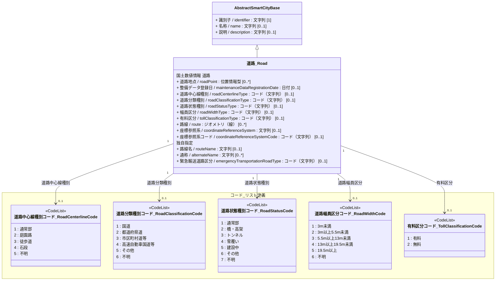
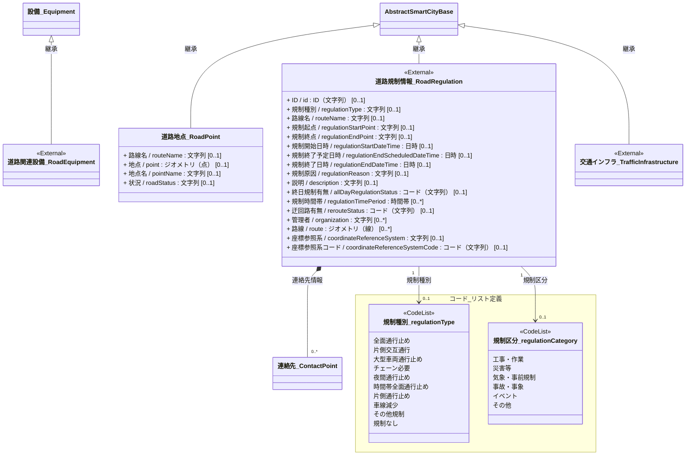

# 4.6 道路クラス図

道路モデルを「共通基盤」と「ドメイン別継承関係」に分けて定義します。

## 4.6.1 共通基盤（Base）

すべての道路の基底となるクラスの定義です。
共通基盤は国土数値情報の道路データ（ライン）を基本とします。
このデータモデルはノードとリンク、上下線や車線、高低差などのネットワーク構成を持たないため、ネットワーク構成が必要な場合は専門データモデルの参照が必要です。
道路の詳細モデルは[3D都市モデル標準製品仕様書](https://www.mlit.go.jp/plateaudocument/toc4/)　tran:roadおよび道路基盤地図情報製品仕様書（案）を参照してください。

※ UMLクラス図にプロパティの記載がありながら、例外処置としてコードにリレーションを取ります。

## 4.6.2 ドメイン別継承関係

### 4.6.2.1 道路地点・道路規制・インフラ
* 道路地点は道路のある地点を示す場合に利用します。
* 道路関連設備は[3D都市モデル標準製品仕様書 frn:CityFurniture](https://www.mlit.go.jp/plateaudocument/toc4/toc4_14/toc4_14_03/toc4_14_03_01/_ecc6aef8-ce50-ce44-989d-eccc33711712/) を参照することができます。
* 交通規制情報は[公益財団法人日本道路交通情報センターの公開する交通規制情報](https://www.jartic.or.jp/d/opendata/typeD_kisei_73_k_2.1.pdf) を参照することができます。JARTICの交通規制情報を利用しない簡単な規制（ネットワーク構成なし）を、道路規制情報として参考にクラス図にて記載します。
* 交通インフラは[3D都市モデル標準製品仕様書 橋梁モデル](https://www.mlit.go.jp/plateaudocument/toc4/toc4_11/)、[3D都市モデル標準製品仕様書 トンネルモデル](https://www.mlit.go.jp/plateaudocument/toc4/toc4_12/)などを参照することができます。

