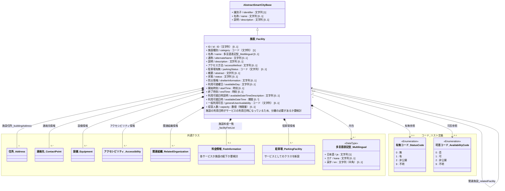
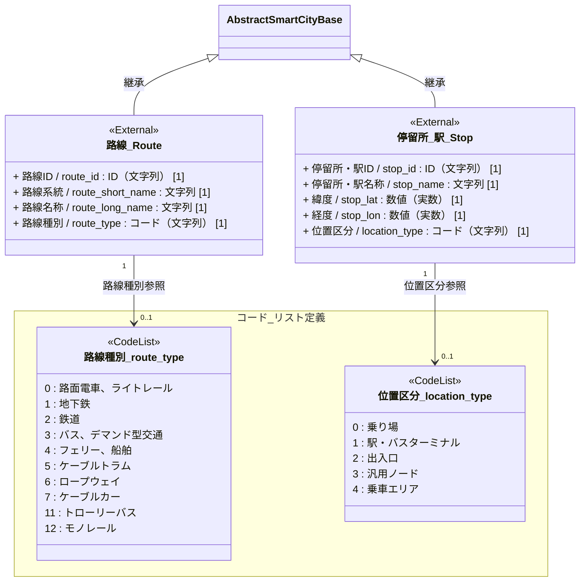
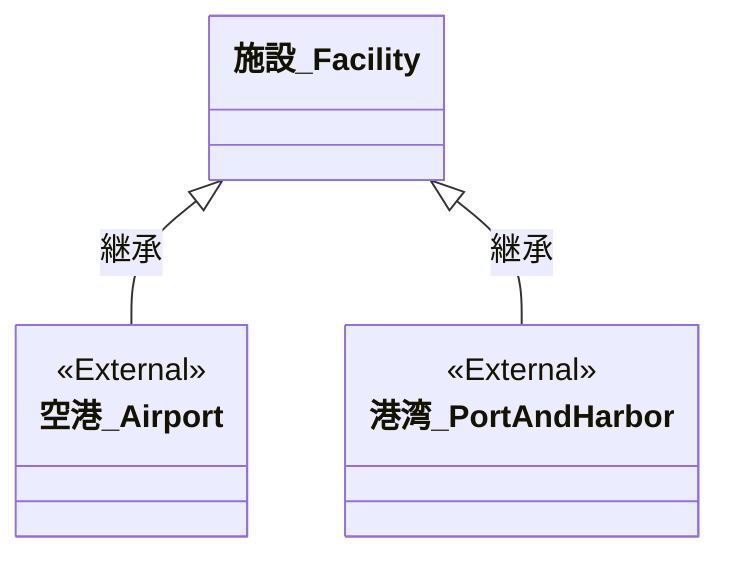
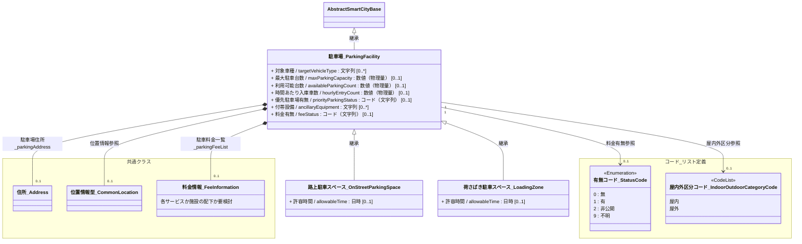
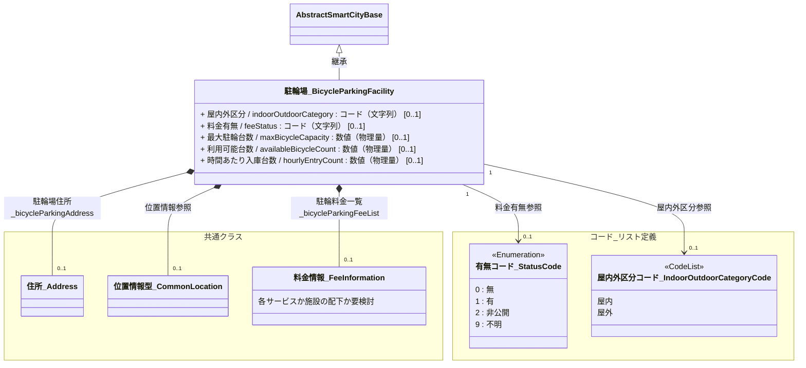
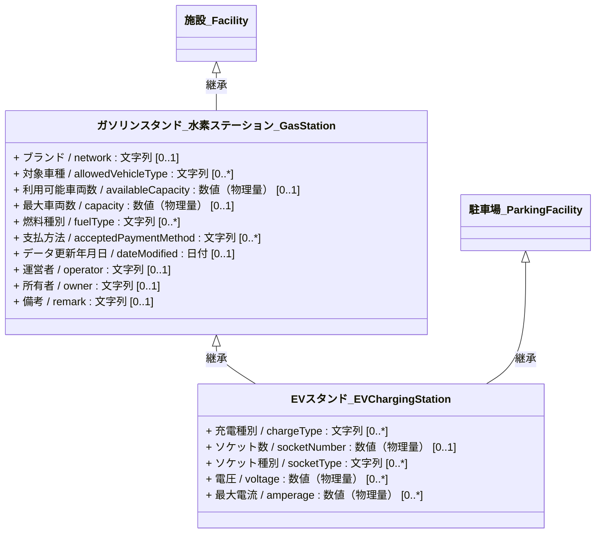
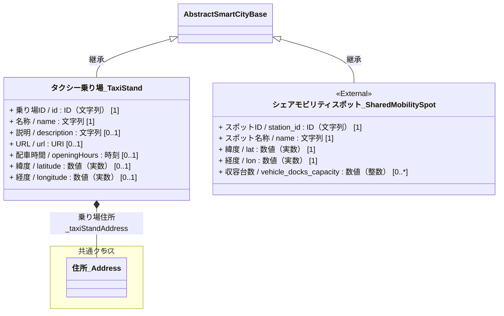

# 4.7 交通関連施設クラス図

交通関連施設モデルを「共通基盤」および「ドメイン別継承関係」に分けて定義します。

## 4.7.1 共通基盤（Base & Components）

すべての交通関連施設の共通となる基底クラス（共通属性）および共通パーツの定義です。

---

## 4.7.2 ドメイン別継承関係

交通関連施設の各サブカテゴリにおける固有のクラス定義と関係性です。

### 4.7.2.1 公共交通（GTFS-JP外部参照）

運行ダイヤや系統情報を持つ公共交通コアデータは、独自に定義せず[公共交通運行情報標準データ GTFS-JP](https://www.mlit.go.jp/sogoseisaku/transport/sosei_transport_tk_000067.html)を利用します。公共交通関連施設ですが、駅や停留所に関連する路線もここでは記載をしています。
クラス図上では `<<External>>` を付与し、GTFS-JP内の `stops.txt`（駅・バス停）および `routes.txt`（鉄道路線・バス路線）を参照する形に整理しています。
以下は参考までにGTFS-JP(stops.txt, routes.txt)の主要プロパティを記載します。GTFS-JP記載のスネークケースで表しています。

### 4.7.2.2 空港・港湾

施設の基本モデルを使用し、[国土数値情報](https://nlftp.mlit.go.jp/ksj/index.html)の空港、港湾を参照します。

### 4.7.2.3 駐車場・駐輪場

一般および路上の駐車スペース、駐輪場のモデル定義です。施設に関連する場合と関連しない場合があるため、独立の基本モデルとして定義します。
なお、荷捌きなど1台分の駐車スペースとして荷捌き駐車スペース、パーキングメーターなどの路上駐車スペースは駐車場の基本モデルを利用します。

 
 

### 4.7.2.4 モビリティインフラ（給油・給電・シェア・タクシー）

各種給油・給電スポット、および施設を伴わない乗降・シェア用スポットの定義です。
EVスタンド（`EVスタンド_EVChargingStation`）は、ガソリンスタンドや駐車場の属性（ブランド、運営者、支払方法、車両容量など）を共有するため、`ガソリンスタンド_水素ステーション_GasStation` と `駐車場_ParkingFacility` を親クラスとする多重継承関係として定義しています。

※なお、EVスタンドを管理の主体（メインエンティティ）とする場合は、EVスタンド側に `parkingId`（対象駐車場ID）や `gasStationId`（対象ガソリンスタンドID）等の属性を持たせてアソシエーション（関連）で紐付けることも可能です。

 

レンタル自転車・eスクータースポット・シェアードカーステーションなどのシェアモビリティスポットは、独自に定義せず[公共交通運行情報標準データ GTFS-JP](https://www.mlit.go.jp/sogoseisaku/transport/sosei_transport_tk_000067.html)で定義される`GBFS(General Bikeshare Feed Specification)`を利用します。
クラス図上では `<<External>>` を付与し、GBFS内の `station_information.json` および `vehicle_types.json` を参照する形に整理しています。
以下は参考までにGBFS(station_information.json)の主要プロパティを記載します。GBFS記載のスネークケースで表しています。

