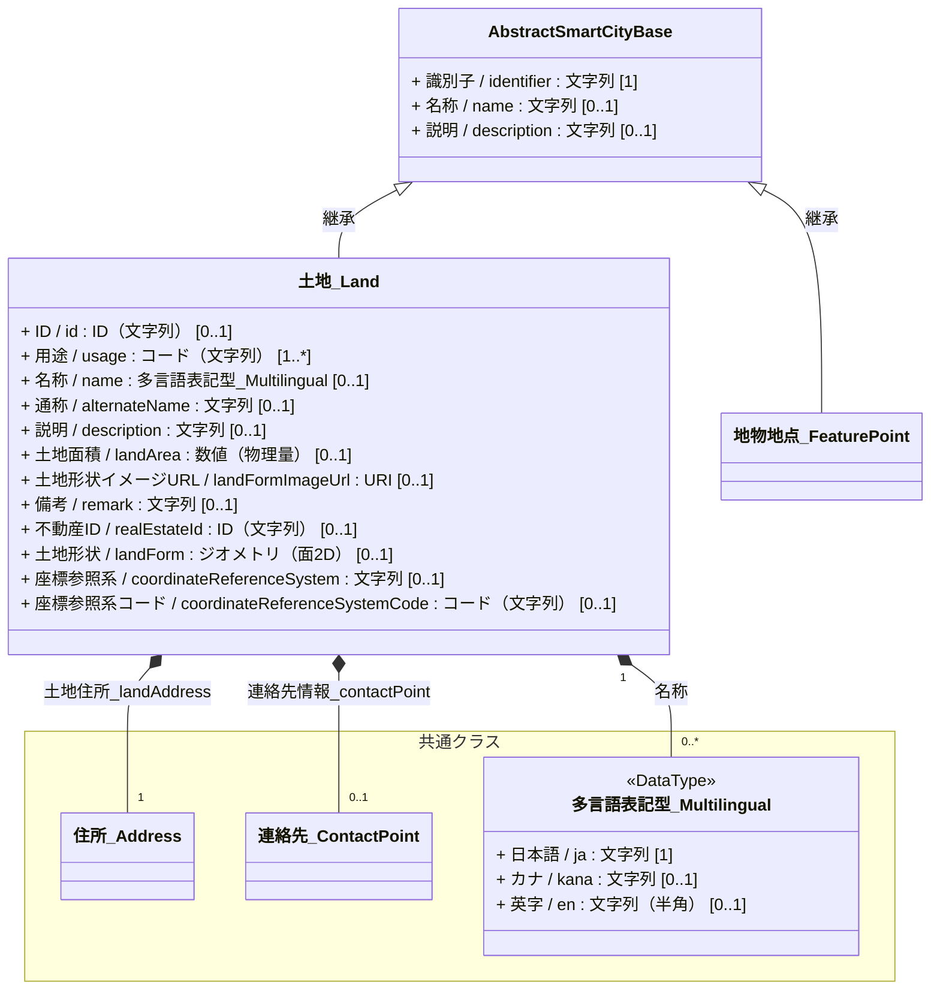
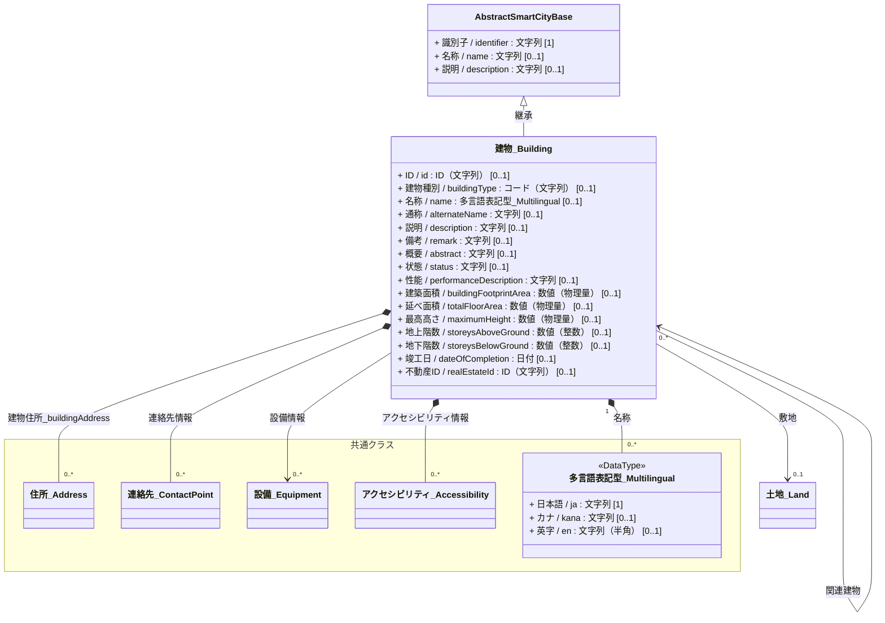
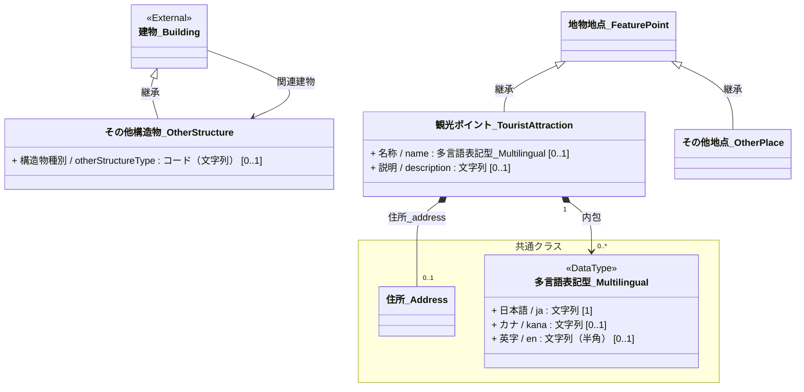
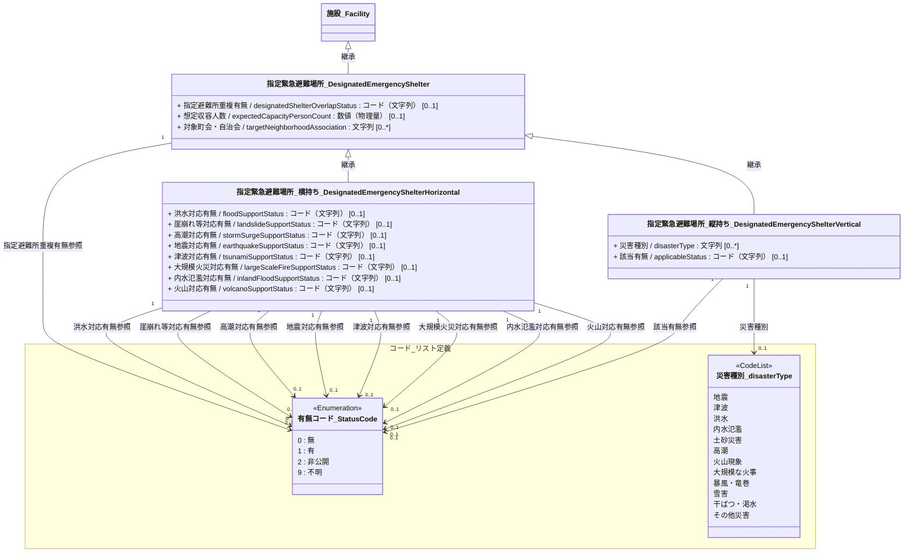
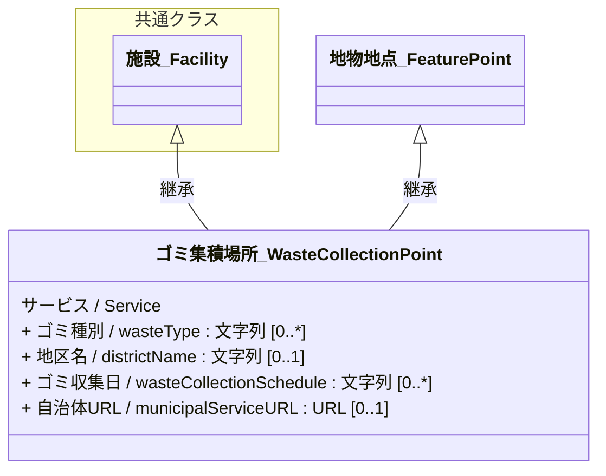

# 4.8 地物・地点クラス図

地物・地点モデルを「共通基盤」および「ドメイン別継承関係」に分けて定義します。

## 4.8.1 共通基盤（Base & Components）

すべての地物・地点の基底となる共通属性および、基本モデルである「土地」「建物」の定義です。

 

---

## 4.8.2 ドメイン別継承関係

地物・地点モデルの各サブカテゴリにおける固有のクラス定義と関係性です。

### 4.8.2.1 構造物・地物

建物や土地に類する「その他構造物」や、POIとしての「観光ポイント」、代表的な経緯度情報を保持する汎用的な「その他地点」のモデルです。

---

### 4.8.2.2 防災 ※要修正

> [!NOTE]
> 記載箇所は地物地点から移動すべき内容

避難所情報を持つ「指定緊急避難場所」など、防災に関する地物・地点モデルです。
防災は内閣府より公表されている災害対応基本共有情報（EEI）を参照します。
「指定緊急避難場所」については、データ連携や物理設計に合わせられるよう、各災害種別ごとの対応有無をカラムとして展開した「横持ち形式（フラットスキーマ）」と、災害種別を行に展開した「縦持ち形式（ノーマライズスキーマ）」の2パターンを選択可能なモデルとして整理しています。

### 4.8.2.3 生活インフラ

生活に密着した「ゴミ集積場所」など、インフラ寄りの地物・地点モデルです。
データモデルはデジタル庁の自治体標準オープンデータセットを参照します。
ゴミ集積場所は、戸建て住宅地や集積ボックスなどの「施設（`施設_Facility`）」として定義される場合と、道路上のステーションや特定の集積エリアといった単なる「地点（`地物地点_FeaturePoint`）」として定義される場合があるため、双方の継承関係（多重継承）をモデル化しています。

