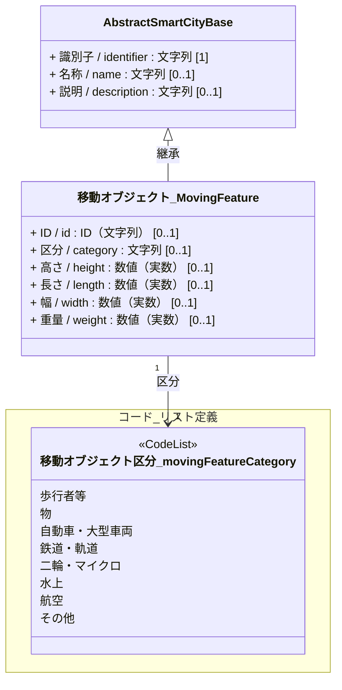
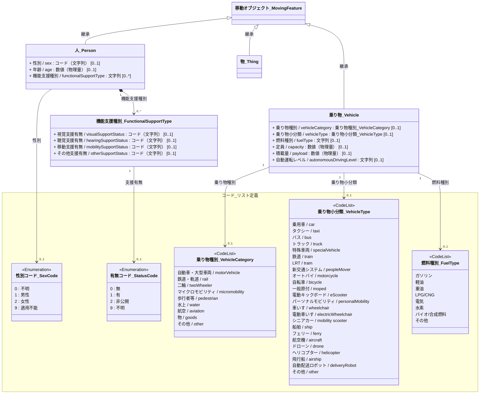

# 4.9 移動オブジェクトクラス図

移動オブジェクトモデルを「共通基盤（Base）」に分けて定義します。

## 4.9.1 共通基盤（Base）

すべての移動オブジェクトの基底となる共通属性の定義です。

---

## 4.9.2 ドメイン別継承関係

移動オブジェクトの各サブカテゴリにおける固有のクラス定義と関係性です。

### 4.9.2.1 移動オブジェクトのサブカテゴリ

移動オブジェクトを「人」「乗り物」「物」に分類し、それぞれの持つ属性やコードリストとの関係性を定義します。

### 4.9.2.2 継承属性の解釈と単位定義

親クラス `移動オブジェクト_MovingFeature` から継承される属性について、各サブクラスにおける物理的な意味および使用される単位の定義は以下の通りです。

| 継承元属性 (MovingFeature) | 人 (Person) での物理的意味・単位 | 乗り物 (Vehicle) での物理的意味・単位 | 物 (Thing) での物理的意味・単位 |
| :--- | :--- | :--- | :--- |
| `id` | 一意のID（識別キー） | 一意のID（識別キー） | 一意のID（識別キー） |
| `height` | 身長（単位: cm） | 高さ（単位: m） | 高さ（単位: 実数） |
| `length` | - | 長さ（単位: m） | 長さ（単位: 実数） |
| `width` | - | 幅（単位: m） | 幅（単位: 実数） |
| `weight` | 体重（単位: kg） | 重量（単位: kg） | 重量（単位: 実数） |
