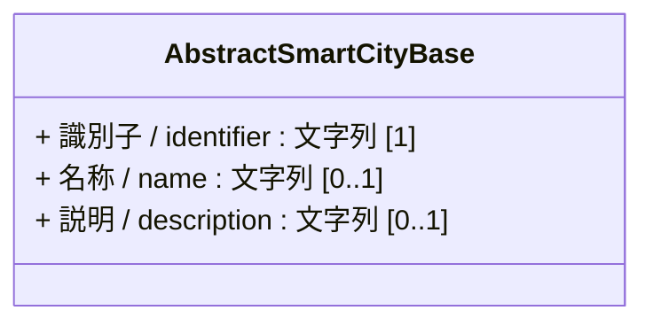
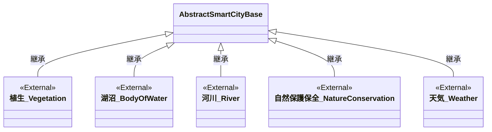

# 4.10 自然クラス図

自然モデルを「共通基盤」および「ドメイン別継承関係」に分けて定義します。

## 4.10.1 共通基盤

自然モデルに特化した固有の共通基盤クラスは存在しないため、基本共通クラスである `AbstractSmartCityBase` を継承します。

---

## 4.10.2 ドメイン別継承関係

自然モデルの各サブカテゴリにおける定義と関係性です。
本モデルは主に既存の都市モデル（CityGML/PLATEAU）や国土数値情報、気象庁などの外部仕様を参照する外部クラス（`<<External>>`）として位置づけられます。

### 4.10.2.1 自然・環境

* 植生は[3D都市モデル標準製品仕様書 Vegetation](https://www.mlit.go.jp/plateaudocument/toc4/toc4_17/) などを参照することができます。
* 湖沼は[3D都市モデル標準仕様書 wtr:WaterBody](https://www.mlit.go.jp/plateaudocument/toc4/toc4_19/toc4_19_03/) を参照することができます。
* 河川は[3D都市モデル標準仕様書 urf:WaterWay](https://www.mlit.go.jp/plateaudocument/toc4/toc4_10/toc4_10_02/toc4_10_02_13/) や[3D都市モデル標準仕様書 wtr:WaterBody](https://www.mlit.go.jp/plateaudocument/toc4/toc4_19/toc4_19_03/)、[国土数値情報 河川](https://nlftp.mlit.go.jp/ksj/gml/datalist/KsjTmplt-W05.html)を参照することができます。
* 自然保護保全は[国土数値情報 世界自然遺産](https://nlftp.mlit.go.jp/ksj/gml/datalist/KsjTmplt-A28.html)や[国土数値情報 自然公園地域](https://nlftp.mlit.go.jp/ksj/gml/datalist/KsjTmplt-A10-2015.html)、[国土数値情報 自然保全地域](https://nlftp.mlit.go.jp/ksj/gml/datalist/KsjTmplt-A11.html)、[国土数値情報 鳥獣保護区](https://nlftp.mlit.go.jp/ksj/gml/datalist/KsjTmplt-A15.html)を参照することができます。
* 天気は[気象庁 配信資料に関する技術資料](https://www.data.jma.go.jp/add/suishin/cgi-bin/jyouhou/jyouhou.cgi)を参照することができます。

