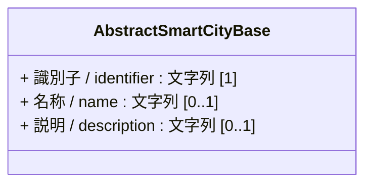
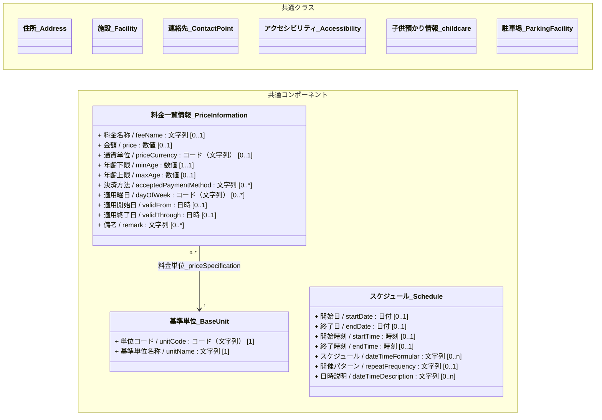

# 4.12 イベント・アクションクラス図

イベント・アクションモデルを「共通基盤」および「ドメイン別継承関係」に分けて定義します。

## 4.12.1 共通基盤

イベント・アクションモデルの基本クラスである `イベント_Event` は、基本共通クラスである `AbstractSmartCityBase` を継承します。また、住所や施設、連絡先など、他のドメインで定義される共通コンポーネントクラスを参照・包含します。

---

## 4.12.2 ドメイン別継承関係

### 4.12.2.1 イベント・アクション

イベント・アクションモデルにおけるクラス定義と関係性です。

```mermaid
classDiagram
    direction TB
    class AbstractSmartCityBase

    %% ---------------------------------------------------------
    %% 共通パーツ（Components）
    %% ---------------------------------------------------------
    class 共通クラス{
        住所_Address
        施設_Facility
        連絡先_ContactPoint
        アクセシビリティ_Accessibility
        子供預かり情報_childcare
        駐車場_ParkingFacility
    }

    namespace 共通コンポーネント{
        %% 共通の構造体
        class 料金情報_FeeInformation
        class スケジュール_Schedule
        class 多言語表記型_Multilingual <<DataType>> {
           + 日本語 / ja : 文字列 [1]
           + カナ / kana : 文字列 [0..1]
           + 英字 / en : 文字列（半角） [0..1]
        }

        class 申込予約_ReserveAction {
           + 申込開始日時 / reserveActionStartDateTime : 日時 [0..1]
           + 申込終了日時 / reserveActionEndDateTime : 日時 [0..1]
           + 申込URL / reserveActionUrl : URI [0..*]
           + 申込方法 / reserveActionDescription : 文字列 [0..*]
        }
    }

    %% ---------------------------------------------------------
    %% クラス定義
    %% ---------------------------------------------------------
    class イベント_Event {
        %% サービス・アクティビティ / Service & Activity
        + ID / id : ID(文字列) [1]
          %% Schema.org: identifier
        + イベント名 / eventName : 多言語表記型_Multilingual [1]
          %% Schema.org: name
        + 通称 / alternateName : 文字列 [0..*]
          %% Schema.org: alternateName
        + サブタイトル / subTitle : 文字列 [0..1]
          %% Schema.org: alternativeHeadline
        + 説明 / description : 文字列 [1]
          %% Schema.org: description
        + イベント種別 / eventType : コード（文字列） [1]
          %% イベント種別参照 (Schema.org: additionalType)
        + イベントURL / eventUrl : URI [1]
          %% Schema.org: url
        + 状態 / status : コード（文字列） [0..1]
          %% 開催状況参照 (Schema.org: eventStatus)
        + キーワード / keyword : 文字列 [0..*]
          %% Schema.org: keywords
        + タグ / tag : 文字列 [0..*]
          %% Schema.org: tags (keywordsのエイリアス)
        + 主催団体 / organizer : 文字列 [1]
          %% Schema.org: organizer (Agent)
        + 共催団体 / coorganizer : 文字列 [0..1]
          %% Schema.org: contributor (Role/Agent)
        + 関連団体 / relatedGroup : 文字列 [0..1]
          %% Schema.org: contributor (Role/Agent)
        + 対象者 / targetPerson : 文字列 [1]
          %% Schema.org: audience (Audience)
        + 対象者備考 / targetRemark : 文字列 [0..1]
          %% Schema.org: audience/description
        + 定員 / capacity : 数値（物理量） [0..1]
          %% 単位: 人 (Schema.org: maximumAttendeeCapacity)
        + 定員備考 / capacityRemark : 文字列 [0..1]
          %% Schema.org: additionalProperty (定員備考)
        + 料金有無 / feeStatus : コード（文字列） [1]
          %% 有無コード参照 (Schema.org: isAccessibleForFree)
        + 言語コード / languageCode : 文字列 [0..1]
          %% Schema.org: inLanguage
        + 外国語対応 / foreignLanguageSupport : 文字列 [0..*]
          %% Schema.org: amenityFeature (外国語対応)
        + 外国語対応備考 / foreignLanguageSupportRemark : 文字列 [0..1]
          %% Schema.org: amenityFeature (外国語対応備考)
        + 概要 / abstract : 文字列 [0..1]
          %% Schema.org: abstract
        + コンテンツURL / contentsUrl : URI [0..1]
          %% Schema.org: subjectOf
        + 対象産業 / targetItem : 文字列 [0..*]
          %% Schema.org: about
        + 開催条件 / holdingCondition : 文字列 [0..*]
          %% Schema.org: additionalProperty (開催条件)

        %% 期間・スケジュール / Schedule
        + 所要時間 / timeRequired : 文字列 [0..1]
          %% Schema.org: duration

        %% 場所・施設 / Place & Facility
        + 開催場所 / location : 文字列 [0..1]
          %% Schema.org: location (Place/name)
        + アクセス方法 / accessMethod : 文字列 [0..1]
          %% Schema.org: location (Place/description)
        + 受付場所 / locationOfReception : 文字列 [0..*]
          %% Schema.org: location
        + 駐車場有無 / parkingStatus : コード（文字列） [0..1]
          %% 有無コード参照 (Schema.org: amenityFeature)
        + 駐輪場情報 / bicycleParking : 文字列 [0..1]
          %% Schema.org: amenityFeature
        + Web開催形式区分 / webHoldingCategory : コード（文字列） [0..1]
          %% Web開催形式区分参照 (Schema.org: eventAttendanceMode)
        + Web開催URL / webinarUrl : URI [0..1]
          %% Schema.org: location (VirtualLocation/url)
        + Web開催備考 / webHoldingRemark : 文字列 [0..1]
          %% Schema.org: location (VirtualLocation/description)
    }

    class アクション_Action {
        + アクション名 / actionName : 文字列 [1]
          %% Schema.org: name
        + アクション種別 / actionType : 文字列 [1..*]
          %% アクション種別参照 (Schema.org: additionalType)
        + 実施日 / implementationDate : 日付 [1]
          %% Schema.org: startTime
        + 開始時刻 / startTime : 時刻 [1]
          %% Schema.org: startTime
        + 終了時刻 / endTime : 時刻 [1]
          %% Schema.org: endTime
        + アクション内容 / actionContent : 文字列 [1]
          %% Schema.org: description
        + 実施結果 / implementationResult : 文字列 [1]
          %% Schema.org: result
        + 引き継ぎ事項 / handoverDescription : 文字列 [1]
        + 対応者名 / supportPersonName : 文字列 [1]
          %% Schema.org: agent
    }

    %% ---------------------------------------------------------
    %% コード・リスト定義クラス
    %% ---------------------------------------------------------
    namespace コード_リスト定義 {
        class 有無コード_StatusCode <<Enumeration>> {
            0 : 無
            1 : 有
            2 : 非公開
            9 : 不明
        }
        class 開催状況_HoldingStatus <<CodeList>> {
            %% 独自仮記載（再考の必要あり）
            準備中
            受付中
            開催予定
            開催中 : EventScheduled
            中止 : EventCancelled
            休止中
            復旧中
            延期 : EventPostponed
        }
        class イベント種別_EventType <<CodeList>> {
            %% イベント
            文化・芸術 : culture/Art
            音楽 : music
            セミナー : seminar
            子育て・教育 : parenting/education
            健康・福祉 : health/welfare
            スポーツ : sports
            生活・環境 : life/environment
            催事・観光 : festival/tourism
            仕事・産業 : business/industry
            公共サービス : public service
            安全・防災 : safety/disaster prevention
            資格・認定 : qualification/certification
            採用 : recruitment
            申請 : application
            その他イベント : other event
            %% 災害
            炊出 : disaster meal service
            給水 : disaster water supply
            風呂 : disaster bath
            医療 : disaster medical care
            ガソリン : disaster gasoline
            給電 : disaster power supply
            その他 : disaster other
            %% 体験種別
            学ぶ : learn
            触れる・感じる : touch/feel
            遊ぶ・体を動かす : play/exercise
            奏でる・歌う : perform/sing
            乗る : ride
            見る : watch
            創る : create
            採集・収穫する : harvest
            その他（体験） : experience other
        }
        class Web開催形式区分_WebHoldingCategory <<CodeList>> {
            現地開催 : OfflineEventAttendanceMode 
            オンライン : OnlineEventAttendanceMode
            ハイブリッド : MixedEventAttendanceMode
        }
    }


    %% 汎化（継承関係）
    AbstractSmartCityBase <|-- イベント_Event : 継承
    イベント_Event <|-- アクション_Action : 継承

    %% コンポジション・参照関係
    イベント_Event *-- "0..*" 共通クラス : アクセシビリティ情報_子供預かり情報_連絡先_開催場所住所_開催施設_駐車場情報
    イベント_Event *-- "0..*" 料金情報_FeeInformation : イベント料金一覧
    イベント_Event *-- "0..*" 料金情報_FeeInformation : 駐車場料金一覧
    イベント_Event "1" --> "0..*" イベント_Event : サブイベント
    イベント_Event *-- "0..*" スケジュール_Schedule : スケジュール
    イベント_Event *-- "0..*" 申込予約_ReserveAction : 申込予約
    イベント_Event *--> "1" 多言語表記型_Multilingual : イベント名

    %% コードリストとの関連
    イベント_Event "1" --> "1" イベント種別_EventType : イベント種別
    イベント_Event "1" --> "0..1" 開催状況_HoldingStatus : 状態
    イベント_Event "1" --> "0..1" Web開催形式区分_WebHoldingCategory : Web開催形式区分
    イベント_Event "1" --> "1" 有無コード_StatusCode : 料金有無
    イベント_Event "1" --> "0..1" 有無コード_StatusCode : 駐車場有無
```

