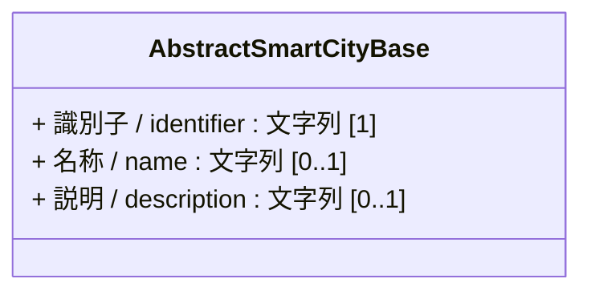
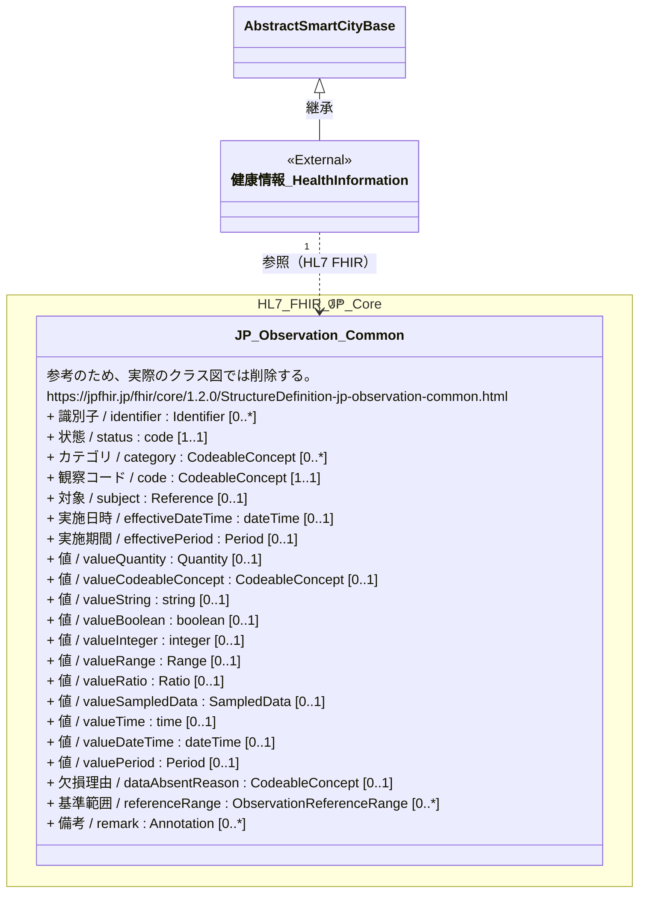
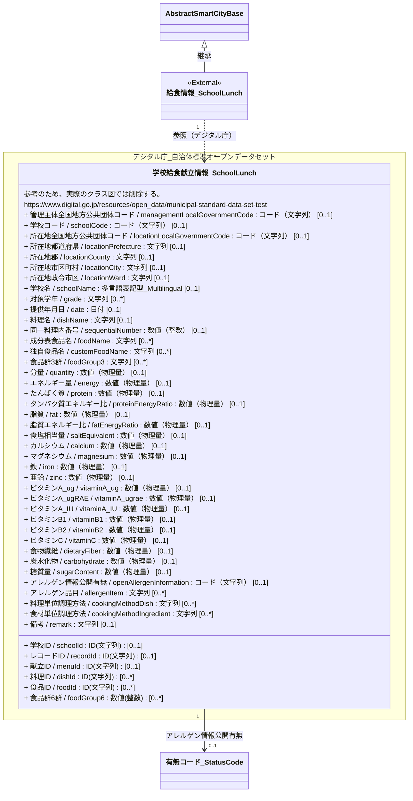
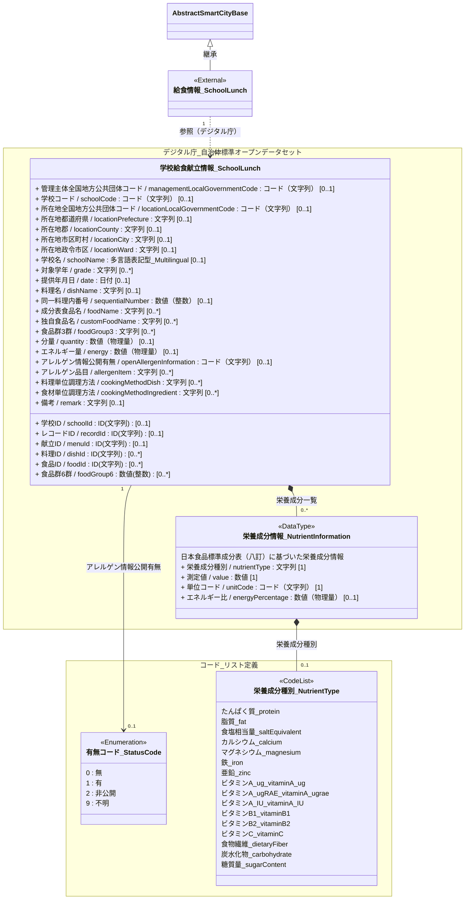

# 4.14 健康情報クラス図

健康情報モデルを「共通基盤」および「ドメイン別継承関係」に分けて定義します。
健康情報および給食情報は外部のデータ標準・オープンデータ仕様を参照することを想定しており、本モデルはこれらとの対応関係を示します。

## 4.14.1 共通基盤

健康情報モデルおよび給食情報モデルの基本クラスは、基本共通クラスである `AbstractSmartCityBase` を継承します。

---

## 4.14.2 ドメイン別継承関係

### 4.14.2.1 健康情報

* 健康情報は[HL7 FHIR JP Core](https://jpfhir.jp/fhir/core/history.html)のJP_Observation_Commonもしくは[Fast Healthcare Interoperability Resource HL7 FHIR](http://hl7.org/fhir/)のObservationを参照することができます。

### 4.14.2.2 給食情報

* 給食情報は[デジタル庁 自治体標準オープンデータセット](https://www.digital.go.jp/resources/open_data/municipal-standard-data-set-test)の学校給食献立情報を参照することができます。

### 4.14.2.2.1 通常データモデル

### 4.14.2.2.2 リスト構造化データモデル

