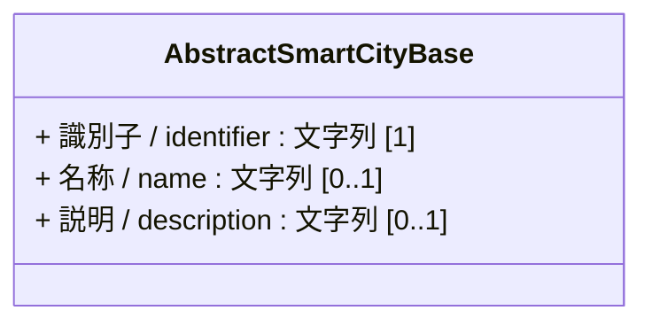
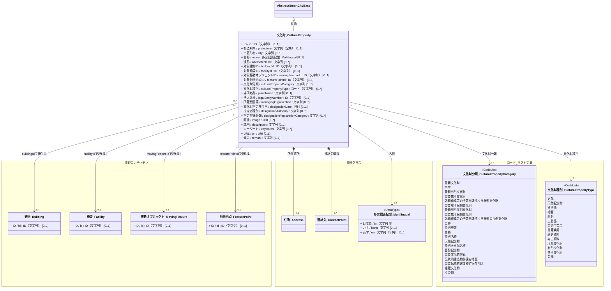
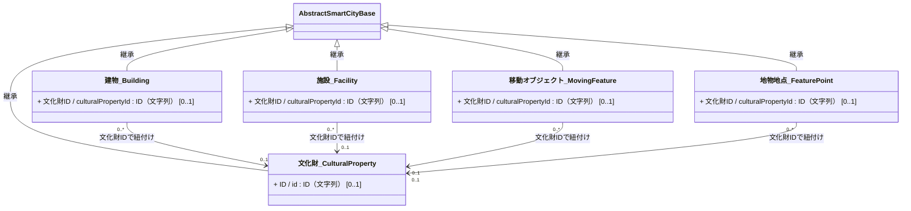

# 4.15 文化財クラス図

文化財モデルを「共通基盤」および「ドメイン別関係」に分けて定義します。
本ドメインモデルでは、文化財指定情報を表す「文化財_CulturalProperty」を主に配置し、有形文化財の場合は「建物」「施設」「移動オブジェクト」「地物・地点」の物理オブジェクトを関連（参照）しています。これにより、無形文化財と有形文化財を一元管理しつつ、物理オブジェクトの特性を柔軟にマッピングできます。

## 4.15.1 共通基盤

文化財モデルの基本クラスである `文化財_CulturalProperty` は、基本共通クラスである `AbstractSmartCityBase` を継承します。

---

## 4.15.2 ドメイン別関係

### 4.15.2.1 文化財

文化財モデルにおけるクラス定義と関係性です。

#### 4.15.2.2.1 通常クラス

#### 4.15.2.2.2 物理エンティティ主体モデル（アソシエーションによる結合）

建物、施設などを主体（親）とし、文化財情報を関連で紐付けるモデル案です。
物理オブジェクトが属性として文化財ID（culturalPropertyId）を持つことで、それぞれの実体に文化財の情報を関連付けます。

