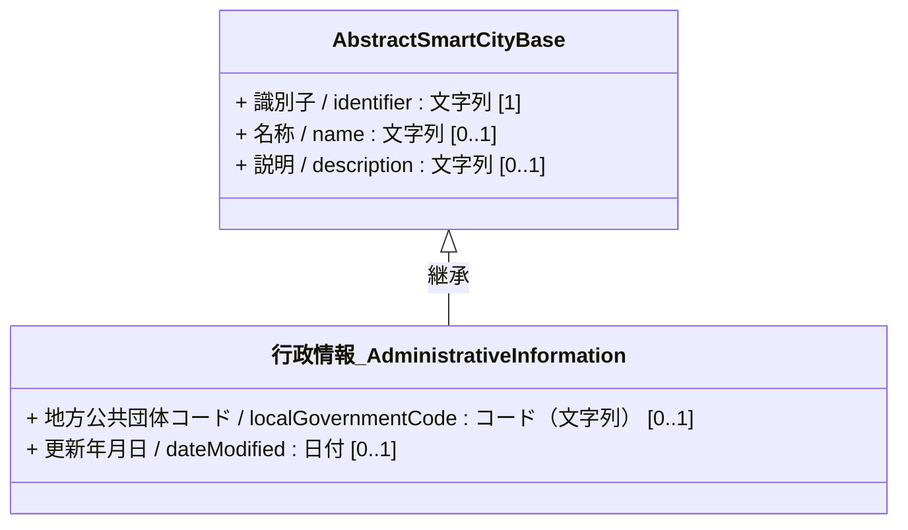
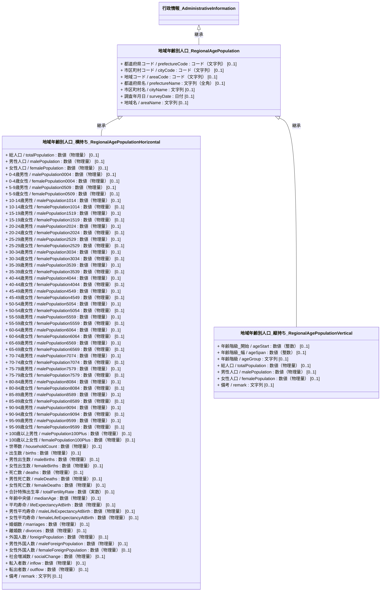
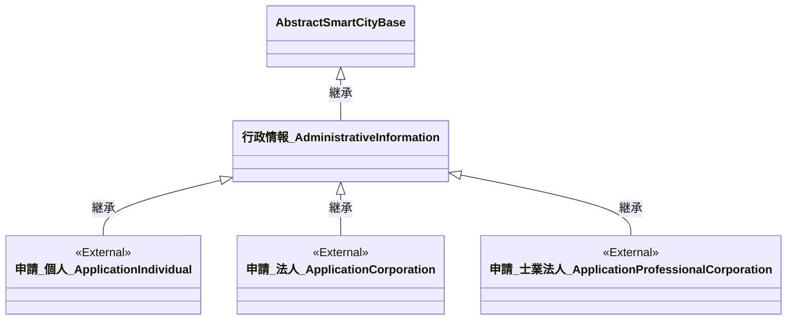
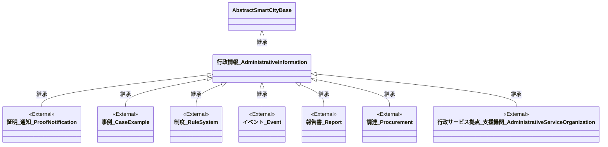

# 4.16 行政情報クラス図

行政情報モデルを「共通基盤」および「ドメイン別関係」に分けて定義します。
行政情報モデルは、地域統計を表す「地域・年齢別人口」と、行政サービス全般のデジタル化を支える「行政実装データモデル（デジタル庁 GIF 451準拠）」で構成されます。

## 4.16.1 共通基盤

行政情報モデルの基本クラスである `行政情報_AdministrativeInformation` は、基本共通クラスである `AbstractSmartCityBase` を継承します。

---

## 4.16.2 ドメイン別関係

### 4.16.2.1 地域・年齢別人口

地域ごとの人口や統計情報を保持するためのクラス定義です。縦持ち（年齢階級別の集計データ）と横持ち（特定地域の多項目データ）の2つの表現形式を定義しています。

---

### 4.16.2.2 行政実装データモデル（GIF 451準拠）

デジタル庁の「政府相互運用性フレームワーク（GIF） 451_実装データモデル_行政」に対応するデータモデルの定義です。これらは行政手続きや窓口業務における相互運用性を担保するための外部準拠データモデルです。

実装データモデルの詳細は[デジタル庁 政府相互運用性フレームワークGIF（451_実装データモデル_行政）](https://github.com/JDA-DM/GIF)を参照してください。

