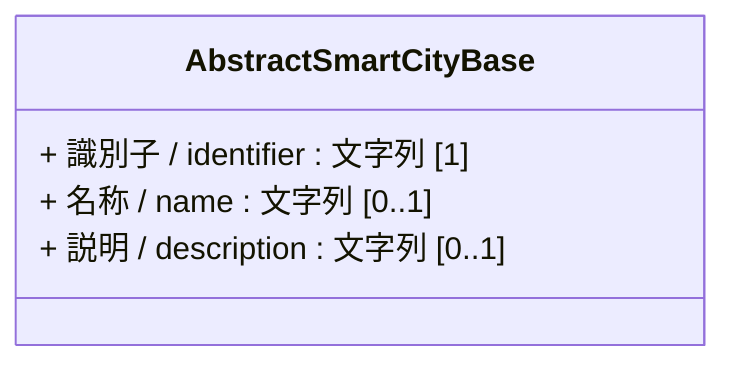

# 4.17 観測情報クラス図

観測情報モデルを「共通基盤」および「ドメイン別関係」に分けて定義します。
観測情報モデルは、IoTデバイス等の自動計測を行う「センサー系統」と、人間等が計測・記録を行う「人的観測系統」に分けて構成されます。

## 4.17.1 共通基盤

観測情報モデルの各クラスは、基本共通クラスである `AbstractSmartCityBase` を直接継承します。



---

## 4.17.2 ドメイン別関係

### 4.17.2.1 観測モデル

IoT機器等による自動計測を行う「センサー（自動計測）系統」と、人間や組織の調査員が目視等で計測・記録する「人的観測系統」に分割して定義しています。
これにより、自動計測用のマスタ管理（センサーマスタ）と、測定者情報や詳細な集計期間を伴う人的観測データの双方を、混在させずに明瞭に管理できます。

* このデータモデルは W3C SOSA (Sensor, Observation, Sample, and Actuation) / SSN (Semantic Sensor Network Ontology) を参照します。

```mermaid
classDiagram
    direction TB
    class AbstractSmartCityBase

    %% ---------------------------------------------------------
    %% 1. センサー（IoT自動計測）系統
    %% ---------------------------------------------------------
    namespace センサー {
        class センサーマスタ_Sensor {
            + 機器ID / sensorId : ID（文字列） [0..1]
            + 設置場所名称 / locationName : 文字列 [0..1]
            + 設置緯度 / latitude : 数値（実数） [0..1]
            + 設置経度 / longitude : 数値（実数） [0..1]
            + 計測対象 / measurementTarget : 文字列 [0..1]
            + 計測方法 / measurementMethod : 文字列 [0..1]
            + 精度 / accuracy : 実数 [0..1]
        }

        class センサー観測データ_SensorObservation {
            + 観測データID / observationDataId : ID（文字列） [0..1]
            + 機器ID / sensorId : ID（文字列） [0..1] 
            + 観測緯度 / observationLatitude : 数値（実数） [0..1]
              %% 移動型センサーの場合、観測された時点での緯度
            + 観測経度 / observationLongitude : 数値（実数） [0..1]
              %% 移動型センサーの場合、観測された時点での経度
            + 観測日時 / resultTime : 日時（秒あり） [0..1]
            + 開始日時 / phenomenonStartTime : 日時 [0..1]
            + 終了日時 / phenomenonEndTime : 日時 [0..1]
            + 観測期間 / phenomenonTime : 期間 [0..1]
              %% 観測を期間で表す場合、開始日時と終了日時を合わせて期間で表すことができる。
            + 数値 / value : 数値（実数） [0..1]
            + 単位 / unit : 文字列 [0..1] 
              %% UN/CEFACT
            + 備考 / remark : 文字列 [0..1]
        }
    }

    %% ---------------------------------------------------------
    %% 2. 手動観測系統 人間やその他による観測を想定
    %% ---------------------------------------------------------
    namespace 人的観測 {
        class 人的観測データ_ManualObservation {
            + 観測データID / observationDataId : ID（文字列） [1]
            + 成果指標名 / indicatorName : 文字列 [0..1]
            + 測定名 / measurementName : 文字列 [0..1]
            + 測定者名 / observerName : 文字列 [1]
            + データ計測方法 / dataCollectionMethod : 文字列 [0..1]
            + 対象地域 / targetArea : 文字列 [0..1]
            + 観測緯度 / observationLatitude : 数値（実数） [0..1]
            + 観測経度 / observationLongitude : 数値（実数） [0..1]
            + 観測日時 / resultTime : 日時 [1]
            + 開始日時 / phenomenonStartTime : 日時 [0..1]
            + 終了日時 / phenomenonEndTime : 日時 [0..1]
            + 観測期間 / phenomenonTime : 期間 [0..1]
              %% 観測を期間で表す場合、開始日時と終了日時を合わせて期間で表すことができる。
            + 数値 / value : 数値（実数） [1]
            + 単位 / unit : 文字列 [0..1]
            + 測定数 / sampleCount : 数値（整数） [0..1]
            + 備考 / remark : 文字列 [0..1]
        }
    }

    %% 共通クラス
    namespace 共通クラス {
        class 住所_Address
    }

    %% コード・リスト定義クラス
    namespace コード_リスト定義 {
        class センサー種別_SensorType <<CodeList>> {
            %% 独自定義のため、参考
            大気
            騒音
            温度
            湿度
            風速
            風向
            圧力
            水位
            水質
            化学物質濃度
            酸性度
            照度
            振動
            加速度
            ひずみ
            人流
            交通量
            その他
        }

        class 移動区分_MovementCategory <<CodeList>> {
            固定
            移動
        }

        class 測定周期区分_MeasurementPeriodCategory <<Enumeration>> {
            %% 定期 : 主コード:ISO 8601 Duration、別コード:UN/CEFACT
            %% [主コード] : [日本語ラベル] {別コード}
            P1Y : 年次 { ANN }
            P1M : 月次 { MON }
            P1W : 週次 { WEE }
            P1D : 日次 { DAY }
            PT1H : 時間次 { HUR }
            PT1M : 分次 { MIN }
            PT0S : リアルタイム { SEC }
            %% 不定期 : OGC/W3C国際標準の識別子を使用
            EVENT_TRIGGERED : 随時_事象発生時 { EVENT_TRIGGERED }
        }
    }

    %% 汎化（継承関係）
    AbstractSmartCityBase <|-- センサーマスタ_Sensor : 継承
    AbstractSmartCityBase <|-- センサー観測データ_SensorObservation : 継承
    AbstractSmartCityBase <|-- 人的観測データ_ManualObservation : 継承

    %% 関係性の定義
    センサー観測データ_SensorObservation "0..*" --> "1" センサーマスタ_Sensor : 機器ID(sensorId)で紐付け
    センサーマスタ_Sensor *-- "0..1" 住所_Address : 設置場所住所

    %% コードリストへの関連
    センサーマスタ_Sensor "1" --> "0..*" センサー種別_SensorType : センサー種別
    センサーマスタ_Sensor "1" --> "0..1" 移動区分_MovementCategory : 移動区分
    センサーマスタ_Sensor "1" --> "0..1" 測定周期区分_MeasurementPeriodCategory : 測定周期区分
```

> [!NOTE]
> **測定周期区分（MeasurementPeriodCategory）のコード定義**:
> 本モデルの測定周期区分は、国際標準に適合するため以下のように定義します。
> * **定期（Periodic）計測**: `P`（期間/Period）および `T`（時間/Time）から始まる [ISO 8601](https://www.iso.org/iso-8601-date-and-time-format.html) の拡張形式に準拠します（例: `P1Y` ➔ 1年、`PT1H` ➔ 1時間、`PT0S` ➔ 遅延なし即時/リアルタイム）。日本での記載はJIS X0301(https://www.jisc.go.jp/app/jis/general/G99B011.html)で確認できます。
> * **定期（Periodic）計測**: [UN/CEFACT](https://unece.org/trade/uncefact/mainstandards)の[Rec20](https://unece.org/trade/documents/2021/06/uncefact-rec20-0)においても周期を表せるため、同義語として扱っています。そのため、ISO 8601 DurationでもUN/CEFACT-Rec20のどちらを採用しても、同じ意味として扱うようにしています。
> * **不定期（Event-triggered）計測**: OGC/W3Cの慣例に準拠し、イベント発生やデータ変化時のみ送信する動作を **`EVENT_TRIGGERED`** と定義します。

---

### 4.17.2.2 外部標準（W3C SSN/SOSA）との対応関係

スマートシティデータモデルの相互運用性を高めるため、観測ドメインにおける代表的な国際標準セマンティクスである **W3C SSN/SOSA (Sensor, Observation, Sample, and Actuation)** との対応関係を以下に定義します。

| 本データモデル項目（物理名） | 英語論理名 | W3C SOSA 概念・プロパティ | 説明 |
| :--- | :--- | :--- | :--- |
| **センサーマスタ** | `Sensor` | `sosa:Sensor` | 観測を実施するセンサーや計測器のメタデータ。 |
| **センサー観測データ** | `SensorObservation` | `sosa:Observation` | 自動センサーによって実行された個々の観測記録。 |
| **人的観測データ** | `ManualObservation` | `sosa:Observation` | 人間（`observerName`）や組織によって実施された個々の観測記録。 |
| **観測日時** | `resultTime` | `sosa:resultTime` | 観測結果が確定・記録されたタイムスタンプ。 |
| **開始日時 / 終了日時 / 観測期間** | `phenomenonStartTime` / `phenomenonEndTime` / `phenomenonTime` | `sosa:phenomenonTime` | 計測が実施された観測対象の現象時間（期間）。 |
| **数値** | `value` | `sosa:hasSimpleResult` | 観測によって得られた測定値（実数値）。 |
| **設置場所住所** | `locationAddress` (住所_Address) | `sosa:Sensor / location` | 観測箇所（センサー・人的観測）の物理住所。 |

---

### 4.17.2.3 評価・調査情報

アンケート調査や住民満足度などの主観的な評価・統計データを表すモデルです。

```mermaid
classDiagram
    direction TB
    class AbstractSmartCityBase

    %% ---------------------------------------------------------
    %% クラス定義
    %% ---------------------------------------------------------
    class 主観的指標_SubjectiveIndicator {
        + 指標ID / id : ID（文字列） [0..1]
        + 成果指標名 / metricName : 文字列 [0..1]
        + 対象地域 / targetArea : 文字列 [0..1]
        + 開始日時 / startDateTime : 日時 [0..1]
        + 終了日時 / endDateTime : 日時 [0..1]
        + 公表年月日 / publicationDate : 日付 [0..1]
        + 回答 / responseValue : 文字列 [0..1]
        + 計測方法 / measurementMethod : 文字列 [0..1]
        + 測定数 / sampleSize : 数値（整数） [0..1]
        + 測定者名 / observerName : 文字列 [0..1]
        + 測定略名 / sourceSurveyName : 文字列（全角） [0..1]
        + 備考 / remark : 文字列 [0..1]
    }

    %% ---------------------------------------------------------
    %% コード・リスト定義クラス
    %% ---------------------------------------------------------
    namespace コード_リスト定義 {
        class 測定周期区分_MeasurementPeriodCategory <<Enumeration>> {
            %% 定期 : 主コード:ISO 8601 Duration、別コード:UN/CEFACT
            %% [主コード] : [日本語ラベル] {別コード}
            P1Y : 年次 { ANN }
            P1M : 月次 { MON }
            P1W : 週次 { WEE }
            P1D : 日次 { DAY }
            PT1H : 時間次 { HUR }
            PT1M : 分次 { MIN }
            PT0S : リアルタイム { SEC }
            %% 不定期 : OGC/W3C国際標準の識別子を使用
            EVENT_TRIGGERED : 随時_事象発生時 { EVENT_TRIGGERED }
        }
    }

    %% 汎化（継承関係）
    AbstractSmartCityBase <|-- 主観的指標_SubjectiveIndicator : 継承

    %% コードリストへの関連
    主観的指標_SubjectiveIndicator "1" --> "0..1" 測定周期区分_MeasurementPeriodCategory : 測定周期区分
```
