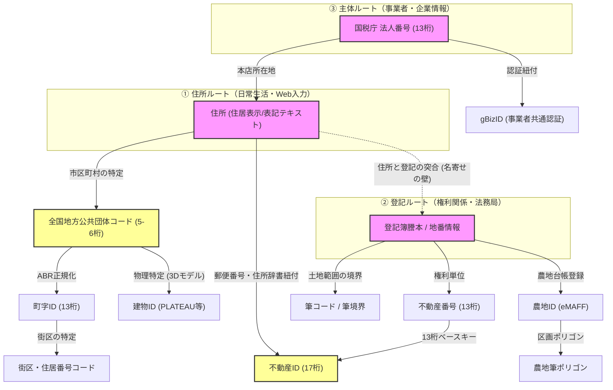

# 国内で共通的に利用される各種識別子（ID）に関する調査報告書

* **作成日**: 2026-07-06
* **バージョン**: v1.0.0

---

本報告書は、日本国内において共通的・社会基盤的に利用される主要な識別子（ID）について、関係省庁等の公式公開データに基づき、定義（概要）、所管省庁と部署、関連JIS規格、全国普及率、一般公開状況と取得方法（APIの有無を含む）、およびデータ利活用における実務的な特性を体系的に整理したものである。
なお、複数ドメイン間で共有されるID体系を中心に記載しており、ドメイン内部で利用されるID体系は記載していない。

---

## 1. 国内で共通的に利用される各種識別子（ID）の詳細

国内で共通的に利用される各種IDを、その対象とする領域（土地・建物・空間、住所・行政区画、専門領域、主体・認証）ごとにグルーピングし、詳細を記載する。

### 1-1. 土地・建物・空間領域の識別子

#### ① 不動産番号
*   **定義（概要）**
    *   不動産登記法に基づき,法務局が登記されている土地や建物（区分所有建物を含む）の一筆・一個ごとに割り当てる**13桁の数字**である（権利関係の登記単位で付与）。不動産登記の登記記録（1つの土地または1つの建物）ごとに付与される番号。
*   **所管省庁と部署**
    *   **法務省 民事局**（担当：民事第二課）
*   **関連JISコード**
    *   **なし**（法務省独自の識別コード）
*   **記載例（サンプル）**
    *   `1201000345678`（13桁の数字。法務局が登記された土地や建物に個別に付与する番号）
*   **全国普及率（カバー率・整備率）**
    *   **登記済み不動産に対して100%**：
        *   法的に登記されている日本国内のすべての土地および建物に対して例外なく付与されている。
        *   ただし、日本全国の土地にはごく一部の「未登記の土地（無地番地など）」や、未登記の建物（新築直後や登記申請が怠られている建物）が存在するため、日本の国土・全建物における完全な100%網羅ではない。
*   **一般公開状況・取得方法・API**
    *   **一般公開**：あり（閲覧・取得は有料）
    *   **取得方法**：民間の「登記情報提供サービス」に一時利用または会員登録し、オンラインで登記事項（PDF）を取得する際に確認できる(有料)。また、法務局窓口や[登記ねっと（登記・供託オンライン申請システム)](https://www.touki-kyoutaku-online.moj.go.jp/toukinet/top.html)経由で「登記事項証明書」を申請・受領することでも確認可能である。
    *   **Web API提供**：**なし**（公式の公開APIは存在しない）
    *   **公開URL**：[登記情報提供サービス（一般財団法人 民事法務協会）](https://www1.touki.or.jp/)
*   **実務データ項目**
    *   **提供データ形式**：PDF（登記事項）、XML/JSON（民間の一時検索API等を利用する場合）
    *   **更新頻度**：随時（登記事項の変更登記完了後に即時反映）
    *   **ライセンス（実務利用上の可否判定）**
        *   **著作権上の扱い**：**商用利用可能（制限なし）**。不動産番号（13桁の数値）や登記情報に記載されている不動産の物理的・権利的事実情報は「客観的事実の記録」であり、創作物ではないため著作権の保護対象外（著作権フリー）である。
        *   **サービス規約による制限（禁止事項）**：一般財団法人民事法務協会が提供する「登記情報提供サービス」の利用規約において、以下の行為は禁止されている。
            *   取得したPDFなどの成果物をそのまま無断でインターネット上にアップロードし、不特定多数に再配布・転売すること。
            *   スクレイピング等のプログラムツールを用いて、システムに過度な負荷をかけるような大量自動クエリを行うこと（検知された場合はアカウント停止等の措置）。
        *   **実務上の利用可否（許容事項）**：
            *   自社のCRM（顧客管理システム）や不動産査定システム等の内部データベースに、取得した不動産番号をマッピング・蓄積して社内利用することは**問題なし**である。
            *   また、自社サービスにおいて、「特定の不動産に不動産番号を付与して顧客に提示する」といった、付加価値情報・属性情報のひとつとして二次提供することも著作権法上および規約上、問題ない。

#### ② 不動産ID
*   **定義（概要）**
    *   不動産情報を官民で連携させるための共通コードである。不動産番号（13桁）に特定コード（4桁：部屋番号等）を組み合わせた**17桁のコード**で構成される（取引やデータ連携の単位で付与）。
*   **所管省庁と部署**
    *   **国土交通省 不動産・建設経済局（担当：不動産市場整備課、情報活用推進課）**
*   **関連JISコード**
    *   **なし**（国土交通省がガイドラインを策定・整備中）
*   **記載例（サンプル）**
    *   `12010003456780001`（17桁の数字。不動産番号13桁「1201000345678」＋部屋番号を特定するコード4桁「0001」）
*   **全国普及率（カバー率・整備率）**
    *   **実質的にほぼ未普及（0%に近い普及段階）**：
        *   2022年にガイドラインが策定され、現在整備・実証実験を行っているフェーズである。
        *   2026年5月27日、国土交通省は不動産IDの具体的な管理・運用ルールの策定や社会実装の加速に向け、新たに[不動産IDのあり方に関する勉強会](https://www.mlit.go.jp/tochi_fudousan_kensetsugyo/tochi_fudousan_kensetsugyo_tk5_000001_00040.html)を設置した。
        *   「建築・都市のDX」官民ロードマップに基づき、2026〜2027年度にかけてシステム構築や一部先行整備地域における試験運用の開始が計画されている。
*   **一般公開状況・取得方法・API**
    *   **一般公開**：なし（現在は仕様・ガイドラインのみ公開）
    *   **取得方法**：全国を網羅する公的な「不動産ID検索データベース」といったものは現在一般公開されていない。
    *   **Web API提供**：**なし**（一般公開されているAPIは存在しない）
    *   **公開URL**：[国土交通省：不動産ID](https://www.mlit.go.jp/tochi_fudousan_kensetsugyo/tochi_fudousan_kensetsugyo_tk5_000001_00025.html)
*   **実務データ項目**
    *   **提供データ形式**：テキスト（コード仕様のみ）
    *   **更新頻度**：整備中（2026〜2027年度の先行試験運用開始に向けて検討中）
    *   **ライセンス**：ガイドライン自体は誰でも無償で参照・利用可能である。

#### ③ 登記所備付地図データ（地図XMLの地番属性・筆境界）　※参考情報
*   **定義（概要）**
    *   不動産登記法第14条第1項に規定する地図またはこれに準ずる図面（登記所備付地図）のデータをGISなど地理空間データとして扱えるように電子化したものである。地図XMLファイル内において、各土地（筆）を特定・識別する属性情報（大字コード、丁目コード、小字コード、予備コード、地番等）および筆境界（境界線・面ポリゴン）のデータで構成される。
*   **所管省庁と部署**
    *   **法務省 民事局 （担当：民事第二課）**
*   **関連JISコード**
    *   **なし**（ただし、コード内部にJIS X 0402（市区町村コード）を含む）
*   **記載例（サンプル）**
    *   地図XML内における属性構造の例：
        *   大字コード：`001` （3桁）
        *   丁目コード：`01` （2桁）
        *   小字コード：`00` （2桁）
        *   予備コード：`0` （1桁）
        *   地番：`23-1` （文字列。通常地番のほか、めがね地番 `23V1`、無地番 `無地番-1` などの特殊地番文字列を含む）
        ※市区町村コード（JIS X 0402）は、提供されるフォルダ名やファイル名等で識別される。
*   **全国普及率（カバー率・整備率）**
    *   **全国平均で53%（令和7年度末／2025年度末時点）**：
        *   国土交通省発表の地籍調査の全国平均進捗率は53%（優先実施地域では81%）となっており、地籍調査未完了エリア（特に都市部や山林など）を中心にデジタル境界データが存在しない地域がある。
*   **一般公開状況・取得方法・API**
    *   **一般公開**：あり（無償・オープンデータ）
    *   **取得方法**：G空間情報センターから、都道府県または市町村単位でXML、Shapefile、GeoJSON等の形式で無償ダウンロードできる。
    *   **Web API提供**：**なし**（メタデータ用のCKAN APIはあるが、一筆ごとの境界データセットを直接検索・取得するAPIは公式には公開されていない）
    *   **公開URL**：[G空間情報センター（法務省 登記所備付地図データ）](https://front.geospatial.jp/moj-chizu-xml-readme/)、[法務省（登記所備付地図データの提供）](https://www.moj.go.jp/MINJI/minji05_00494.html)
*   **実務データ項目**
    *   **提供データ形式**：XML（登記所地図）、Shapefile / GeoJSON / SpatiaLite（変換データ）
    *   **更新頻度**：年1回程度
    *   **ライセンス**：政府標準利用規約（CC BYに準拠）、商用利用可能
    *   **変換コンバータ**：[登記所備付地図データ（地図XML形式）変換コンバータ](https://www.digital.go.jp/news/4b7250a3-3fcf-4b83-8d52-4bb131e1ba9d)にてGeoJSONに変換可能。G空間情報センターにて変換済みデータのダウンロードが可能。
    *   **実務利用・データモデリング上の留意事項（地番の取り扱い）**
        *   **地番の合成キー**: 地図XMLのデータ自体には、市区町村コードから地番までを連結した「地番キー（地番コード）」という合成カラムは直接定義されていない。そのため、システム連携やDB設計の実務では、XML内の「大字コード」「丁目コード」「小字コード」「予備コード」および「地番」の各項目を、インポート処理時に結合して独自の主キー（筆IDなど）を生成・定義することが一般的である。
        *   **地番のデータ型（文字列型）**: 地番項目には、通常の数字のみで表される地番のほか、めがね地番（例：`100V1`）、二重地番（例：`100W1`）、無地番（例：`無地番-1`）など、英字や日本語が含まれる特殊表記が多数実在する。したがって、これらを取りこぼさずにシステムへ取り込むため、地番およびそれらを合成したキーのデータ型は、必ず「可変長文字列型（VARCHAR）」で設計しなければならない。

#### ④ 筆ポリゴン（農地境界）
*   **定義（概要）**
    *   農林水産省が整備する、農地（田・畑など）の区画情報（一筆ごとの地理的形状）をGISデータ化した統計用の区画データである。農地のみを対象とし、耕地面積の把握や農政支援のために整備されている。
*   **所管省庁と部署**
    *   **農林水産省 大臣官房 統計部 （担当：生産流通消費統計課）**
*   **関連JISコード**
    *   **なし**（農林水産省独自のコード仕様）
*   **記載例（サンプル）**
    *   筆ポリゴンID（`polygon_uuid`）：`f5a9e2c4-8d1a-4f3b-ba2c-7b6d7681c9ba`（36桁のハイフン付きUUID version 4。2022年4月以降のデータで採用）
    ※旧仕様（2022年4月以前）では、都道府県(2桁)＋座標系(2桁)＋重心点座標(14桁)から成る18桁の数値IDが使用されていました。
*   **全国普及率（カバー率・整備率）**
    *   **日本の全農地に対してほぼ100%**：
        *   全国の農地（田・畑など約3,000万筆）については、衛星画像等をベースに農水省がほぼ100%整備を完了している。
*   **一般公開状況・取得方法・API**
    *   **一般公開**：あり（無償・オープンデータ）
    *   **取得方法**：農林水産省の「筆ポリゴン公開サイト」から、都道府県または市町村単位で無償ダウンロードできる。
    *   **Web API提供**：**なし**（一括ダウンロードのみで、境界データを直接検索・取得するAPIは公式には公開されていない）
    *   **公開URL**：[筆ポリゴン公開サイト（農林水産省）](https://open.fude.maff.go.jp/)
*   **実務データ項目**
    *   **提供データ形式**：Shapefile / GeoJSON / SpatiaLite
    *   **更新頻度**：年1回更新
    *   **ライセンス**：政府標準利用規約（CC BYに準拠）、商用利用可能

#### ⑤ 建物ID（uro:buildingID）
*   **定義（概要）**
    *   3D都市モデル「PLATEAU」等のデータ仕様において、個々の建物オブジェクトを一意に特定するための識別子である（`uro:buildingID`）。
*   **所管省庁と部署**
    *   **国土交通省 都市局（担当：都市政策課）**
*   **関連JISコード**
    *   **なし**（国土交通省独自のコード仕様）
*   **記載例（サンプル）**
    *   `13101-bldg-904`（市区町村コード5桁「13101」＋`-bldg-`＋建物連番の例。ゼロパディングされた `13101-bldg-000904` などの形式も実在する）
*   **全国普及率（カバー率・整備率）**
    *   **極めて限定的（建物数ベースで推計数%未満）**：
        *   3D都市モデル「PLATEAU」の整備対象である全国約200以上の自治体（主要都市圏）の主要建物には付与されているが、地方や未整備エリアの建物は含まれておらず、日本全国の全建物に対する普及率は非常に低い状態である。
*   **一般公開状況・取得方法・API**
    *   **一般公開**：部分的にあり（無償・オープンデータ）
    *   **取得方法**：G空間情報センターから各自治体の3D都市モデル（PLATEAU）のデータ（CityGML等）を無償ダウンロードすることで取得可能である。
    *   **Web API提供**：**なし**（一棟ごとの簡易な建物ID検索Web APIは公式には公開されていません）
    *   **公開URL**：[PLATEAUポータルサイト（国土交通省）](https://www.mlit.go.jp/plateau/)
*   **実務データ項目**
    *   **提供データ形式**：CityGML, 3D Tiles, OBJ, FBX, Shapefile 等
    *   **更新頻度**：自治体の整備スケジュールに応じて不定期（年数回から数年に1回程度）
    *   **ライセンス**：政府標準利用規約（CC BYに準拠）、商用利用可能
    *   **実務利用・データモデリング上の留意事項（永続キーとしての利用）**
        *   **他システム連携・履歴管理の基準キー**: 本ID[uro:buildingID](https://www.mlit.go.jp/plateaudocument02/tocC/tocC_03/tocC_03_02/tocC_03_02_05/)は建物の建て替えがない限りデータ更新後も引き継がれる、個別の建物に付与される一意のIDである。データセット内のシステム参照キー（`gml:id`）のように、アップデートのたびに再発番されて値が変わってしまうリスクがないため、外部データベースと連携・名寄せして建物を永続管理するキーとして利用できる。
        *   **連番部分の表記ゆれ**: 本IDの構成である `[市区町村コード]-bldg-[連番]` の連番部分について、国交省の標準製品仕様書等ではゼロパディング（0埋め）の有無や桁数に関する厳密な統一ルールが規定されていない。そのため、データ整備を行う自治体や委託業者によって「ゼロパディングあり（固定長、例: `000904`）」と「ゼロパディングなし（可変長、例: `904`）」が混在している。システム間での確実な突合や名寄せを行うためには、データ取り込み時に連番部分のゼロをトリムして数値を統一するなどの正規化（クレンジング）処理を施す必要がある。

### 1-2. 住所・行政区画領域の識別子

#### ① 全国地方公共団体コード
*   **定義（概要）**
    *   全国の都道府県・市区町村・一部事務組合を一意に特定する**6桁（都道府県2桁+市区町村3桁+チェックデジット1桁）のコード**である。行政エリア識別における上位IDとして機能する。
*   **所管省庁と部署**
    *   **総務省 自治行政局（担当：地域情報化企画室）**
*   **関連JISコード**
    *   [JIS X 0401](https://www.jisc.go.jp/app/jis/general/GnrJISSearch.html)（都道府県コード：2桁）
    *   [JIS X 0402](https://www.jisc.go.jp/app/jis/general/GnrJISSearch.html)（市区町村コード：5桁）
        ※上記データベース検索ページより規格番号「X0401」「X0402」を入力することで検索・無料閲覧が可能（要無料会員登録）。
*   **記載例（サンプル）**
    *   `131016`（6桁の数字。東京都千代田区の例。最初の5桁「13101」がJIS X 0402の市区町村コードで、末尾の「6」が入力誤りを防ぐためのチェックデジット）
*   **全国普及率（カバー率・整備率）**
    *   **100%（全国整備完了）**：
        *   全国のすべての都道府県、市区町村（1,741市区町村および一部事務組合）に対して100%付与されている。
*   **一般公開状況・取得方法・API**
    *   **一般公開**：あり（無償）
    *   **取得方法**：総務省のウェブサイトからExcel形式およびPDF形式で一覧を無料ダウンロードできる。
    *   **Web API提供**：**なし**（総務省としての公式APIは存在しない。ただし、デジタル庁のアドレス・ベース・レジストリWeb APIなどを通じて市区町村コードの取得は可能である）
    *   **公開URL**：[総務省：全国地方公共団体コード](https://www.soumu.go.jp/denshijiti/code.html)
*   **実務データ項目**
    *   **提供データ形式**：Excel, PDF
    *   **更新頻度**：随時（自治体合併や名称変更等に伴い改定）
    *   **ライセンス**：無償利用可能（二次利用の制限なし）
    *   **実務利用・データモデリング上の留意事項（5桁と6桁の表記ゆれ）**
        *   **データの桁数不一致**: 一般的な業務システムや総務省公表リスト等では、チェックデジットを含む「6桁」で管理・流通されることが多い。しかし、GIS（地図データ）やe-Statなどの統計データ、および国税庁の法人番号データ等、JIS X 0402規格に基づいたチェックデジット無しの「5桁」で収録されている場合も多い。
        *   **名寄せ時の対策**: システム間でデータ連携や名寄せを行う際、5桁と6桁の不一致によって結合に失敗するリスクがある。そのため、データ設計の段階でシステム内での統一ルールを定めておく必要がある（例: 6桁目のチェックデジットを切り落として「5桁」に統一する、あるいは5桁データに計算式でチェックデジットを追加して「6桁」に揃えるなど）。

#### ② 町字ID（項目名：住所_町字コード）
*   **定義（概要）**
    *   デジタル庁が[アドレス・ベース・レジストリ](https://www.digital.go.jp/policies/base_registry_address)として整備する、全国の「町字（大字・町丁目・小字）」を一意に識別する識別子である。
    *   デジタル庁の公式仕様書等における呼称は以下の通り定義・区別されている。
        *   **「町字ID」**: 個々の町字オブジェクトを指し示す **7桁の識別子**（ABR上の物理カラム名は `machiaza_id`）。
        *   **「住所_町字コード」**: 上記町字ID（7桁）の前に全国地方公共団体コード（6桁）を前置・結合した **13桁の連携用コード**（実務上は単に「町字コード」と呼ばれることもあるが、従来のJ-LIS提供の11桁コードとの混同を避けるため「13桁の住所_町字コード」と明記されることが多い）。
    *   **13桁の根拠**: デジタル庁が策定した『[地方公共団体情報システムデータ要件・連携要件標準仕様書](https://www.digital.go.jp/policies/local_governments/specification/)』において、各業務システム間の共通データ連携項目である **`住所_町字コード`** の仕様として「桁数：13桁（半角英数字）」と規定されている。これは、従来のJ-LIS（地方公共団体情報システム機構）や国土地理協会等が提供していたデファクト規格である「11桁の町字コード（都道府県2桁+市区町村3桁+大字3桁+丁目・小字3桁）」に代わる新しい全国標準仕様である。
*   **所管省庁と部署**
    *   **デジタル庁 デジタル社会共通機能グループ**（および住所マスターデータの支援を行う**総務省 自治行政局**）
*   **関連JISコード**
    *   **なし**（最初の5桁は [JIS X 0402](https://www.jisc.go.jp/app/jis/general/GnrJISSearch.html)（市区町村コード）に相当するが、7桁の町字IDおよび13桁全体の体系はデジタル庁の独自仕様である）
*   **記載例（サンプル）**
    *   `1310160001001`（13桁の数字。東京都千代田区丸の内一丁目を指すアドレス・ベース・レジストリ町字コードの例）
        *   内訳：`131016`（全国地方公共団体コード6桁）＋ `0001001`（町字ID7桁）
*   **全国普及率（カバー率・整備率）**
    *   **100%（全国整備完了）**：
        *   全国のすべての都道府県、市区町村におけるすべての大字・町丁目レベルまでの町字に対して100%付与され、一般公開されている。
*   **一般公開状況・取得方法・API**
    *   **一般公開**：あり（無償・オープンデータ）
    *   **取得方法**：デジタル庁が運営する「アドレス・ベース・レジストリ カタログサイト」から、CSV形式で都道府県・市区町村単位のマスターデータを無償ダウンロードできる。
    *   **Web API提供**：**あり**（デジタル庁が提供する「アドレス・ベース・レジストリ Web API」や「ABRジオコーダー」を用いて、API経由で住所のID化や正規化が可能である）
    *   **公開URL**：[アドレス・ベース・レジストリ データダウンロード（デジタル庁）](https://dataset.address-br.digital.go.jp/)
*   **実務データ項目**
    *   **提供データ形式**：CSV形式
    *   **更新頻度**：随時（自治体による町字の新規設置や廃止に伴う変更申請に応じて更新）
    *   **ライセンス**：クリエイティブ・コモンズ 表示 4.0 国際 (CC BY 4.0)
    *   **実務利用・データモデリング上の留意事項（データベース設計の注意点）**
        *   **町字ID単体でのユニーク制約はNG（レコード重複の罠）**: 同一の町字内に「住居表示実施区域」と「住居表示非実施区域」が混在する場合、全く同じ町字ID（7桁）で住居表示フラグ（`rsdt_addr_flg`）のみが異なる2つのレコードが格納される仕様である。そのため、マスタDBを設計する際は、地方公共団体コード＋町字IDに加え、住居表示フラグを含めた複合キー `{lg_code, machiaza_id, rsdt_addr_flg}` をユニーク制約（主キーまたはユニークインデックス）として定義しなければならない。
        *   **町字ID（7桁）のコード体系**: 上4桁が「大字・町（0001〜9999。大字なしは0000）」、下3桁が「丁目・小字」を表す階層構造になっている。下3桁において、丁目なし・小字なしは `000`、丁目は `001〜100`（左ゼロ埋め）、小字や文字を含む丁目は `101〜999` が割り当てられる。仕様上、1つのレコードで「丁目」と「小字」を同時にID内に混在させることはできず、いずれか一方のみが収録される。
        *   **永続性と廃止IDの再利用禁止**: 町字の区域変更や名称変更があっても町字IDは引き継がれる。また、廃止された町字IDは永久欠番となり、新しい町字に再利用（使い回し）されることはない。複数の町字を合併して新しい町字を画定した場合は、既存のIDは廃止扱いとなり、新しい町字には最大値＋1の新規IDが付番される。
        *   **住居表示フラグと町字区分コードの属性値（ドメイン値）**:
            *   **住居表示フラグ（`rsdt_addr_flg`）**: `1` (住居表示実施区域。下位の「住居表示マスター」である街区・住居のデータが存在することを意味する), `0` (非実施区域。下位データは存在せず、地番住所となる)。
            *   **町字区分コード（`machiaza_type`）**: レコードが表現する町字の階層を示す区分値。`1` (大字・町), `2` (小字), `3` (丁目) 等が定義されている。住所を「大字 ➔ 丁目」や「大字 ➔ 小字」といった階層構造（親子関係）で解釈し、名寄せや正規化を行うための重要な分類キーとなる。

#### ③ 街区符号・住居番号
*   **定義（概要）**
    *   住居表示法に基づき市区町村が整備する、住所の「◯番（街区）」や「◯号（住居番号）」を識別するためのコードである。町字ID（住所_町字コード）の下位レイヤーに位置づけられる。
    *   デジタル庁のアドレス・ベース・レジストリ仕様においては、それぞれ以下のコード長で規定されている。
        *   **「街区ID」**: 3桁の識別子。住所_町字コード（13桁）と結合して **16桁の街区コード** を構成する。
        *   **「住居ID」**: 3桁の識別子。街区コード（16桁）と結合して **19桁の住居番号コード** を構成する。
        *   ※中高層建物の各戸（部屋番号）等を示す「住居2ID（5桁）」をさらに結合した **24桁のコード仕様**（住居表示個別コード）も定義されている。
*   **所管省庁と部署**
    *   **デジタル庁 デジタル社会共通機能グループ（担当：国民生活サービスユニット アドレス担当）**（および住居表示の制度所管である**総務省 自治行政局（担当：住民制度課）**）
*   **関連JISコード**
    *   **なし**（デジタル庁のアドレス・ベース・レジストリに基づく仕様）
*   **記載例（サンプル）**
    *   **街区コード**: `1310160001001002`（16桁の数字。丸の内一丁目2番を特定する例。※仕様上の定義値であり、実データとしての提供は現在なし）
        *   内訳：住所_町字コード13桁 `1310160001001` ＋ 街区ID3桁 `002`
    *   **住居番号コード**: `1310160001001002003`（19桁の数字。丸の内一丁目2番3号を特定する例。※仕様上の定義値であり、実データとしての提供は現在なし）
        *   内訳：街区コード16桁 `1310160001001002` ＋ 住居ID3桁 `003`
*   **全国普及率（カバー率・整備率）**
    *   **全国レベルでの一元的な公開データマスタは「整備・検討中」**：
        *   「街区符号・住居番号」については、現在「住所・所在地情報管理システムの共通化（地方公共団体の紙台帳の電子化等）」を含め、自治体と連携したパイロットシステムによる業務検証（実証実験）を行っている検討段階である。
*   **一般公開状況・取得方法・API**
    *   **一般公開**：**なし**（仕様書やデータ要件定義などのドキュメントのみ公開）
    *   **取得方法**：**なし**
    *   **Web API提供**：**なし**
    *   **公開URL**：[アドレス・ベース・レジストリ（デジタル庁）](https://www.digital.go.jp/policies/base_registry_address)
*   **実務データ項目**
    *   **提供データ形式**：**なし**（仕様テキストのみ）
    *   **更新頻度**：なし（実証実験・検討段階）
    *   **ライセンス**：なし
    *   **実務利用・データモデリング上の留意事項（データ未提供・将来のスキーマ設計）**

---

### 1-3. 産業・専門領域の識別子

#### ① 農地ID
*   **定義（概要）**
    *   農地台帳等で管理されている農地一筆を一意に識別するID。農林水産省の「eMAFF農地ナビ」などで各農地ピン（位置情報）と紐付いている。
*   **所管省庁と部署**
    *   **農林水産省 経営局 （担当：農地政策課）**
*   **関連JISコード**
    *   **なし**（農林水産省独自のコード仕様）
*   **記載例（サンプル）**
    *   `13101-001234`（eMAFF農地ナビや農地共通管理システムで農地を識別するコード。市区町村コード「13101」＋農地特定一連番号等「001234」の例）
*   **全国普及率（カバー率・整備率）**
    *   **ほぼ100%（農地台帳登録農地対象）**：
        *   全国の各市町村農業委員会が農地台帳（公簿）に登録し、把握しているすべての農地（数千万筆）に対してほぼ100%付与されている。
*   **一般公開状況・取得方法・API**
    *   **一般公開**：**なし**（一般ユーザー向けには公開されていない）
    *   **取得方法**：一般に利用可能な「eMAFF農地ナビ」の画面上や公開データでは、共通識別子としての「農地ID」は表示・確認できない。一般ユーザーが農地を特定・照会する際は、住所と同様に「所在・地番」を使用するか、画面上に表示される地域固有の「耕作者整理番号」等を使用する。
    *   **Web API提供**：**なし**
    *   **公開URL**：[eMAFF農地ナビ（農林水産省）](https://map.maff.go.jp/)
*   **実務データ項目**
    *   **提供データ形式**：**なし**（一般公開データとしては存在しない）
    *   **更新頻度**：なし
    *   **ライセンス**：なし

---

### 1-4. 主体・認証領域の識別子

#### ① 法人番号
*   **定義（概要）**
    *   設立登記法人等の団体に対して国税庁が割り当てる**13桁の識別番号**である。法人の「本店所在地（住所）」情報と強固に紐付いている。
*   **所管省庁と部署**
    *   **国税庁 長官官房 企画課（担当：法人番号管理室）**
*   **関連JISコード**
    *   **なし**（社会保障・税番号制度に基づく独自の管理番号。なお、国際標準規格である「ISO/IEC 6523」のスキームにも対応しており、日本の識別子コード（ICD）として **`0183`** が割り当てられている。Peppolベースの電子インボイス等でグローバルなシステム連携の識別コードとして利用される）
*   **記載例（サンプル）**
    *   `9010001000012`（13桁の数字。デジタル庁の法人番号の例）
        *   内訳：`9`（チェックデジット1桁）＋ `010001000012`（会社法人等番号12桁）
*   **全国普及率（カバー率・整備率）**
    *   **全登録法人に対して100%**：
        *   登記されている国内のすべての法人および団体（行政機関、人格のない社団等も含む）に対して100%付与されている。国税庁のインボイス登録法人だけでも約241万者（2025年3月末時点）が存在し、未登録・休眠会社を含めた全法人情報が網羅されている。
*   **一般公開状況・取得方法・API**
    *   **一般公開**：あり（無償・登録不要）
    *   **取得方法**：国税庁法人番号公表サイトにて、個別の検索、全国データの一括ダウンロードが可能である。
    *   **Web API提供**：**あり**（国税庁が「法人番号システム Web-API」を無償提供しており、誰でもアプリケーションIDを取得して自動取得・検索プログラムを構築可能である）
    *   **公開URL**：[国税庁法人番号公表サイト](https://www.houjin-bangou.nta.go.jp/)
*   **実務データ項目**
    *   **提供データ形式**：CSV形式（Shift_JIS/Unicode）、XML形式（※JSONは標準で非対応）
    *   **更新頻度**：毎日（法人の新規設立、名称変更、本店所在地変更が発生した翌稼働日を目途に公表）
    *   **ライセンス**：国税庁法人番号公表サイト利用規約（著作権フリー、営利目的の利用も無制限）
    *   **実務利用・データモデリング上の留意事項（データベース設計上の注意点）**
        *   **会社法人等番号（12桁）との混同防止**: 法務局（登記所）が発行する会社法人等番号は「12桁」である。システム連携時やデータベース設計において、13桁の「法人番号」と12桁の「会社法人等番号」を混同して結合キーにするとマッチしないため、1桁目のチェックデジットの有無を明確にハンドリングする必要がある。
        *   **登記のない団体の付番ルール（逆算の罠）**: 法人番号は登記法人のほか、国の機関や地方公共団体、および「人格のない社団等」にも付与される。これらは商業登記の会社法人等番号を持たないため、法人番号の2〜13桁目は登記番号ではなく国税庁が独自に採番した一連番号（頭が「3」など）になる。そのため、一律に「13桁の左1桁を削れば12桁の登記番号になる」と前提したシステム設計は避けるべきである。
        *   **拠点・支店管理のためのキー設計**: 法人番号は「1法人（本店・本部）」に対して1つのみ付与されるため、法人の「支店」や「営業所」単位には存在しない。自社システムで支店ごとの取引管理などを行う場合は、法人番号（13桁）を親キーとし、子テーブルに自社独自の支店コード（例：3桁等）を組み合わせるなどの複合キー設計が必要である。
        *   **本店所在地の表記ゆれの考慮**: 国税庁が公表する法人所在地住所（本店所在地）は登記情報に基づいており、ビル名・階数の有無、全角半角の混在など、住所表記のゆれが極めて多い。住所から正確な名寄せや地理空間データ連携を行うためには、アドレス・ベース・レジストリ（町字ID等）を利用したクレンジングが必須である。

#### ② gBizID（ジービズアイディー）
*   **定義（概要）**
    *   デジタル庁が運営する、法人・個人事業主が複数の行政サービス（社会保険手続き、補助金申請、電子調達など）に共通してログインできる **事業者向けの共通認証システム（アカウントID）** である。
*   **所管省庁と部署**
    *   **デジタル庁 国民向けサービスグループ（担当：GビズID担当）**
*   **関連JISコード**
    *   **なし**
*   **記載例（サンプル）**
    *   `なし`（認証用アカウントであり、共通コード体系としての公開記載例は存在しない。システム連携時は、認証完了時に暗号化トークンを介して「国税庁法人番号」等の事業者属性が返却される）
*   **全国普及率（カバー率・整備率）**
    *   **累計発行数 約152万者（2026年6月末時点、[デジタル庁公式ダッシュボード](https://www.digital.go.jp/resources/govdashboard/gbiz-id)より）**：
        * 取得法人数 約97万者（全法人数約288万者）であり、取得法人割合 33.7%。
*   **一般公開状況・取得方法・API**
    *   **一般公開**：なし（認証用アカウントであり、登録情報一覧などは公開されない）
    *   **取得方法**：オンラインまたは郵送にてデジタル庁へ申請する。「gBizIDプライム」アカウントの作成時には、商業登記簿謄本と印鑑証明書による実在審査が行われ、このプロセスにおいて「国税庁法人番号（13桁）」との強固な紐付けが行われる。
    *   **Web API提供**：**あり**（各行政機関や外部の連携サービスが、gBizIDによるシングルサインオン認証連携を実装するための認証APIが提供されている）
    *   **公開URL**：[gBizID 公式サイト](https://gbiz-id.go.jp/)
*   **実務データ項目**
    *   **提供データ形式**：認証用連携レスポンス形式（OAuth 2.0 / OpenID Connectベースのプロトコル）
    *   **更新頻度**：随時（事業者登録情報の変更等）
    *   **ライセンス**：無償提供（行政認証サービスとしての利用規約に基づく）
    *   **実務利用・データモデリング上の留意事項（シングルサインオン連携時の注意点）**
        *   **顧客特定キーとしての法人番号の活用**: 外部システムがgBizIDによるシングルサインオン（SSO）連携を行った場合、認証応答（OIDCのIDトークン等）から得られる主要な事業者識別子は「国税庁法人番号」である。自社システム内に顧客マスタを持つ場合、gBizIDの内部識別子ではなく「国税庁法人番号（13桁）」をプライマリキーまたはユニークキーとしてマッピング・設計するのが確実である。
        *   **個人事業主におけるキー設計の工夫**: gBizIDは法人だけでなく「個人事業主」も取得可能である。個人事業主は国税庁法人番号を保有しないため、認証結果の法人番号属性は空（NULL）で返却される。システム設計において個人事業主からのアクセスも許容する場合、認証応答に含まれるプロバイダ内一意の永続識別子（OpenID Connectの `sub` クレーム値など）を自社システム側の個人事業主アカウントと紐付けるキーとして使用する設計が必要となる。
*   **※関連データベース「gBizINFO」について**：
    *   デジタル庁は、法人番号をキーに、政府が保有する法人の活動情報（補助金、調達、特許、表彰など）を一元化して公開するデータベース**「gBizINFO（Gビズインフォ）」**を運営している。このデータベースの情報は「gBizINFO API」を通じて無償で一括ダウンロードやシステム連携が可能である。[gBizINFO公式サイト](https://info.gbiz.go.jp/)
---

## 2. 【実務上の重要課題】「地番」と「住居表示（住所）」の乖離問題

日本国内の不動産・住所データを扱う上で、実務上の最大のボトルネックとなるのが「地番」と「住居表示」の乖離（不一致）である。本報告書で取り上げた各種IDも、この乖離の影響を強く受けている。

### 2-1. 乖離が生じる背景と定義の違い
*   **地番（法務省管轄）**：土地の場所や権利範囲（所有権の範囲）を特定するために、法務局が土地の一筆ごとに付与する番号である。明治時代の「地租改正」を起源とし、不動産登記（**不動産番号**や**筆コード**）の基盤となっている。
*   **住居表示（総務省・市区町村管轄）**：郵便物の配達や人・建物の場所を分かりやすく特定するために、昭和37年制定の「住居表示法」に基づき市区町村が建物に対して付与する住所（◯番◯号など）である（**町字ID**や**街区・住居番号コード**の基盤）。

### 2-2. 実務上の課題（名寄せの困難さ）
日本の多くの都市部では「住居表示」が導入されているが、これは建物に対して付与されるため、ベースとなる「土地の地番」とは規則性が全く異なる。

*   **1対多・多対多の複雑な関係**：
    *   1つの住居表示（住所）の中に、複数の地番（複数の筆）が存在する。
    *   逆に、広大な1つの地番（1筆）の上に、異なる住居表示を持つ複数の建物が建っている。
*   **データ突合の壁**：
    *   登記簿（地番ベース）から所有者情報を取得し、それを顧客リストや地図（住所ベース）にマッピングしようとしても、住所の文字列比較だけでは機械的な名寄せ（同一性の判定）ができない。

### 2-3. 解決に向けた国策とIDの役割
この「地番と住居表示の対照問題」を解消し、社会全体のデータ連携を可能にするために、以下のIDの整備・連携が進められている。

1.  **デジタル庁「アドレス・ベース・レジストリ」**：住所表記のゆれを無くし、町字・街区・住居番号をID化して正規化する。
2.  **国土交通省「不動産ID（17桁）」**：登記簿上の「不動産番号（13桁）」と住所データを突合し、部屋・取引単位で一意のIDを付与することで、地番と住所の壁を取り払う「ブリッジ（架け橋）」として機能させる。

---

## 3. 【特別解説】類似する識別子（ID）の違いと関係性

### 3-1. 「不動産番号」「不動産ID」「建物ID」の違いと関係性
これら3つの識別子は対象となる「単位」や「管理目的」が大きく異なる。

#### ① 違いの比較表

| 項目 | 不動産番号 (法務省) | 不動産ID (国土交通省) | 建物ID (国土交通省等) |
| :--- | :--- | :--- | :--- |
| **管理目的** | 不動産登記手続き・権利関係の保護 | 官民の不動産情報（取引・物流・防災等）のデータ連携 | 地図（GIS）・3D都市モデルにおける構造物の識別 |
| **識別の最小単位** | **登記上の単位**（土地「1筆」,建物「1個」） | **取引・占有の単位**（「◯階◯号室」など） | **物理的な建物一棟（構造物そのもの）** |
| **識別番号の桁数** | 13桁の数字 | 17桁（不動産番号13桁 ＋ 特定コード4桁） | 12〜17桁の英数字（市区町村コード5桁 ＋ "-bldg-" ＋ 連番（最大6桁）） |
| **土地に対するID** | あり（土地の不動産番号） | あり（土地の不動産ID） | **なし**（建物という構造物のみが対象） |

#### ② 具体例で見る違い

##### 例A：100世帯が入居する「分譲マンション（1棟）」の場合
*   **建物ID**：**「1つ」**
    *   物理的なコンクリートの構造物としては「1棟の建物」であるため,建物IDは1つだけ付与される。
*   **不動産番号**：**「100個 ＋ 敷地（土地）の筆数分」**
    *   登記上、部屋ごとに「区分所有権」が発生するため、100の部屋それぞれに異なる不動産番号（13桁）が100個割り当てられる。さらに、マンションが建っている敷地（土地）にも土地の不動産番号が割り当てられる（※ただし、13桁の不動産番号自体は法務局の内部的なランダム連番であり、数値自体から何階のどの部屋かを特定することはできない）。
*   **不動産ID**：**「100個 ＋ 土地分」**
    *   部屋ごとに情報連携を行うため、各部屋の不動産番号に特定コード（4桁。例：1階の1号室であれば `0101` など）を組み合わせて、100個の不動産ID（17桁：不動産番号13桁 ＋ 特定コード4桁）が生成される。

##### 例B：一般的な「戸建て住宅（土地1筆の上に建物1棟）」の場合
*   **建物ID**：**「1つ」**
    *   物理的に建っている建物（構造物）に対して1つ付与される。土地には付与されない。
*   **不動産番号**：**「2つ」**
    *   日本の登記制度では「土地」と「建物」は別々の不動産として扱われる。そのため,土地の不動産番号（13桁）と,建物の不動産番号（13桁）の計2つが存在する。
*   **不動産ID**：**「2つ」**
    *   土地の不動産番号から生成される不動産ID（17桁。特定コード4桁は区分がないため `0000` となる）と、建物の不動産番号から生成される不動産ID（17桁。特定コード4桁は同様に `0000` となる）の計2つの不動産IDが生成される。

### 3-2. 「農地ID」と「筆ポリゴンID」の違いと関係性
これら2つの識別子はいずれも「農地」を対象とするが、「台帳（権利）管理」と「物理形状（統計）管理」という目的の違いがある。

#### ① 違いの比較表
| 項目 | 農地ID (農地政策課) | 筆ポリゴンID (統計部) |
| :--- | :--- | :--- |
| **管理目的** | 所有者や耕作者といった農地に関する **「権利・台帳情報」の管理** | 農地がどのような形状・面積であるかという **「地理現況・統計」の管理** |
| **管理の最小単位** | **登記上の土地「一筆（地番）」ごと** | **実際の耕作状況に応じた「図形（ポリゴン）」ごと** |
| **識別番号の桁数** | 市区町村コード ＋ 農地特定一連番号等（例：`13101-001234`） | UUID（36桁のハイフン付き英数字） |
| **更新のトリガー** | 所有者・耕作者の変更や、転用などの権利異動時 | 年次の航空写真・衛星画像等の現況更新時 |
| **他システムとの連携キー** | **限定的に可能**（農政・農業DXシステム内のみ。ドメイン外とは地番を介した名寄せが必要） | **可能**（GIS地図や空間分析システム間での形状突合キーとして標準的に利用） |

#### ② 具体例で見る違い
##### 例A：登記上（台帳上）は分かれているが、実際には1つの大きな田んぼとして耕作している場合
*   **農地ID**：**「複数（筆数分）」**
    *   登記上、土地が分かれており、所有者や耕作者が別々である可能性があるため、農地台帳データ（農地ID）は分かれている筆数分（例：3筆なら3個）存在します。
*   **筆ポリゴンID**：**「1つ」**
    *   実際の現況として境界の畦道がなく、1つのまとまった区画として耕作されているため、形状を示すポリゴンデータ（筆ポリゴンID）は1つだけになります。

##### 例B：登記上（台帳上）は1つの土地だが、用途を分けて耕作している場合
*   **農地ID**：**「1つ」**
    *   登記上は1つの土地（1筆）であるため、農地台帳レコード（農地ID）は1つだけ存在します。
*   **筆ポリゴンID**：**「複数」**
    *   その1つの土地の半分で「田」、残り半分で「畑」が作られているなど、現況として別の用途で区切られている場合、形状を示すポリゴンデータ（筆ポリゴンID）は2つに分割して管理されます。

#### ③ 実務上の連携と自治体での取り扱い
*   **自治体（農業委員会）職員における農地IDの確認可能性**：
    *   一般公開されている「eMAFF農地ナビ」の画面上にはセキュリティや個人情報保護の観点から「農地ID」そのものは表示されませんが、自治体職員が業務で利用する「農地共通管理システム」や「eMAFF業務端末」の管理画面上では、一筆ごとに農地IDを確認・CSV出力することが可能です。
*   **システム間の連携キー（Key）としての挙動**：
    *   **農政・農業DXドメイン内部**：農林水産省が主導するシステム連携（eMAFF申請データ、JA・農協等の営農管理システムなど）の間では、この「農地ID」を共通の外部キー（FK）として自動突合や名寄せが行われます。
    *   **ドメイン外部（登記・都市計画・民間地図等）**：法務局の不動産登記システム（不動産番号）や民間地図、国交省の都市計画GISなどは「農地ID」を保持していないため、直接キーとして結合することはできません。これらと突合する場合は、農地IDに紐付いている「所在・地番」をキーとして抽出し、地番住所ベースでの空間的・テキスト的な名寄せ（マッチング処理）を行う必要があります。

---

## 4. 各種識別子（ID）のデータ連携マップ

実務におけるデータ利活用において,各IDがどのような切り口から連携されるかを示す関係図である。
従来の「法人番号」単一起点を見直し,実務プロセス（**①日常生活の住所入力,②法務局登記,③事業者/主体**）に即した**マルチ起点構造**に整理している。これら異なる情報源から生じたデータは、最終的に「不動産ID」や「地域メッシュ」によって地理的・空間的に名寄せ・統合される。

---

## 5. 比較・まとめ（マトリクス表）

| 識別子名 | 桁数等 | JIS規格 | Web API提供 | 提供データ形式 | 全国普及率（カバー率） | 主な所管部署（正式名） |
| :--- | :--- | :--- | :--- | :--- | :--- | :--- |
| **不動産番号** | 13桁 | なし | なし | PDF（登記事項） | **100%**（登記済不動産対象） | 法務省 民事局（担当：民事第二課） |
| **不動産ID** | 17桁 | なし | なし | 仕様テキスト | **ほぼ0%**（整備・普及途上） | 国土交通省 不動産・建設経済局 （担当：不動産市場整備課） |
| **登記所備付地図（地図XML地番属性/筆境界）※参考情報** | 各種（大字等コード＋地番文字列） | なし | なし | XML, Shapefile | **地図：53%** (R7末時点) | 法務省 民事局（担当：民事第二課） |
| **筆ポリゴン（農地境界）** | UUID（36桁） | なし | なし | Shapefile, GeoJSON | **農地：ほぼ100%** | 農林水産省 大臣官房 統計部（担当：生産流通消費統計課） |
| **建物ID（uro:buildingID）** | 12〜17桁 | なし | なし | CityGML, Shapefile | **数%未満（PLATEAU対象都市限定）** | 国土交通省 都市局 （担当：都市政策課） |
| **町字ID（住所_町字コード）** | 13桁 | なし | **あり**（ABR API） | CSV | **100%**（全国の大字等対象） | デジタル庁 デジタル社会共通機能グループ（担当：国民生活サービスユニット アドレス担当） |
| **農地ID** | 各種 | なし | なし | なし | **ほぼ100%**（登録農地対象） | 農林水産省 経営局（担当：農地政策課） |
| **全国地方公共団体コード** | 5-6桁 | [JIS X 0401](https://www.jisc.go.jp/app/jis/general/GnrJISSearch.html) (都道府県) [JIS X 0402](https://www.jisc.go.jp/app/jis/general/GnrJISSearch.html) (市区町村) | なし | Excel, PDF | **100%**（全自治体対象） | 総務省 自治行政局（担当：地域情報化企画室） |
| **街区/住居番号コード** (住居表示コード) | 16桁/19桁/24桁 | なし | なし | なし（仕様テキスト） | **国の一元マスタは整備・構築検討中**（自治体のシステム共通化等の実証実験フェーズ） | デジタル庁 デジタル社会共通機能グループ（担当：国民生活サービスユニット アドレス担当）および総務省 自治行政局（担当：住民制度課） |
| **国税庁法人番号** | 13桁 | なし | **あり**（国税庁API） | CSV, XML | **100%**（全登録法人対象） | 国税庁 長官官房 企画課（担当：法人番号管理室） |
| **gBizID** | アカウントID | なし | **あり**（認証API） | OAuth 2.0 / OIDC連携 | **約152万者** (2026年6月末時点) | デジタル庁 国民向けサービスグループ（担当：GビズID担当） |
