# 施設管理データモデル：施設基本クラス図

作成日：2026-10-05  
バージョン：ver4.1（データモデルver4改定・標準化対応）  
状態：改定案（PLATEAU・スマートシティ住所・アクセシビリティ・耐震基準対応）

---

## 1. 目的と位置づけ

本クラス図は、全体関連図で定義された中心エンティティである **`施設基本マスタ (Facility)`** について、以下の設計方針に基づいて詳細化したものである：

1. **コアデータモデルとの連携**: 住所、多言語表記、スケジュール、連絡先、画像などの共通型を参照して分離・集約する。建物は個別IDで管理し、施設が所有する構成とする。
2. **デジタル庁・スマートシティ標準との整合**: 住所モデル（`0305_住所_クラス図.md`）に準拠し、全国地方公共団体コード、町字ID、`streetAddress`（町字）、`cityBlock`（番地以下）を統合。
3. **PLATEAU 3D都市モデル仕様との連携**: 敷地面積（`landArea`）、建築面積（`buildingFootprintArea`）、主要構造（`structure`）、階数（`storeysAboveGround` / `storeysBelowGround`）、用途分類（`usage`）を標準属性化。
4. **耐震管理の2本立て化**: 建築基準法上の新耐震・旧耐震を識別する「耐震基準区分（`seismicStandardCategory`）」と、点検・改修の実施状況を示す「耐震対策区分（`seismicMeasureStatus`）」を明示的に分離。
5. **アクセシビリティ情報の統合**: 施設が提供するバリアフリー・アクセシビリティ情報（`accessibilityType`）を施設基本マスタの重要属性として配置。
6. **台帳履歴・組織管理**: `RelatedOrganization`（運営・所管組織履歴）および `Schedule`（開館・契約期間履歴）を維持し、期間付き役割（Roleパターン: `startDate`, `endDate`）による契約・履歴トレーサビリティを確保。

---

## 2. スタティック情報(Statics) と ダイナミック情報（Dynamics）の整理

施設基本マスタ（データモデルver4の53項目）および関連データを「スタティック情報（静的情報）」と「ダイナミック情報（動的情報）」に分類・整理する。月1回から数年に1回程度の頻度で更新される運用・規程・契約等の情報（準動的情報）は、マスタとしての性質上「スタティック情報」に含めて管理する。

| 区分 | 概念・更新サイクル | 該当属性・情報要素 | コアクラス / コンポーネント |
| :--- | :--- | :--- | :--- |
| **① スタティック情報 （静的情報）** | **固定スペックおよび運用・規程・台帳履歴情報** （更新頻度：1ヶ月〜数年、または十年単位） 建物の新築・改修や廃止がない限り不変の物理属性に加え、条例改正・指定管理更新・年度更新等で改定される運用規程・管理体制履歴を含む。 | - **識別子**: 施設ID (`facilityId`), 建物ID (`buildingId`), 関連施設ID (`relatedFacilityId`), 不動産ID (`realEstateId`) - **名称・多言語**: 名称 (`name`), 名称_カナ (`nameKana`), 名称_英字 (`nameEn`), 通称 (`alternateName`), 説明 (`description`), 種別情報 (`typeInformation`) - **所在地・空間座標**: 全国地方公共団体コード (`localGovernmentCode`), 町字ID (`streetAddressId`), 都道府県 (`prefecture`), 市区町村 (`city`), 町字 (`streetAddress`), 番地以下 (`cityBlock`), 連結表記 (`fullAddress`), 郵便番号 (`postalCode`), 緯度 (`latitude`), 経度 (`longitude`) - **建物・敷地スペック**: 建築年月日 (`constructionDate`), 経過年数 (`buildingAgeCount`), 施設階層 (`floorCount`), 敷地面積 (`landArea`), 建築面積 (`buildingFootprintArea`), 延床面積 (`totalFloorArea`), 構造 (`structure`), 地上階数 (`storeysAboveGround`), 地下階数 (`storeysBelowGround`), 棟数 (`buildingCount`), 用途地域 (`landUseDistrict`), 用途 (`usage`), 建ぺい率 (`buildingCoverageRate`), 容積率 (`floorAreaRatio`), 耐震基準区分 (`seismicStandardCategory`), 耐震対策区分 (`seismicMeasureStatus`) - **メディア**: 画像 (`image`), 画像ライセンス (`imageLicense`) - **運営・所管組織履歴**: 運営主体区分 (`operatorCategory`), 担当部署 (`responsibleDepartment`), 団体名 (`managementOrganization`), 法人番号, 自治体コード, 管理期間 (`startDate`, `endDate`) - **利用規程・スケジュール履歴**: 通常利用可能曜日 (`availableDay`), 通常開館開始時刻 (`startTime`), 通常開館終了時刻 (`endTime`), 開館時間説明 (`availableDateTimeDescription`), 定期休館日 (`closedDay`) - **運用キャパシティ・メタデータ**: 駐車台数 (`parkingCapacityCount`), アクセシビリティ種別 (`accessibilityType`), 備考 (`remark`), 更新日 (`updateDate`) | - `Facility`（基本識別・説明・現行運用属性） - `Building`（施設が所有する建物台帳） - `MultilingualString`（多言語表記型） - `Address`（住所・空間座標） - `RelatedOrganization`（運営・所管組織履歴型） - `Schedule`（利用可能スケジュール履歴型） - `ContactPoint`（連絡先・所管Web） - `Image`（外観画像） |
| **② ダイナミック情報 （動的情報）** | **時系列・リアルタイムデータ** （更新頻度：常時・随時・月次/年次） ※全体関連図でトランザクション（履歴）として分離。 | - **利用・稼働実績**: 延べ利用者数, 開館日数, 利用コマ数 (`UsageHistory`) - **財務・収支実績**: 年間総収入, 光熱水費, 人件費, 施設総コスト (`FinancialResult`) - **保全・点検実績**: 点検結果, 劣化度, 修繕工事実績 (`MaintenanceHistory`) - **防災・避難実績**: 避難者数, 開設ステータス (`DisasterStatusHistory`) | - `UsageHistory` - `FinancialResult` - `MaintenanceHistory` - `DisasterStatusHistory` |

---

## 3. 施設基本クラス図 (Mermaid) - ver4.1

```mermaid
classDiagram
    direction TB

    %% 施設基本マスタ（メインクラス）
    class Facility["施設基本マスタ / Facility"] {
        + PK 施設ID / facilityId : ID（文字列） [1]
        + FK 関連施設ID / relatedFacilityId : ID（文字列） [0..*]
        + FK 不動産ID / realEstateId : ID（文字列） [0..1]
        + 名称 / name : 文字列 [1]
        + 通称 / alternateName : 文字列 [0..1]
        + 種別情報 / typeInformation : 文字列 [0..1]
        + 説明 / description : 文字列 [1]
        + 運営主体区分 / operatorCategory : コード（文字列） [1]
        + 担当部署 / responsibleDepartment : 文字列 [0..1]
        + 団体名 / managementOrganization : 文字列 [0..1]
        + アクセシビリティ種別 / accessibilityType : コード（文字列） [0..*]
        + 駐車台数 / parkingCapacityCount : 数値（整数） [0..1]
          %% 単位:台
        + 棟数 / buildingCount : 数値（整数） [0..1]
          %% 単位:棟
        + 備考 / remark : 文字列 [0..1]
        + 更新日 / updateDate : 日付 [1]
    }

    namespace 共通クラス {
        class Multilingual["多言語表記型 / MultilingualString"] {
            <<DataType>>
            + 日本語 / ja : 文字列 [1]
            + カナ / kana : 文字列 [0..1]
            + 英字 / en : 文字列（半角） [0..1]
            + 通称 / alias : 文字列 [0..1]
        }

        class Address["住所 / Address"] {
            + 全国地方公共団体コード / localGovernmentCode : コード（文字列） [0..1]
            + 町字ID / streetAddressId : ID（文字列） [0..1]
            + 都道府県 / prefecture : コード（文字列） [1]
            + 市区町村 / city : コード（文字列） [1]
            + 町字 / streetAddress : 文字列 [1]
            + 番地以下 / cityBlock : 文字列 [1]
            + 連結表記 / fullAddress : 文字列 [0..1]
            + 郵便番号 / postalCode : 文字列 [0..1]
            + 緯度 / latitude : 数値（実数） [1]
            + 経度 / longitude : 数値（実数） [1]
        }

        class ContactPoint["連絡先 / ContactPoint"] {
            + 電話番号 / phoneNumber : 文字列 [0..1]
            + URL / url : URI [1]
        }

        class RelatedOrganization["関連組織情報型 / RelatedOrganization"] {
            + 役割 / role : 文字列 [1]
            + 組織名 / name : 文字列 [1]
            + 法人番号 / legalEntityNumber : ID（文字列） [0..1]
            + 地方公共団体コード / localGovernmentCode : コード（文字列） [0..1]
            + 管理期間_開始日 / startDate : 日付 [0..1]
            + 管理期間_終了日 / endDate : 日付 [0..1]
            + 運営主体区分 / operatorCategory : コード（文字列） [0..1]
        }

        class Schedule["利用可能スケジュール / Schedule"] {
            + 通常利用可能曜日 / availableDay : 文字列 [0..*]
            + 通常開館開始時刻 / startTime : 時刻 [0..1]
            + 通常開館終了時刻 / endTime : 時刻 [0..1]
            + 開館時間説明 / availableDateTimeDescription : 文字列 [0..1]
            + 休館日 / closedDay : 文字列 [0..1]
            + 管理期間_開始日 / startDate : 日付 [0..1]
            + 管理期間_終了日 / endDate : 日付 [0..1]
        }

        class Building["建物 / Building"] {
            + PK 建物ID / buildingId : ID（文字列） [1]
            + FK 施設ID / facilityId : ID（文字列） [1]
            + 建築年月日 / constructionDate : 日付 [0..1]
            + 経過年数 / buildingAgeCount : 数値（整数） [0..1]
              %% 単位:年
            + 施設階層 / floorCount : 数値（整数） [0..1]
              %% 単位:階
            + 敷地面積 / landArea : 数値（実数） [0..1]
              %% 単位:㎡
            + 建築面積 / buildingFootprintArea : 数値（実数） [0..1]
              %% 単位:㎡
            + 延床面積 / totalFloorArea : 数値（実数） [0..1]
              %% 単位:㎡
            + 構造 / structure : コード（文字列） [0..1]
            + 階数_地上 / storeysAboveGround : 数値（整数） [0..1]
              %% 単位:階
            + 階数_地下 / storeysBelowGround : 数値（整数） [0..1]
              %% 単位:階
            + 用途地域 / landUseDistrict : コード（文字列） [0..1]
            + 用途 / usage : コード（文字列） [0..1]
            + 建ぺい率 / buildingCoverageRate : 数値（実数） [0..1]
              %% 単位:％
            + 容積率 / floorAreaRatio : 数値（実数） [0..1]
              %% 単位:％
            + 耐震基準区分 / seismicStandardCategory : コード（文字列） [0..1]
            + 耐震対策区分 / seismicMeasureStatus : コード（文字列） [0..1]
        }

        class Image["画像 / Image"] {
            + 画像 / image : URI [0..1]
            + 画像ライセンス / imageLicense : 文字列 [0..1]
        }
    }

    namespace コード定義 {
        class OperatorCategory["管理運営方式 / pcd:OperatorCategory"] {
            <<Enumeration>>
            %% コードリストID:01a0cf0e-d167-71ab-8bfb-98f483544ace (直営, 指定管理, 包括委託等)
        }

        class AccessibilityType["アクセシビリティ種別 / pcd:AccessibilityType"] {
            <<Enumeration>>
            %% コードリストID:01a0cf0e-d167-7352-94fb-407ae1b115ef
        }

        class FacilityCategory["施設分類 / pcd:FacilityCategory"] {
            <<Enumeration>>
            %% コードリストID:01a0cf0e-d167-7b61-a3ba-35025debf958
        }

        class BuildingStructureType["建物構造区分コード / pcd:BuildingStructureType"] {
            <<Enumeration>>
            %% コードリストID:01a0cf0e-d167-7baf-a1ee-3ec2b732cc61 (木造, RC, SRC, S等)
        }

        class BuildingUsage["建物用途分類 / pcd:BuildingUsage"] {
            <<Enumeration>>
            %% コードリストID:01a0cf0e-d167-7717-80a5-65c1ab78179c (PLATEAU 19区分)
        }

        class LandUseDistrict["地域地区および用途地域区分コード / pcd:LandUseDistrict"] {
            <<Enumeration>>
            %% コードリストID:01a0cf0e-d167-70bd-9ed5-c257d32a3fbe (都市計画法 13用途地域 / PLATEAU)
        }

        class SeismicStandardCategory["耐震基準区分 / pcd:SeismicStandardCategory"] {
            <<Enumeration>>
            %% コードリストID:01a0cf0e-d167-703a-b7ca-888c84835cbe (新耐震・旧耐震)
        }

        class SeismicMeasureStatus["耐震対策実施状態 / pcd:SeismicMeasureStatus"] {
            <<Enumeration>>
            %% コードリストID:01a0cf0e-d167-7f8a-b525-a2577f62cfa9 (実施・一部実施・未実施等)
        }

        class DayOfWeek["曜日コード / pcd:DayOfWeek"] {
            <<Enumeration>>
            %% コードリストID:01a0cf0e-d167-7eec-a7fa-c3772c1c80ec (月〜日, 祝日等)
        }
    }

    %% リレーション（施設が共通型と建物を所有）
    Facility "1" *--> "1" Multilingual : 名称 (facilityName)
    Facility "1" *--> "1" Address : 所在地 (address)
    Facility "1" *--> "1" ContactPoint : 連絡先 (contactPoint)
    Facility "1" *--> "0..*" RelatedOrganization : 運営・所管組織履歴 (relatedOrganization)
    Facility "1" *--> "0..*" Schedule : 開館規定・契約履歴 (schedule)
    Facility "1" *--> "0..*" Building : 建物 (building)
    Facility "1" *--> "0..1" Image : 外観画像 (image)

    %% コードリスト参照（関連）
    Facility "0..*" --> "1" OperatorCategory : 現行運営区分
    Facility "0..*" --> "0..*" AccessibilityType : アクセシビリティ
    Facility "0..*" --> "0..1" FacilityCategory : 施設分類
    RelatedOrganization "0..*" --> "1" OperatorCategory : 歴代運営区分
    Schedule "0..*" --> "0..*" DayOfWeek : 利用可能曜日
    Building "0..*" --> "0..1" BuildingStructureType : 構造区分
    Building "0..*" --> "0..1" BuildingUsage : 用途区分
    Building "0..*" --> "0..1" LandUseDistrict : 用途地域
    Building "0..*" --> "0..1" SeismicStandardCategory : 耐震基準
    Building "0..*" --> "0..1" SeismicMeasureStatus : 耐震対策状況
```

---

## 4. クラスおよびリレーションの設計詳細

### 4.1 メインエンティティ（`Facility`）
- 施設の最上位の識別、種別、および現行の運営主体を管理。
- 元Excel（`m_facilities`）およびデータモデルver4との下位互換性・直接照合性を担保するため、現行の代表属性（`担当部署`、`団体名`、`運営主体区分`）を属性として保持しつつ、過去ログ・詳細履歴はコンポーネント側へ展開する。
- 施設が提供するバリアフリー対応状況を集約するため、多重度 `[0..*]` の `accessibilityType`（アクセシビリティ種別）を保持する。

### 4.2 コアデータモデル共通クラス（Components）
1. **`MultilingualString` (多言語文字列型)**:
   - 日本語正式名（`ja`）、カナ読み（`kana`）、半角英字表記（`en`）、通称・愛称（`alias`）を集約。
   - `<<DataType>>`（値オブジェクト）として扱い、施設と一体不可分。
2. **`Address` (住所型)**:
   - デジタル庁「アドレス・ベース・レジストリ」およびスマートシティ共通住所モデル（`0305_住所_クラス図.md`）に準拠。
   - `localGovernmentCode`（全国地方公共団体コード）、`streetAddressId`（町字ID）を保持し、公的レジストリとの100%連携を担保。
   - `streetAddress`（町字）と `cityBlock`（番地以下）の標準プロパティ名を採用。
   - 代表点座標（`latitude`, `longitude`）を住所属性として内包。
3. **`Building` (建物)**:
   - PLATEAU 3D都市モデル標準に準拠した物理的建築物スペックを集約。
   - 敷地面積（`landArea`）、建築面積（`buildingFootprintArea`）、主要構造（`structure`）、階数（`storeysAboveGround` / `storeysBelowGround`）、用途分類（`usage`）を管理。
   - 耐震性については、昭和56年基準による「耐震基準区分（`seismicStandardCategory`）」と、耐震改修・補強の状況を示す「耐震対策区分（`seismicMeasureStatus`）」の2属性で厳密に管理。
   - 一意の建物IDを持ち、現在の施設IDを必須のFKとして持つ。1施設に0棟以上を許容し、コンポジション関係を保持。
4. **`RelatedOrganization` (関連組織情報型 - ver2.0新設)**:
   - スマートシティ参考モデル（`0403_施設_クラス図.md`）および基底クラス `Thing` の Role パターンに準拠。
   - 歴代の指定管理者、所管課、委託先、所有者などの組織情報を多重度 `0..*` で保持。
   - 法人番号、地方公共団体コード、および適用期間（`startDate`, `endDate`）を持つことで、契約管理・台帳履歴との完全なトレーサビリティを確立。
5. **`Schedule` (利用可能スケジュール型)**:
   - 開館曜日（`availableDay` [0..*]）、開館開始/終了時刻（`startTime` / `endTime`: 時刻型）、開館時間説明（`availableDateTimeDescription`）、休館日、および契約・運用期間（`startDate`, `endDate`）を集約。
6. **`ContactPoint` (連絡先型)**:
   - 代表電話番号（`phoneNumber`）および公式WebサイトURL（`url`）。
7. **`Image` (画像型)**:
   - 施設外観の画像URL（`image`）と、CCライセンス等の著作権情報（`imageLicense`）をペアで管理。

### 4.3 参照コードリスト・統制語彙（Enumeration）
- **`pcd:OperatorCategory` (管理運営方式)**: 地方自治法第244条の2に基づく直営・指定管理等の区分（ID: `01a0cf0e-d167-71ab-8bfb-98f483544ace`）。
- **`pcd:AccessibilityType` (アクセシビリティ種別)**: 障害者・高齢者配慮設備等の種別コード（ID: `01a0cf0e-d167-7352-94fb-407ae1b115ef`）。
- **`pcd:FacilityCategory` (施設分類)**: 総務省更新費用推計ソフト分類に基づく公共施設分類（ID: `01a0cf0e-d167-7b61-a3ba-35025debf958`）。
- **`pcd:BuildingStructureType` (建物構造区分コード)**: 国交省PLATEAU仕様に基づく木造・RC・SRC・S等の標準コード（ID: `01a0cf0e-d167-7baf-a1ee-3ec2b732cc61`）。
- **`pcd:BuildingUsage` (建物用途分類)**: 国交省PLATEAU仕様に基づく建物用途19区分（ID: `01a0cf0e-d167-7717-80a5-65c1ab78179c`）。
- **`pcd:LandUseDistrict` (地域地区および用途地域区分コード)**: 都市計画法第8条およびPLATEAU仕様に基づく用途地域（ID: `01a0cf0e-d167-70bd-9ed5-c257d32a3fbe`）。
- **`pcd:SeismicStandardCategory` (耐震基準区分)**: 新耐震基準（1981年6月以降）適合区分（ID: `01a0cf0e-d167-703a-b7ca-888c84835cbe`）。
- **`pcd:SeismicMeasureStatus` (耐震対策実施状態)**: 消防庁防災拠点調査等に基づく耐震化実施状態（ID: `01a0cf0e-d167-7f8a-b525-a2577f62cfa9`）。
- **`pcd:DayOfWeek` (曜日コード)**: ISO 8601準拠の曜日コード（ID: `01a0cf0e-d167-7eec-a7fa-c3772c1c80ec`）。

---

## 5. 元Excel（原本）およびデータモデルver4との整合性マッピング

本クラス図（ver4.1）は、`施設管理データモデルver4.csv`（施設基本マスタ53項目）の最新定義に100%対応した構造案である。

| 内部管理ID | 日本語名（ver4） | プロパティ英語名 | クラス図での配置先クラス | 整合性・設計意図 |
| :--- | :--- | :--- | :--- | :--- |
| PROP_FAC_001 | ID | `facilityId` | `Facility` (PK) | 施設一意の主キー |
| PROP_FAC_002 | 関連施設ID | `relatedFacilityId` | `Facility` (FK) | 敷地内・関連施設への自己参照FK [0..*] |
| PROP_FAC_003 | 不動産ID | `realEstateId` | `Facility` (FK) | 国土交通省不動産ID連携キー [0..1] |
| PROP_FAC_004 | 名称 | `name` | `MultilingualString.ja` / `Facility.name` | 施設正式名称 |
| PROP_FAC_005 | 名称_カナ | `nameKana` | `MultilingualString.kana` | カナ読み上げ・検索用インデックス |
| PROP_FAC_006 | 名称_通称 | `alternateName` | `MultilingualString.alias` / `Facility.alternateName` | 通称・愛称（ネーミングライツ等） |
| PROP_FAC_007 | 全国地方公共団体コード | `localGovernmentCode` | `Address.localGovernmentCode` | 自治体識別コード（6桁） |
| PROP_FAC_008 | 町字ID | `streetAddressId` | `Address.streetAddressId` | アドレス・ベース・レジストリ町字ID |
| PROP_FAC_009 | 所在地_都道府県 | `prefecture` | `Address.prefecture` | 都道府県コード / 名称 |
| PROP_FAC_010 | 所在地_市区町村 | `city` | `Address.city` | 市区町村名 |
| PROP_FAC_011 | 所在地_町字 | `streetAddress` | `Address.streetAddress` | 町字名（大字・町丁目） |
| PROP_FAC_012 | 所在地_番地以下 | `cityBlock` | `Address.cityBlock` | 街区符号・地番・住居番号 |
| PROP_FAC_013 | 所在地_連結表記 | `fullAddress` | `Address.fullAddress` | 表示・印刷用フルアドレス |
| PROP_FAC_014 | 郵便番号 | `postalCode` | `Address.postalCode` | 7桁郵便番号（ハイフンあり） |
| PROP_FAC_015 | 電話番号 | `phoneNumber` | `ContactPoint.phoneNumber` | 代表連絡先電話番号 |
| PROP_FAC_016 | 緯度 | `latitude` | `Address.latitude` | 世界測地系（実数） |
| PROP_FAC_017 | 経度 | `longitude` | `Address.longitude` | 世界測地系（実数） |
| PROP_FAC_018 | 名称_英字 | `nameEn` | `MultilingualString.en` | 半角英字表記 |
| PROP_FAC_019 | 説明 | `description` | `Facility.description` | 施設目的・案内文 |
| PROP_FAC_020 | 種別情報 | `typeInformation` | `Facility.typeInformation` | 総務省更新費用推計ソフト施設分類 |
| PROP_FAC_021 | 運営主体区分 | `operatorCategory` | `Facility` / `RelatedOrganization` | 地方自治法準拠コード。現行値および履歴として保持 |
| PROP_FAC_022 | 担当部署 | `responsibleDepartment` | `Facility` / `RelatedOrganization` | 現行の所管部署、および組織履歴（role="所管課"） |
| PROP_FAC_023 | 団体名 | `managementOrganization` | `Facility` / `RelatedOrganization` | 現行の指定管理者、および組織履歴（role="指定管理者"） |
| PROP_FAC_024 | 管理期間_開始日 | `startDate` | `Schedule` / `RelatedOrganization` | 指定管理・運営契約の開始日 |
| PROP_FAC_025 | 管理期間_終了日 | `endDate` | `Schedule` / `RelatedOrganization` | 指定管理・運営契約の終了日 |
| PROP_FAC_026 | 通常利用可能曜日 | `availableDay` | `Schedule.availableDay` | 利用可能曜日 [0..*] |
| PROP_FAC_027 | 通常開館開始時刻 | `startTime` | `Schedule.startTime` | 開館時刻（ISO 8601 TIME） |
| PROP_FAC_028 | 通常開館終了時刻 | `endTime` | `Schedule.endTime` | 閉館時刻（ISO 8601 TIME） |
| PROP_FAC_029 | 開館時間説明 | `availableDateTimeDescription` | `Schedule.availableDateTimeDescription` | 時間変動・特別開館時間等の注記 |
| PROP_FAC_030 | 休館日 | `closedDay` | `Schedule.closedDay` | 定期休館日・年末年始情報 |
| PROP_FAC_031 | 建築年月日 | `constructionDate` | `Building.constructionDate` | 着工・竣工日 |
| PROP_FAC_032 | 経過年数 | `buildingAgeCount` | `Building.buildingAgeCount` | 築年数（導出属性） |
| PROP_FAC_033 | 施設階層 | `floorCount` | `Building.floorCount` | 総階数 |
| PROP_FAC_034 | 敷地面積 | `landArea` | `Building.landArea` | 敷地面積（㎡） |
| PROP_FAC_035 | 用途地域 | `landUseDistrict` | `Building.landUseDistrict` | 都市計画法用途地域コード |
| PROP_FAC_036 | 用途 | `usage` | `Building.usage` | PLATEAU 建物利用現況用途分類コード |
| PROP_FAC_037 | 建ぺい率 | `buildingCoverageRate` | `Building.buildingCoverageRate` | 建ぺい率（％） |
| PROP_FAC_038 | 容積率 | `floorAreaRatio` | `Building.floorAreaRatio` | 容積率（％） |
| PROP_FAC_039 | 建築面積 | `buildingFootprintArea` | `Building.buildingFootprintArea` | 建築面積（水平投影面積, ㎡） |
| PROP_FAC_040 | 延床面積 | `totalFloorArea` | `Building.totalFloorArea` | 延床面積（㎡） |
| PROP_FAC_041 | 構造 | `structure` | `Building.structure` | 建築構造区分コード |
| PROP_FAC_042 | 階数_地上 | `storeysAboveGround` | `Building.storeysAboveGround` | 地上階数（階） |
| PROP_FAC_043 | 階数_地下 | `storeysBelowGround` | `Building.storeysBelowGround` | 地下階数（階） |
| PROP_FAC_044 | 耐震基準区分 | `seismicStandardCategory` | `Building.seismicStandardCategory` | 新耐震基準適合区分（新耐震/旧耐震） |
| PROP_FAC_045 | 耐震対策区分 | `seismicMeasureStatus` | `Building.seismicMeasureStatus` | 耐震診断・改修実施状態コード |
| PROP_FAC_046 | 棟数 | `buildingCount` | `Facility.buildingCount` | 敷地内総棟数 |
| PROP_FAC_047 | 駐車台数 | `parkingCapacityCount` | `Facility.parkingCapacityCount` | 駐車収容可能台数（台） |
| PROP_FAC_048 | アクセシビリティ種別 | `accessibilityType` | `Facility.accessibilityType` | バリアフリー・アクセシビリティ種別 [0..*] |
| PROP_FAC_049 | URL | `url` | `ContactPoint.url` | 公式WebサイトURL |
| PROP_FAC_050 | 画像 | `image` | `Image.image` | 施設外観サムネイルURL |
| PROP_FAC_051 | 画像ライセンス | `imageLicense` | `Image.imageLicense` | 画像著作権・CCライセンス情報 |
| PROP_FAC_052 | 備考 | `remark` | `Facility.remark` | その他特記事項 |
| PROP_FAC_053 | 更新日 | `updateDate` | `Facility.updateDate` | 情報更新日・公開日 |
