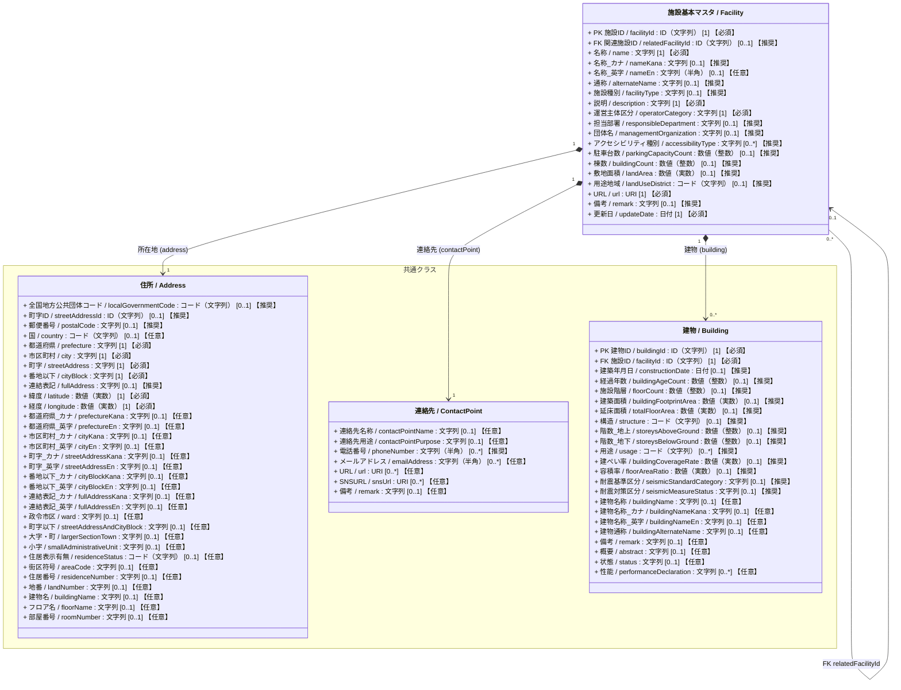

# 施設管理データモデル：施設基本クラス図

作成日：2026-10-14  
更新日：2026-10-16  
バージョン：ver5.1（基本・概要版）  
状態：改定案（PLATEAU・スマートシティ住所・アクセシビリティ・耐震基準・収集区分対応）

---

## 1. 目的と位置づけ

本クラス図は、施設管理データモデル全体関連図の中心エンティティである **`施設基本マスタ (Facility)`** と、その構成要素・参照コードを定義する基本モデルである。  

> [!NOTE]
> - 各設計方針の詳細解説、静的/動的詳細属性一覧、および現行の `施設管理データモデルver4.csv`との対応表は、別冊の [施設基本クラス図（詳細）](<./01_施設基本_クラス図_詳細.md>) を参照のこと。
> - **設備のスコープについて**: 設備（`Equipment` / `m_facility_equipments`）は、点検・修繕履歴や費用記録と深く連携する独立したマスタのため、本図（施設基本）ではなく後続の個別クラス図（`02_設備_クラス図.md` 等）にて詳細化する。

---

## 2. 施設基本クラス図 (Mermaid) - ver5.1

### 属性の多重度と収集区分の表記ルール

属性は `属性名 / 英語名 : 型 [多重度] 【収集区分】` と表記する。  
`[多重度]` はUML上の値の個数、`【収集区分】` は施設管理データモデルCSVの「必須」列に対応する本プロジェクト独自の表示であり、両者を明確に区別する。

| 収集区分 | 単一値属性の例 | 意味 |
| :--- | :--- | :--- |
| **必須** | `[1] 【必須】` | そのクラスのインスタンスが存在する場合、値を必ず保持する。 |
| **推奨** | `[0..1] 【推奨】` | 値がなくても成立するが、収集を推奨する。 |
| **任意** | `[0..1] 【任意】` | 値がなくても成立し、収集も任意とする（詳細拡張属性等）。 |

複数値属性は、必要な最小・最大件数に応じて `[0..*]` または `[1..*]` を用い、収集区分を併記する（例: `[0..*] 【推奨】`）。

### 2.1 簡易クラス図

### 2.2 詳細クラス図

```mermaid
classDiagram
    direction LR

    %% 施設基本マスタ（メインクラス）
    class Facility["施設基本マスタ / Facility"] {
        + PK 施設ID / facilityId : ID（文字列） [1] 【必須】
        + FK 関連施設ID / relatedFacilityId : ID（文字列） [0..1] 【推奨】
        %% + FK 不動産ID / realEstateId : ID（文字列） [0..1] 【推奨】
          %% "将来不動産ID"が利用可能になった際の対応
        + 名称 / name : 文字列 [1] 【必須】
        + 名称_カナ / nameKana : 文字列 [0..1] 【推奨】
        + 名称_英字 / nameEn : 文字列（半角） [0..1] 【任意】
        + 通称 / alternateName : 文字列 [0..1] 【推奨】
        + 施設種別 / facilityType : 文字列 [0..1] 【推奨】
          %% "公共施設分類"の種別から選択を想定
        + 説明 / description : 文字列 [1] 【必須】
        + 運営主体区分 / operatorCategory : 文字列 [1] 【必須】
        + 担当部署 / responsibleDepartment : 文字列 [0..1] 【推奨】
          %% "関連組織情報型"で用いることも可能
        + 団体名 / managementOrganization : 文字列 [0..1] 【推奨】
          %% "関連組織情報型"で用いることも可能
        + アクセシビリティ種別 / accessibilityType : 文字列 [0..*] 【推奨】
        + 駐車台数 / parkingCapacityCount : 数値（整数） [0..1] 【推奨】
          %% 単位:台
        + 棟数 / buildingCount : 数値（整数） [0..1] 【推奨】
          %% 単位:棟
        + 敷地面積 / landArea : 数値（実数） [0..1] 【推奨】
          %% 単位:㎡
          %% 敷地として"土地型"で用いることも可能
        + 用途地域 / landUseDistrict : コード（文字列） [0..1] 【推奨】
        + URL / url : URI [1] 【必須】
          %% 施設のWebページURLなど
        + 備考 / remark : 文字列 [0..1] 【推奨】
        + 更新日 / updateDate : 日付 [1] 【必須】
    }

    namespace 共通クラス {
        %% class Multilingual["多言語表記型 / MultilingualString"] {
        %%    <<DataType>>
        %%    + 日本語 / ja : 文字列 [1] 【必須】
        %%    + カナ / kana : 文字列 [0..1] 【推奨】
        %%    + 英字 / en : 文字列（半角） [0..1] 【推奨】
        %% }

        class Address["住所 / Address"] {
            %% 外部管理コード・ID類
            + 全国地方公共団体コード / localGovernmentCode : コード（文字列） [0..1] 【推奨】
            + 町字ID / streetAddressId : ID（文字列） [0..1] 【推奨】
            + 郵便番号 / postalCode : 文字列 [0..1] 【推奨】
            + 国 / country : コード（文字列） [0..1] 【任意】
            %% 基本住所
            + 都道府県 / prefecture : 文字列 [1] 【必須】
              %% 都道府県コードは全国地方公共団体コードに含める。都道府県コードでの取得可能。
              %% バリデーションはシステム保持もしくはWeb取得した全国地方公共団体コードで対応想定。
              + 市区町村 / city : 文字列 [1] 【必須】
              %% 市区町村コードは全国地方公共団体コードに含める。
              %% バリデーションはシステム保持もしくはWeb取得した全国地方公共団体コードで対応想定。
            + 町字 / streetAddress : 文字列 [1] 【必須】
            + 番地以下 / cityBlock : 文字列 [1] 【必須】
            + 連結表記 / fullAddress : 文字列 [0..1] 【推奨】
            %% 地理空間座標属性
            + 緯度 / latitude : 数値（実数） [1] 【必須】
            + 経度 / longitude : 数値（実数） [1] 【必須】
            %% 多言語構造化属性
            + 都道府県_カナ / prefectureKana : 文字列 [0..1] 【任意】
            + 都道府県_英字 / prefectureEn : 文字列 [0..1] 【任意】
            + 市区町村_カナ / cityKana : 文字列 [0..1] 【任意】
            + 市区町村_英字 / cityEn : 文字列 [0..1] 【任意】
            + 町字_カナ / streetAddressKana : 文字列 [0..1] 【任意】
            + 町字_英字 / streetAddressEn : 文字列 [0..1] 【任意】
            + 番地以下_カナ / cityBlockKana : 文字列 [0..1] 【任意】
            + 番地以下_英字 / cityBlockEn : 文字列 [0..1] 【任意】
            + 連結表記_カナ / fullAddressKana : 文字列 [0..1] 【任意】
            + 連結表記_英字 / fullAddressEn : 文字列 [0..1] 【任意】
            %% 非多言語構造化属性・詳細地番等
            + 政令市区 / ward : 文字列 [0..1] 【任意】
            + 町字以下 / streetAddressAndCityBlock : 文字列 [0..1] 【任意】
              %% "町字"と"番地以下"で作成可能。
            + 大字・町 / largerSectionTown : 文字列 [0..1] 【任意】
            + 小字 / smallAdministrativeUnit : 文字列 [0..1] 【任意】
            + 住居表示有無 / residenceStatus : コード（文字列） [0..1] 【任意】
            + 街区符号 / areaCode : 文字列 [0..1] 【任意】
            + 住居番号 / residenceNumber : 文字列 [0..1] 【任意】
            + 地番 / landNumber : 文字列 [0..1] 【任意】
            + 建物名 / buildingName : 文字列 [0..1] 【任意】
            + フロア名 / floorName : 文字列 [0..1] 【任意】
            + 部屋番号 / roomNumber : 文字列 [0..1] 【任意】
        }

        class ContactPoint["連絡先 / ContactPoint"] {
            + 連絡先名称 / contactPointName : 文字列 [0..1] 【任意】
            + 連絡先用途 / contactPointPurpose : 文字列 [0..1] 【任意】
            + 電話番号 / phoneNumber : 文字列（半角） [0..*] 【推奨】
            + メールアドレス / emailAddress : 文字列（半角） [0..*] 【任意】
            + URL / url : URI [0..*] 【任意】
            + SNSURL / snsUrl : URI [0..*] 【任意】
            + 備考 / remark : 文字列 [0..1] 【任意】
        }

        class RelatedOrganization["関連組織情報型 / RelatedOrganization"] {
            + 役割 / role : 文字列 [1] 【必須】
            + 名称 / name : 文字列 [1] 【必須】
            + 法人番号 / legalEntityNumber : ID（文字列） [0..1] 【推奨】
            + 全国地方公共団体コード / localGovernmentCode : コード（文字列） [0..1] 【推奨】
            + 管理期間_開始日 / startDate : 日付 [0..1] 【推奨】
            + 管理期間_終了日 / endDate : 日付 [0..1] 【推奨】
            + 運営主体区分 / operatorCategory : 文字列 [0..1] 【任意】
        }

        class Schedule["利用可能スケジュール / Schedule"] {
            + 利用可能曜日 / availableDay : 文字列 [0..*] 【推奨】
            + 開始時刻 / startTime : 時刻 [0..1] 【推奨】
            + 終了時刻 / endTime : 時刻 [0..1] 【推奨】
            + 利用可能日時説明 / availableDateTimeDescription : 文字列 [0..1] 【推奨】
            + 休館日 / closedDay : 文字列 [0..1] 【推奨】
            + 管理期間_開始日 / startDate : 日付 [0..1] 【推奨】
            + 管理期間_終了日 / endDate : 日付 [0..1] 【推奨】
        }

        class Building["建物 / Building"] {
            + PK 建物ID / buildingId : ID（文字列） [1] 【必須】
            + FK 施設ID / facilityId : ID（文字列） [1] 【必須】
            + 建築年月日 / constructionDate : 日付 [0..1] 【推奨】
              %% 着工日と竣工日を用いることも可能。
            + 経過年数 / buildingAgeCount : 数値（整数） [0..1] 【推奨】
              %% 単位:年
            + 施設階層 / floorCount : 数値（整数） [0..1] 【推奨】
              %% 単位:階
            + 建築面積 / buildingFootprintArea : 数値（実数） [0..1] 【推奨】
              %% 単位:㎡
            + 延床面積 / totalFloorArea : 数値（実数） [0..1] 【推奨】
              %% 単位:㎡
            + 構造 / structure : コード（文字列） [0..1] 【推奨】
            + 階数_地上 / storeysAboveGround : 数値（整数） [0..1] 【推奨】
              %% 単位:階
            + 階数_地下 / storeysBelowGround : 数値（整数） [0..1] 【推奨】
              %% 単位:階
            + 用途 / usage : コード（文字列） [0..*] 【推奨】
            + 建ぺい率 / buildingCoverageRate : 数値（実数） [0..1] 【推奨】
              %% 単位:％
            + 容積率 / floorAreaRatio : 数値（実数） [0..1] 【推奨】
              %% 単位:％
            + 耐震基準区分 / seismicStandardCategory : 文字列 [0..1] 【推奨】
            + 耐震対策区分 / seismicMeasureStatus : 文字列 [0..1] 【推奨】
            %% 建物名称　※施設名称と別に建物名称がある場合に利用
            + 建物名称 / buildingName : 文字列 [0..1] 【任意】
            + 建物名称_カナ / buildingNameKana : 文字列 [0..1] 【任意】
            + 建物名称_英字 / buildingNameEn : 文字列 [0..1] 【任意】
            + 建物通称 / buildingAlternateName : 文字列 [0..1] 【任意】
            %% 任意項目の建物クラス
            + 備考 / remark : 文字列 [0..1] 【任意】
            + 概要 / abstract : 文字列 [0..1] 【任意】
            + 状態 / status : 文字列 [0..1] 【任意】
            + 性能 / performanceDeclaration : 文字列 [0..*] 【任意】
              %% 耐震性能を除く、防火性能などの情報を記載
        }

        class Image["画像 / Image"] {
            + 画像 / image : URI [0..1] 【推奨】
            + 画像ライセンス / imageLicense : 文字列 [0..1] 【推奨】
            %% 任意項目の画像クラス
            + タイトル / title : 文字列 [0..1] 【任意】
            + キーワード / keywords : 文字列 [0..1] 【任意】
            + 公開日 / publicationDate : 日付 [0..1] 【任意】
            + 提供者 / provider : 文字列 [0..1] 【任意】
            + 作成者 / creator : 文字列 [0..1] 【任意】
        }
    }

    namespace コード定義 {
        class OperatorCategory["管理運営方式 / OperatorCategory"] {
            <<ControlledVocabulary>>
            %% コードリストID:01a0cf0e-d167-71ab-8bfb-98f483544ace (直営, 指定管理, 包括委託等)
        }

        class AccessibilityType["アクセシビリティ種別 / AccessibilityType"] {
            <<ControlledVocabulary>>
            %% コードリストID:01a0cf0e-d167-7352-94fb-407ae1b115ef
        }

        class PublicFacilityCategory["公共施設分類 / PublicFacilityCategory"] {
            <<ControlledVocabulary>>
            %% コードリストID:01a0cf0e-d167-7b61-a3ba-35025debf958
        }

        class BuildingStructureType["建物構造区分コード / BuildingStructureType"] {
            <<Enumeration>>
            %% コードリストID:01a0cf0e-d167-7baf-a1ee-3ec2b732cc61 (木造, RC, SRC, S等)
        }

        class BuildingUsage["建物用途分類 / BuildingUsage"] {
            <<Enumeration>>
            %% コードリストID:01a0cf0e-d167-7717-80a5-65c1ab78179c (PLATEAU 19区分)
        }

        class LandUseDistrict["地域地区および用途地域区分コード / LandUseDistrict"] {
            <<Enumeration>>
            %% コードリストID:01a0cf0e-d167-70bd-9ed5-c257d32a3fbe (都市計画法 13用途地域 / PLATEAU)
        }

        class SeismicStandardCategory["耐震基準区分 / SeismicStandardCategory"] {
            <<ControlledVocabulary>>
            %% コードリストID:01a0cf0e-d167-703a-b7ca-888c84835cbe (新耐震・旧耐震)
        }

        class SeismicMeasureStatus["耐震対策実施状態 / SeismicMeasureStatus"] {
            <<ControlledVocabulary>>
            %% コードリストID:01a0cf0e-d167-7f8a-b525-a2577f62cfa9 (実施・一部実施・未実施等)
        }

        class DayOfWeek["曜日コード / DayOfWeek"] {
            <<Enumeration>>
            %% コードリストID:01a0cf0e-d167-7eec-a7fa-c3772c1c80ec (月〜日, 祝日等)
        }
    }

    %% リレーション（施設が共通型と建物を所有）
    %% Facility "1" *--> "1" Multilingual : 名称 (facilityName)
    Facility "1" *--> "1" Address : 所在地 (address)
    Facility "1" *--> "1" ContactPoint : 連絡先 (contactPoint)
    Facility "1" *--> "0..*" RelatedOrganization : 運営・所管組織履歴 (relatedOrganization)
    Facility "1" *--> "0..*" Schedule : 利用可能スケジュール (schedule)
    Facility "1" *--> "0..*" Building : 建物 (building)
    Facility "1" *--> "0..1" Image : 画像 (image)
    Facility "0..*" --> "0..1" Facility : FK relatedFacilityId

    %% コードリスト参照（関連）
    Facility "0..*" --> "1" OperatorCategory : 現行/運営主体区分
    Facility "0..*" --> "0..*" AccessibilityType : アクセシビリティ
    Facility "0..*" --> "0..1" PublicFacilityCategory : 公共施設分類
    RelatedOrganization "0..*" --> "0..1" OperatorCategory : 歴代/運営主体区分
    Schedule "0..*" --> "0..*" DayOfWeek : 利用可能曜日
    Building "0..*" --> "0..1" BuildingStructureType : 構造区分
    Building "0..*" --> "0..*" BuildingUsage : 用途区分
    Facility "0..*" --> "0..1" LandUseDistrict : 用途地域
    Building "0..*" --> "0..1" SeismicStandardCategory : 耐震基準
    Building "0..*" --> "0..1" SeismicMeasureStatus : 耐震対策状況
```

---

## 3. 主要クラスおよびリレーション仕様

### 3.1 メインエンティティ（`Facility`）
- 施設の最上位の識別、種別、および現行の運営主体を管理。

### 3.2 コアデータモデル共通クラス（Components）
1. **`MultilingualString` (多言語文字列型)**:
   - 日本語正式名（`ja`）、カナ（`kana`）、英字（`en`）の構造化型。本モデルではコメントアウトで記載
2. **`Address` (住所型)**:
   - 基本住所（`prefecture`, `city`, `streetAddress`, `cityBlock` 【必須】）に加え、世界測地系の代表点座標（`latitude`, `longitude` 【必須】）を内包。
3. **`Building` (建物)**:
   - 建物として、1施設に複数棟が存在する実態に対応するため、独立した主キー `buildingId` 【必須】 と親施設への外部キー `facilityId` 【必須】 を持つコンポジション関係（`1` 対 `0..*`）。
4. **`RelatedOrganization` (関連組織情報型)**:
   - 指定管理者、所管課、委託先、所有者などの組織情報を多重度 `0..*` で保持。過去と現在の組織情報を管理できるようにする。
5. **`Schedule` (利用可能スケジュール型)**:
   - 開館曜日、開館開始・終了時刻、開館時間説明、休館日、および契約・運用期間を集約。
6. **`ContactPoint` (連絡先型)**:
   - 公式WebサイトURL、代表電話番号、問い合わせ用メールアドレス、公式SNS URLを集約。
7. **`Image` (画像型)**:
   - 施設外観画像URL、著作権・CCライセンス情報を集約。

### 3.3 参照コードリスト・統制語彙（Enumeration）
- **`OperatorCategory` (管理運営方式)**: 地方自治法第244条の2に基づく直営・指定管理等の区分（ID: `01a0cf0e-d167-71ab-8bfb-98f483544ace`）。
- **`AccessibilityType` (アクセシビリティ種別)**: 障害者・高齢者配慮設備等の種別コード（ID: `01a0cf0e-d167-7352-94fb-407ae1b115ef`）。
- **`FacilityCategory` (施設分類)**: 総務省更新費用推計ソフト分類に基づく公共施設分類（ID: `01a0cf0e-d167-7b61-a3ba-35025debf958`）。
- **`BuildingStructureType` (建物構造区分コード)**: 国交省PLATEAU仕様に基づく木造・RC・SRC・S等の標準コード（ID: `01a0cf0e-d167-7baf-a1ee-3ec2b732cc61`）。
- **`BuildingUsage` (建物用途分類)**: 国交省PLATEAU仕様に基づく建物用途19区分（ID: `01a0cf0e-d167-7717-80a5-65c1ab78179c`）。
- **`LandUseDistrict` (地域地区および用途地域区分コード)**: 都市計画法第8条およびPLATEAU仕様に基づく用途地域（ID: `01a0cf0e-d167-70bd-9ed5-c257d32a3fbe`）。
- **`SeismicStandardCategory` (耐震基準区分)**: 新耐震基準（1981年6月以降）適合区分（ID: `01a0cf0e-d167-703a-b7ca-888c84835cbe`）。
- **`SeismicMeasureStatus` (耐震対策実施状態)**: 消防庁防災拠点調査等に基づく耐震化実施状態（ID: `01a0cf0e-d167-7f8a-b525-a2577f62cfa9`）。
- **`DayOfWeek` (曜日コード)**: ISO 8601準拠の曜日コード（ID: `01a0cf0e-d167-7eec-a7fa-c3772c1c80ec`）。

---

## 4. スタティック情報とダイナミック情報の概要

施設管理に関わるデータを、マスタとして管理する「スタティック情報（静的情報）」と、時系列実績として管理する「ダイナミック情報（動的情報）」に分類する。

| 区分 | 主な内容 | 配置先 |
| :--- | :--- | :--- |
| **スタティック情報** | 施設・建物の物理基本情報、所在地・空間座標、管理体制・組織履歴、開館規定・契約期間など | 本クラス図（`Facility`、`Building`、共通クラス群） |
| **ダイナミック情報** | 利用・稼働実績、財務・収支実績、保全・点検・修繕履歴、防災・避難実績など | 全体関連図で定義する各履歴クラス群 |

---

## 5. 詳細仕様・設計根拠・原本対応表への参照

より深い設計背景や原本データとの完全な整合関係については、以下の別冊ドキュメントを参照のこと。

👉 **[施設基本クラス図（詳細）](<./01_施設基本_クラス図_詳細.md>)**
- **第5章 設計方針の詳細解説**: PLATEAU 3D都市モデル整合、スマートシティGIF連携、耐震2系統分離、データ収集区分の背景
- **第6章 スタティック・ダイナミック情報の詳細属性一覧**: 更新サイクルと該当属性の完全リスト
- **第7章 データモデルver4（53項目）との対応表**: 原本CSVの内部管理ID（PROP_FAC_001〜053）とクラス図プロパティの1対1対応表
