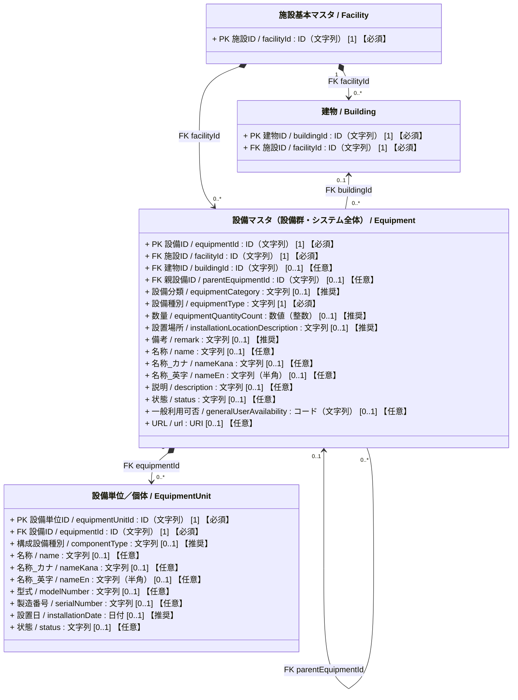

# 施設管理データモデル：設備クラス図

作成日：2026-10-16  
更新日：2026-10-18  
バージョン：ver1.0（基本版）  
状態：クラス図確定・データモデルCSV反映待ち

---

## 1. 目的と位置づけ

本クラス図は、**建物系施設を管理**することを目的として、施設または建物に属する**管理上の設備群・設備システム全体**を管理するクラスである。
また、維持管理実務における台帳構成は、国土交通省大臣官房官庁営繕部『保全台帳及び保全計画書の様式の取扱いについて』（[要領ページ](https://www.mlit.go.jp/gobuild/gobuild_tk3_000002.html)）を参照している。

点検、修繕、状態を設備単位で管理する必要があるものだけ、`EquipmentUnit`（設備単位／個体）を登録する。AEDなら1台ごと、空調なら集中管理システム・室外機・室内機・ダクトなど管理対象となる構成要素ごとに登録できる。

### 設備種別の設計整理

1. **設備種別の表現方式**:
   - **「中分類（設備分野）＋ 具体設備リスト（統制語彙）」の2階層構造**を取り入れつつ、**基本は統制語彙リストから選択し、リストにない特殊な設備は自由な文字列を直接入力できる方式**とする。

---

## 2. 設備クラス図（Mermaid）

### 属性の多重度と収集区分の表記ルール

属性は `属性名 / 英語名 : 型 [多重度] 【収集区分】` と表記する。  
`[多重度]` はUML上の値の個数、`【収集区分】` は施設管理データモデルCSVの「必須」列に対応する本プロジェクト独自の表示であり、両者を明確に区別する。

| 収集区分 | 単一値属性の例 | 意味 |
| :--- | :--- | :--- |
| **必須** | `[1] 【必須】` | そのクラスのインスタンスが存在する場合、値を必ず保持する。 |
| **推奨** | `[0..1] 【推奨】` | 値がなくても成立するが、収集を推奨する。 |
| **任意** | `[0..1] 【任意】` | 値がなくても成立し、収集も任意とする（詳細拡張属性等）。 |

複数値属性は、必要な最小・最大件数に応じて `[0..*]` または `[1..*]` を用い、収集区分を併記する（例: `[0..*] 【推奨】`）。

### 2.1 簡易クラス図

### 2.2 詳細クラス図

`Equipment` と `EquipmentUnit` に対して、共通クラス、全体関連図の履歴クラス、および統制語彙・コード定義を展開した詳細図である。

```mermaid
classDiagram
    direction TB

    class Facility["施設基本マスタ / Facility"] {
        + PK 施設ID / facilityId : ID（文字列） [1] 【必須】
    }

    class Building["建物 / Building"] {
        + PK 建物ID / buildingId : ID（文字列） [1] 【必須】
        + FK 施設ID / facilityId : ID（文字列） [1] 【必須】
    }

    class Equipment["設備マスタ（設備群・システム全体） / Equipment"] {
        + PK 設備ID / equipmentId : ID（文字列） [1] 【必須】
        + FK 施設ID / facilityId : ID（文字列） [1] 【必須】
        + FK 建物ID / buildingId : ID（文字列） [0..1] 【任意】
          %% 設計追加。屋外設備等は建物に紐づかない。
        + FK 親設備ID / parentEquipmentId : ID（文字列） [0..1] 【任意】
        + 設備分類 / equipmentCategory : 文字列 [0..1] 【推奨】
          %% EquipmentCategory（中分類リスト）を参照。
        + 設備種別 / equipmentType : 文字列 [1] 【必須】
          %% EquipmentType（具体設備リスト）から選択、なければ文字列直接入力。
        + 数量 / equipmentQuantityCount : 数値（整数） [0..1] 【推奨】
          %% 同種設備を数える場合の全体数量。異種要素からなるシステムでは空欄可。型・単位は設備ごとに判断。
        + 設置場所 / installationLocationDescription : 文字列 [0..1] 【推奨】
          %% 建物内の階・室などは自由記述とする。
        + 備考 / remark : 文字列 [0..1] 【推奨】
        %% 任意項目
        + 名称 / name : 文字列 [0..1] 【任意】
        + 名称_カナ / nameKana : 文字列 [0..1] 【任意】
        + 名称_英字 / nameEn : 文字列（半角） [0..1] 【任意】
        + 説明 / description : 文字列 [0..1] 【任意】
        + 状態 / status : 文字列 [0..1] 【任意】
          %% 設備群・システム全体の運用状態。下位要素の状態から単純に自動算出しない。
        + 一般利用可否 / generalUserAvailability : コード（文字列） [0..1] 【任意】
          %% 可否コード（0:否, 1:可, 2:非公開, 9:不明）を参照。
        + URL / url : URI [0..1] 【任意】
    }

    class EquipmentUnit["設備単位／個体 / EquipmentUnit"] {
        + PK 設備単位ID / equipmentUnitId : ID（文字列） [1] 【必須】
        + FK 設備ID / equipmentId : ID（文字列） [1] 【必須】
        + 構成設備種別 / componentType : 文字列 [0..1] 【推奨】
          %% 親と異種の構成設備（室外機・ダクト等）の場合に指定。同種の各AEDでは空欄可。
        + 名称 / name : 文字列 [0..1] 【任意】
        + 名称_カナ / nameKana : 文字列 [0..1] 【任意】
        + 名称_英字 / nameEn : 文字列（半角） [0..1] 【任意】
        + 型式 / modelNumber : 文字列 [0..1] 【任意】
        + 製造番号 / serialNumber : 文字列 [0..1] 【任意】
        + 設置日 / installationDate : 日付 [0..1] 【推奨】
        + 状態 / status : 文字列 [0..1] 【任意】
    }

    class MaintenanceHistory["点検・修繕履歴 / MaintenanceHistory"] {
        + PK 点検修繕ID / maintenanceId : ID（文字列） [1] 【必須】
        + FK 設備ID / equipmentId : ID（文字列） [0..1] 【任意】
        + FK 設備単位ID / equipmentUnitId : ID（文字列） [0..1] 【任意】
        + 対象部位 / maintenanceTargetPart : 文字列 [0..1] 【推奨】
          %% 部位別分類を参照。Equipmentの設備分類（中分類）と対応。
    }

    namespace 共通クラス {
        class CommonLocation["位置情報型 / CommonLocation"] {
            + 位置 / locationPoint : ジオメトリ（点） [0..1] 【任意】
              %% geo:geometry、GeoJSONなどを想定
            + 緯度 / latitude : 数値（実数） [0..1] 【任意】
            + 経度 / longitude : 数値（実数） [0..1] 【任意】
            + 階数 / level : 文字列 [0..1] 【任意】
              %% 単位:階
            + 標高 / elevation : 数値（物理量） [0..1] 【任意】
              %% 単位:m
            + 位置説明 / locationDescription : 文字列 [0..1] 【任意】
        }

        class ContactPoint["連絡先 / ContactPoint"] {
            + 連絡先名称 / contactPointName : 文字列 [0..1] 【任意】
            + 連絡先用途 / contactPointPurpose : 文字列 [0..1] 【任意】
            + 電話番号 / phoneNumber : 文字列（半角） [0..*] 【任意】
            + メールアドレス / emailAddress : 文字列（半角） [0..*] 【任意】
            + URL / url : URI [0..*] 【任意】
            + SNSURL / snsUrl : URI [0..*] 【任意】
            + 備考 / remark : 文字列 [0..1] 【任意】
        }

        class RelatedOrganization["関連組織情報型 / RelatedOrganization"] {
            + 役割 / role : 文字列 [0..1] 【任意】
              %% 所有者、管理主体、保守事業者など
            + 名称 / name : 文字列 [0..1] 【任意】
            + 法人番号 / legalEntityNumber : ID（文字列） [0..1] 【任意】
            + 全国地方公共団体コード / localGovernmentCode : コード（文字列） [0..1] 【任意】
            + 管理期間_開始日 / startDate : 日付 [0..1] 【任意】
            + 管理期間_終了日 / endDate : 日付 [0..1] 【任意】
        }
    }

    namespace コード定義 {
        class EquipmentCategory["設備分類 / EquipmentCategory"] {
            <<ControlledVocabulary>>
            %% コードリストID:01a147bb-824f-7dcd-a2ae-768e7a7e3c2c
            %% 官庁営繕「部位別分類」の設備区分＋利用支援区分
            電気設備 : 電灯・動力設備, 受変電設備, 自家発電・蓄電設備, 通信・情報設備, その他電気設備
            機械設備 : 空気調和設備, 換気設備, 給排水・衛生設備, ガス・燃料設備, その他機械設備
            消防・防災設備 : 消防用設備, 非常用電灯設備, 防火・排煙設備, 救命・避難設備, 防災・備蓄設備, その他消防・防災設備
            搬送・移動支援設備 : 搬送・昇降設備, その他搬送・移動支援設備
            その他 : 子育て・休養室設備, 視覚・聴覚支援設備, 駐車場設備, 外構・出入口設備, その他
        }

        class EquipmentType["設備種別リスト / EquipmentType"] {
            <<ControlledVocabulary>>
            %% コードリストID:01a147bb-824f-7dcd-a2ae-768e7a7e3c2c
            %% 基本はリストから選択し、該当がない場合は自由文字列を直接入力可（オープン統制語彙）
        }

        class AvailabilityCode["可否コード / AvailabilityCode"] {
            <<Enumeration>>
            %% コードリストID:01a0cf0e-d167-7afd-996e-aec8d3c118d1
            0 : 否
            1 : 可
            2 : 非公開
            9 : 不明
        }
    }

    %% 施設・建物・履歴とのリレーション
    Facility "1" *--> "0..*" Building : FK facilityId
    Facility "1" *--> "0..*" Equipment : FK facilityId
    Building "0..1" <-- "0..*" Equipment : FK buildingId
    Equipment "1" *--> "0..*" EquipmentUnit : FK equipmentId
    Equipment "0..1" <-- "0..*" Equipment : FK parentEquipmentId
    Equipment "0..1" <-- "0..*" MaintenanceHistory : FK equipmentId（候補）
    EquipmentUnit "0..1" <-- "0..*" MaintenanceHistory : FK equipmentUnitId（候補）

    %% 共通クラスとのリレーション（スマートシティ拡張・任意）
    Equipment "1" *--> "0..1" CommonLocation : 設置位置 (installationLocation)
    Equipment "1" *--> "0..*" ContactPoint : 連絡先情報 (contactPoint)
    Equipment "1" *--> "0..*" RelatedOrganization : 保守点検先・製造元
    EquipmentUnit "1" *--> "0..1" CommonLocation : 設置位置 (installationLocation)

    %% 統制語彙・コード定義への参照
    Equipment "0..*" --> "0..1" EquipmentCategory : 設備種別（中分類）
    Equipment "0..*" --> "0..1" EquipmentType : 設備種別（リスト選択または文字列入力）
    Equipment "0..*" --> "0..1" AvailabilityCode : 一般利用可否
```

---

## 3. 設備全体と設備単位の要点

1. `Equipment` はAED群や空調システムなど、管理上の設備全体を表す。施設に必ず属し、建物への紐づけは任意とする。
2. `EquipmentUnit` は必要な場合だけ登録する設備単位である。各AEDのように親と同種なら種別を引き継ぎ、室外機・ダクト等の異種構成要素なら `componentType` を任意で記録する。
3. 全体の状態と各設備単位の状態は別に管理する。点検・修繕履歴は全体の `equipmentId` を参照し、対象が特定の設備単位なら `equipmentUnitId` も指定する。
4. 種別別の追加項目は、設備全体で一つに決まる値を `Equipment` 側、台・基・構成要素ごとに変わる値を `EquipmentUnit` 側に置く。AED・公衆トイレ等の具体的な配置は詳細版で示す。

---

## 4. 詳細資料

- [設備クラス図（詳細）](./02_設備_クラス図_詳細.md)：種別別拡張図、属性配置判断、設計根拠、現行CSVとの対応。
- [設備用統制語彙リスト](./02_設備_クラス図_統制語彙コード.md)：設備種別と選択基準。コード定義の正本は `06_データモデルCSV/施設管理コード定義ver8.csv`。
