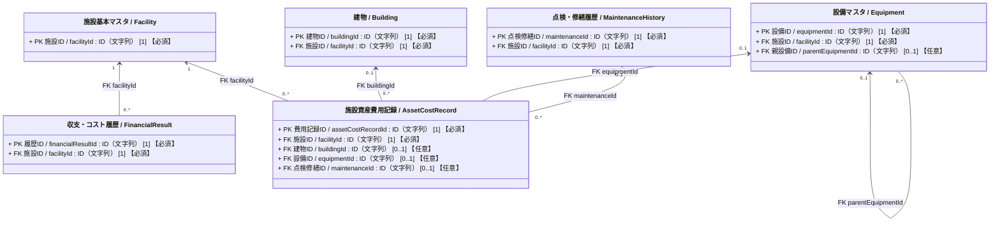

# 施設管理データモデル：収支・コスト履歴クラス図

作成日：2026-10-19  
更新日：2026-10-20  
バージョン：ver1.1（基本版）
状態：クラス図改定・データモデルCSV再反映待ち

## 1. 目的と対象

本クラス図は、施設の収支および運営コストと整備・保全・除却費用を管理するクラス図である。
施設単位・年度単位の収支および運営コストの集計を `FinancialResult`、施設・建物・設備に帰属する個別の整備・保全・除却費用を `AssetCostRecord` として区別する。

- **`FinancialResult`（収支・コスト履歴）**：総務省「統一的な基準による地方公会計」の行政コスト計算書（PL）の科目構造を基礎とし、1施設・1会計年度あたりの収入・現金支出・減価償却費・総コスト・純施設コストを管理する。
- **`AssetCostRecord`（施設資産費用記録）**：国土交通省「国家機関の建築物等の保全の現況」「保全台帳及び保全計画書の様式の取扱いについて」および公会計の固定資産台帳・投資活動支出等の明細を基礎とし、施設全体（敷地・土地を含む）・建物・設備群・主要機器に帰属する新設・更新・改修・修繕・保守点検・撤去等の個別費用（実績および計画・見積）を管理する。「資産」はここでは費用の帰属対象を指し、すべての記録が会計上の資産計上に該当する意味ではない。

## 2. 全体構造

### 属性の多重度と収集区分の表記ルール

属性は `属性名 / 英語名 : 型 [多重度] 【収集区分】` と表記する。  
`[多重度]` はUML上の値の個数、`【収集区分】` は施設管理データモデルCSVの「必須」列に対応する本プロジェクト独自の表示であり、両者を明確に区別する。

| 収集区分 | 単一値属性の例 | 意味 |
| :--- | :--- | :--- |
| **必須** | `[1] 【必須】` | そのクラスのインスタンスが存在する場合、値を必ず保持する。 |
| **推奨** | `[0..1] 【推奨】` | 値がなくても成立するが、収集を推奨する。 |
| **任意** | `[0..1] 【任意】` | 値がなくても成立し、収集も任意とする（詳細拡張属性等）。 |

複数値属性は、必要な最小・最大件数に応じて `[0..*]` または `[1..*]` を用い、収集区分を併記する（例: `[0..*] 【推奨】`）。

### 2.1 簡易クラス図

`FinancialResult` と `AssetCostRecord` の間に所有関係や必須の集計線は引かない。年度収支集計（PLベースの期間損益・運営コスト）と個別資産費用明細（資本的支出や将来計画額を含む整備・保全・除却費用）は粒度・会計上の性質が異なり、金額を無条件に加算できないためである。

## 2.2 詳細クラス図　属性および統制語彙を含むクラス図

```mermaid
classDiagram
    direction TB

    class Facility["施設基本マスタ / Facility"] {
        + PK 施設ID / facilityId : ID（文字列） [1] 【必須】
    }

    class FinancialResult["収支・コスト履歴 / FinancialResult"] {
        + PK 履歴ID / financialResultId : ID（文字列） [1] 【必須】
        + FK 施設ID / facilityId : ID（文字列） [1] 【必須】
        + 対象年度 / fiscalYear : 数値（整数） [1] 【必須】
          %% 単位:年度。西暦YYYY(ISO8601)への正規化。
        + 施設利用収入額 / revenueUsageFeeAmount : 数値（整数） [0..1] 【推奨】
          %% 単位:円。公会計PL「経常収益＞使用料及び手数料」相当。
        + その他収入額 / revenueOtherAmount : 数値（整数） [0..1] 【推奨】
          %% 単位:円。公会計PL「経常収益＞その他」相当。
        + 合計収入額 / revenueTotalAmount : 数値（整数） [0..1] 【推奨】
          %% 単位:円。施設利用収入額＋その他収入額（公会計PL「経常収益」相当）。
        + 修繕支出額 / expenditureRepairAmount : 数値（整数） [0..1] 【推奨】
          %% 単位:円。公会計PL「業務費用＞物件費等＞維持補修費」相当。
        + 光熱水費支出額 / expenditureUtilityAmount : 数値（整数） [0..1] 【推奨】
          %% 単位:円。公会計PL「物件費」のうち電気・ガス・水道料金。
        + 維持管理支出額 / expenditureManagementAmount : 数値（整数） [0..1] 【推奨】
          %% 単位:円。公会計PL「物件費」のうち保守点検・清掃・警備等の業務委託費等。
        + 人件費支出額 / expenditurePersonnelAmount : 数値（整数） [0..1] 【推奨】
          %% 単位:円。公会計PL「業務費用＞人件費」相当。
        + その他支出額 / expenditureOtherAmount : 数値（整数） [0..1] 【推奨】
          %% 単位:円。公会計PL「物件費」等のうち上記以外の消耗品費・賃借料（借地料等）・雑支出。
        + 現金支出合計 / cashExpenditureTotalAmount : 数値（整数） [0..1] 【推奨】
          %% 単位:円。上記5つの現金支出科目の合計。
        + 減価償却費 / nonCashDepreciationAmount : 数値（整数） [0..1] 【推奨】
          %% 単位:円。公会計PL「業務費用＞物件費等＞減価償却費」（非現金支出）相当。
        + 施設総コスト / totalCostAmount : 数値（整数） [0..1] 【推奨】
          %% 単位:円。現金支出合計＋減価償却費（公会計PL「経常費用」相当のフルコスト）。
        + 純施設コスト / fiscalBalanceAmount : 数値（整数） [0..1] 【推奨】
          %% 単位:円。施設総コスト－合計収入額（公会計PL「純経常行政コスト」＝実質公費負担額相当）。
    }

    class Building["建物 / Building"] {
        + PK 建物ID / buildingId : ID（文字列） [1] 【必須】
        + FK 施設ID / facilityId : ID（文字列） [1] 【必須】
    }
    class Equipment["設備マスタ / Equipment"] {
        + PK 設備ID / equipmentId : ID（文字列） [1] 【必須】
        + FK 施設ID / facilityId : ID（文字列） [1] 【必須】
        + FK 親設備ID / parentEquipmentId : ID（文字列） [0..1] 【任意】
    }
    class MaintenanceHistory["点検・修繕履歴 / MaintenanceHistory"] {
        + PK 点検修繕ID / maintenanceId : ID（文字列） [1] 【必須】
        + FK 施設ID / facilityId : ID（文字列） [1] 【必須】
        + 費用額 / maintenanceCostAmount : 数値（整数） [0..1] 【推奨】
          %% 単位:円。費用記録との役割分担・二重計上防止は第4章参照。
    }
    class AssetCostRecord["施設資産費用記録 / AssetCostRecord"] {
        + PK 費用記録ID / assetCostRecordId : ID（文字列） [1] 【必須】
        + FK 施設ID / facilityId : ID（文字列） [1] 【必須】
        + FK 建物ID / buildingId : ID（文字列） [0..1] 【任意】
          %% 設備IDと排他。建物・設備とも空欄の場合は施設全体（敷地・土地を含む）への帰属を表す。
        + FK 設備ID / equipmentId : ID（文字列） [0..1] 【任意】
          %% 建物IDと排他。
        + FK 点検修繕ID / maintenanceId : ID（文字列） [0..1] 【任意】
        + 対象内容 / costTargetDescription : 文字列 [0..1] 【任意】
          %% 主要部位・施工箇所・一括工事の対象などを補足。設備単位IDは直接持たない。
        + 費用区分 / costCategory : 文字列 [1] 【必須】
          %% AssetCostCategory（費用区分）を参照。光熱水費等の運営費全般は対象外。
        + 計画・見積・実績区分 / costStage : 文字列 [1] 【必須】
          %% MaintenanceInformationCategory（維持管理計画実績区分）を共通参照。
        + 対象日 / costDate : 日付 [0..1] 【任意】
        + 対象年度 / fiscalYear : 数値（整数） [0..1] 【任意】
          %% 現行の全体関連図の型を維持。FinancialResultの年度型とは要調整。
        + 費用額 / amount : 数値（実数） [1] 【必須】
          %% 単位:円。整数・小数の扱いはCSV反映時に確認。
        + 根拠資料 / sourceDocumentReference : URI [0..1] 【任意】
    }

    namespace コード定義 {
        class AssetCostCategory["費用区分 / AssetCostCategory"] {
            <<ControlledVocabulary>>
            %% コードリストID:01a15660-22c0-7a4b-9c1d-3e8f4a2b6d90
            %% 大分類:整備・保全・除却費用（詳細は施設管理コード定義ver8.csv参照）
            取得・整備 : 新設・取得費
            更新・改修 : 更新費
            更新・改修 : 改修費
            維持・保全 : 修繕費
            維持・保全 : 保守・点検費
            廃棄・除却 : 撤去・解体費
            その他 : その他費用
        }

        class MaintenanceInformationCategory["維持管理計画実績区分 / MaintenanceInformationCategory"] {
            <<ControlledVocabulary>>
            %% コードリストID:01a0cf0e-d167-711c-9dbe-8fee8d6dc4d9
            実績
            実施計画
            中長期計画
        }
    }

    Facility "1" <-- "0..*" FinancialResult : FK facilityId
    Facility "1" <-- "0..*" AssetCostRecord : FK facilityId
    Building "0..1" <-- "0..*" AssetCostRecord : FK buildingId
    Equipment "0..1" <-- "0..*" Equipment : FK parentEquipmentId
    Equipment "0..1" <-- "0..*" AssetCostRecord : FK equipmentId
    MaintenanceHistory "0..1" <-- "0..*" AssetCostRecord : FK maintenanceId

    %% 統制語彙への参照
    AssetCostRecord "0..*" --> "1" AssetCostCategory : 費用区分 (costCategory)
    AssetCostRecord "0..*" --> "1" MaintenanceInformationCategory : 計画・見積・実績区分 (costStage)
```

## 3. 整合条件

### 3.1 帰属先と対象範囲の整合条件（土地・敷地を含む）
- **建物・設備・施設全体（敷地・土地）への帰属規則**：
  - `AssetCostRecord` は `facilityId` を必須とし、`buildingId` と `equipmentId` は同時に指定しない（排他制約）。
  - **`buildingId` と `equipmentId` の両方を未指定（NULL）とした場合は、特定の1建物・1設備に限定されない「施設全体（敷地・土地・外構全体を含む）」に帰属する費用**（例：敷地造成費・用地取得費、複数棟一括の設計監理費・解体工事費等）を表す。
  - `equipmentId` には費用を帰属させる最も具体的な設備群・主要機器を指定する。設備の親子は同一施設に属し、親子の費用を無条件に合算しない。指定した建物・設備の所属施設は `facilityId` と一致させる。
  - 建物の部位、設備の構成部分や一括工事の対象は `costTargetDescription` で補足できる。個体の詳細は点検・修繕履歴や根拠資料に記録できるが、取得・撤去など履歴のない費用も認める。
- **対象日と対象年度**：
  - `costDate` と `fiscalYear` は少なくとも一方を指定する。両方を指定する場合、日付が属する会計年度と年度値を一致させる。会計年度の開始月は現段階では固定しない。
- **点検・修繕履歴との紐づけ**：
  - `maintenanceId` は点検・修繕履歴（`MaintenanceHistory`）に由来する費用に限り指定する。参照先の点検・修繕履歴も同じ施設に属することを確認する。

### 3.2 公会計基準（財務書類4表）との対応と計算・集計規則
- **`FinancialResult` の科目構造と算出関係**：
  - 総務省「統一的な基準による地方公会計」の行政コスト計算書（PL）の科目構造（`05_参考` 参照）に準拠し、施設単位で発生する科目を保持する。
  - （社会保障給付・補助金等の移転費用や地方債支払利息など、自治体全体にのみ帰属する科目は対象外）。
  - 項目間の基本的な計算関係は以下のとおりとする。ただし、元の個別値が未取得（NULL）のときに欠測をゼロとみなして自動補完しない。
    1. `合計収入額 (revenueTotalAmount)` ＝ `施設利用収入額` ＋ `その他収入額`（公会計PLの「経常収益」相当）
    2. `現金支出合計 (cashExpenditureTotalAmount)` ＝ `修繕支出額` ＋ `光熱水費支出額` ＋ `維持管理支出額` ＋ `人件費支出額` ＋ `その他支出額`（公会計PLの「業務費用」のうち人件費・維持補修費・物件費等の現金支出相当）
    3. `施設総コスト (totalCostAmount)` ＝ `現金支出合計` ＋ `減価償却費 (nonCashDepreciationAmount)`（公会計PLの「経常費用」相当のフルコスト）
    4. `純施設コスト (fiscalBalanceAmount)` ＝ `施設総コスト` － `合計収入額`（公会計PLの「純経常行政コスト」相当：プラス値が収入で賄えない実質的な公費負担額を表す）
  - **公会計指標との連携**：`合計収入額 ÷ 施設総コスト` により、施設単位の「受益者負担比率」を導出できる。
  - 
- **`FinancialResult` と `AssetCostRecord` を無条件に合算しない理由**：
  - 02_クラス図\03_収支・コスト履歴_クラス図_詳細.mdに記載。
