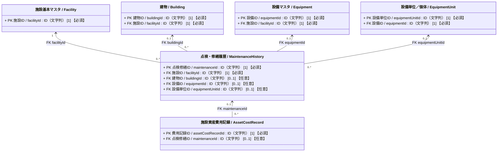

# 施設管理データモデル：点検・修繕履歴クラス図

作成日：2026-10-22  
更新日：2026-10-24  
バージョン：ver1.0（基本版）  
状態：クラス図改定・データモデルCSV反映待ち

---

## 1. 目的と位置づけ

本クラス図は、施設、建物、設備群・システム全体、および設備単位／個体に対する**保全・維持管理業務（点検、調査、診断、保守、修繕、更新、改修、撤去等）の計画および実績**を記録・管理するクラス図である。

維持管理実務においては、日常点検・定期点検から中長期修繕計画、緊急修繕、機器更新まで幅広い業務が発生する。本モデルでは、これらを「どの管理単位（アセット）に対して」「何の業務を」「どの段階（計画・実績）で」実施したかを統一的に追跡できる構造とする。

業務に伴って発生する個別費用明細は `AssetCostRecord`（施設資産費用記録）と連携し、施設単位・年度単位の収支集計である `FinancialResult`（収支・コスト履歴）との間で適切な集計境界を保つ。

---

## 2. 点検・修繕履歴クラス図（Mermaid）

### 属性の多重度と収集区分の表記ルール

属性は `属性名 / 英語名 : 型 [多重度] 【収集区分】` と表記する。  
`[多重度]` はUML上の値の個数、`【収集区分】` は施設管理データモデルCSVの「必須」列に対応する本プロジェクト独自の表示であり、両者を明確に区別する。

| 収集区分 | 単一値属性の例 | 意味 |
| :--- | :--- | :--- |
| **必須** | `[1] 【必須】` | そのクラスのインスタンスが存在する場合、値を必ず保持する。 |
| **推奨** | `[0..1] 【推奨】` | 値がなくても成立するが、収集を推奨する。 |
| **任意** | `[0..1] 【任意】` | 値がなくても成立し、収集も任意とする（詳細拡張属性等）。 |

複数値属性は、必要な最小・最大件数に応じて `[0..*]` または `[1..*]` を用い、収集区分を併記する（例: `[0..*] 【推奨】`）。

---

### 2.1 簡易クラス図

点検・修繕履歴が対象とする「4つの保全対象アセット（施設・建物・設備・設備単位）」と、保全業務から発生する「施設資産費用記録」との関係を示す。

---

### 2.2 詳細クラス図（属性および統制語彙を含むクラス図）

```mermaid
classDiagram
    direction TB

    class Facility["施設基本マスタ / Facility"] {
        + PK 施設ID / facilityId : ID（文字列） [1] 【必須】
    }
    class Building["建物 / Building"] {
        + PK 建物ID / buildingId : ID（文字列） [1] 【必須】
        + FK 施設ID / facilityId : ID（文字列） [1] 【必須】
    }
    class Equipment["設備マスタ / Equipment"] {
        + PK 設備ID / equipmentId : ID（文字列） [1] 【必須】
        + FK 施設ID / facilityId : ID（文字列） [1] 【必須】
    }
    class EquipmentUnit["設備単位／個体 / EquipmentUnit"] {
        + PK 設備単位ID / equipmentUnitId : ID（文字列） [1] 【必須】
        + FK 設備ID / equipmentId : ID（文字列） [1] 【必須】
    }

    class MaintenanceHistory["点検・修繕履歴 / MaintenanceHistory"] {
        + PK 点検修繕ID / maintenanceId : ID（文字列） [1] 【必須】
        + FK 施設ID / facilityId : ID（文字列） [1] 【必須】
        + FK 建物ID / buildingId : ID（文字列） [0..1] 【任意】
        + FK 設備ID / equipmentId : ID（文字列） [0..1] 【任意】
        + FK 設備単位ID / equipmentUnitId : ID（文字列） [0..1] 【任意】
        + 計画日_実施日 / maintenanceEventDate : 日付 [1] 【必須】
          %% 計画レコードでは計画策定日、実績レコードでは実施日。将来の実施予定日ではない。
        + データ区分 / maintenanceDataCategory : 文字列 [1] 【必須】
          %% 維持管理計画実績区分を参照。業務種別とは別の軸。
        + 業務種別 / maintenanceActivityType : 文字列 [1] 【必須】
        + 対象部位 / maintenanceTargetPart : 文字列 [0..1] 【推奨】
        + 劣化度スコア / deteriorationScore : 文字列 [0..1] 【推奨】
          %% 分野・施設種別ごとの個別基準による部位・設備の劣化評価（例：学校施設のA〜D等）。
        + 総合評価ステータス / overallConditionStatus : コード（文字列） [0..1] 【推奨】
          %% 施設管理健全度区分（1〜4,9）を参照。分野横断で共通利用する総合的な健全度判定。
        + 対応内容詳細 / maintenanceActionDescription : 文字列 [0..1] 【推奨】
        + 費用額 / maintenanceCostAmount : 数値（整数） [0..1] 【推奨】
          %% 単位:円。当該保全業務1件の総額（簡易記録用）。費用区分別の内訳管理はAssetCostRecordで行う。
    }

    class AssetCostRecord["施設資産費用記録 / AssetCostRecord"] {
        + PK 費用記録ID / assetCostRecordId : ID（文字列） [1] 【必須】
        + FK 点検修繕ID / maintenanceId : ID（文字列） [0..1] 【任意】
    }

    namespace コード定義 {
        class MaintenanceInformationCategory["維持管理計画実績区分 / MaintenanceInformationCategory"] {
            <<ControlledVocabulary>>
            %% コードリストID:01a0cf0e-d167-711c-9dbe-8fee8d6dc4d9
            実績
            実施計画
            中長期計画
        }
        class MaintenanceActivityType["維持管理業務種別 / MaintenanceActivityType"] {
            <<ControlledVocabulary>>
            %% コードリストID:01a0cf0e-d167-7aa5-abce-e672cdb12900
            点検
            調査
            診断
            保守
            修繕
            更新
            改修
            撤去
        }
        class BuildingPartClassification["部位別分類 / BuildingPartClassification"] {
            <<ControlledVocabulary>>
            %% コードリストID:01a0cf0e-d167-72db-97bb-6828f3e54bbe
            %% 詳細は施設管理コード定義ver8参照
        }
        class SchoolFacilityDeteriorationRating["学校施設劣化状況評価 / SchoolFacilityDeteriorationRating"] {
            <<Enumeration>>
            %% コードリストID:01a0cf0e-d167-7168-bd37-1ae2aa1e59f7
            A : 概ね良好
            B : 部分的に劣化
            C : 広範囲に劣化
            D : 早急に対応する必要がある
        }
        %%class RoadBridgeConditionCategory["道路橋健全性診断区分 / RoadBridgeConditionCategory"] {
        %%    <<Enumeration>>
        %%    %% コードリストID:01a0cf0e-d167-7fc5-856b-2c3aa3a71b7b
        %%    Ⅰ : 健全
        %%    Ⅱ : 予防保全段階
        %%    Ⅲ : 早期処置段階
        %%    Ⅳ : 緊急処置段階
        %%}
        %%class SewerageEquipmentConditionRating["下水道設備健全度 / SewerageEquipmentConditionRating"] {
        %%    <<Enumeration>>
        %%    %% コードリストID:01a0cf0e-d167-7321-b5aa-69b89db588a3
        %%    5 : 問題なし
        %%    4 : 劣化の兆候あり
        %%    3 : 劣化進行・機能確保
        %%    2 : 機能発揮困難
        %%    1 : 機能停止
        %%}
        class OverallConditionStatus["施設管理健全度区分 / OverallConditionStatus"] {
            <<Enumeration>>
            %% コードリストID:01a0cf0e-d167-7498-b569-6096123100e5
            1 : 健全
            2 : 予防保全段階
            3 : 早期措置段階
            4 : 緊急措置段階
            9 : 判定対象外・未評価
        }
    }

    %% 保全対象アセットとの関連
    Facility "1" <-- "0..*" MaintenanceHistory : FK facilityId
    Building "0..1" <-- "0..*" MaintenanceHistory : FK buildingId（追加案）
    Equipment "0..1" <-- "0..*" MaintenanceHistory : FK equipmentId（追加案）
    EquipmentUnit "0..1" <-- "0..*" MaintenanceHistory : FK equipmentUnitId（追加案）

    %% 費用記録との関連
    MaintenanceHistory "0..1" <-- "0..*" AssetCostRecord : FK maintenanceId

    %% コード定義・統制語彙への参照
    MaintenanceHistory "0..*" --> "1" MaintenanceInformationCategory : maintenanceDataCategory
    MaintenanceHistory "0..*" --> "1" MaintenanceActivityType : maintenanceActivityType
    MaintenanceHistory "0..*" --> "0..1" BuildingPartClassification : maintenanceTargetPart
    MaintenanceHistory "0..*" --> "0..1" SchoolFacilityDeteriorationRating : deteriorationScore（学校施設例示）
    MaintenanceHistory "0..*" --> "0..1" OverallConditionStatus : overallConditionStatus（要劣化度スコアとの違い）
```

---

## 3. 整合条件と業務ルール

`MaintenanceHistory` は施設に属する独立した履歴レコードであり、`Facility`・`Building`・`Equipment`・`EquipmentUnit` を参照する。

### 3.1 保全対象アセットの指定規則（排他および親子整合制約）

保全・維持管理の対象範囲を正確に特定するため、外部キーの指定に以下のルールを適用する。

1. **`facilityId` は常に必須**：
   - 建物、設備、設備単位は、すべて `facilityId` が示す同一施設に属していなければならない。
2. **`buildingId` と `equipmentId` の排他関係**：
   - 1レコードにおいて、`buildingId` と `equipmentId` は同時に指定しない（排他制約）。
   - **両方とも未指定（NULL）の場合**：特定の1建物・1設備に限定されない施設全体、敷地・屋外・グラウンド・外構等を対象とする保全業務を表す（例：敷地除草、施設全体の状況調査）。
   - **`buildingId` を指定する場合**：建物全体、または建築躯体・屋根・外壁・内装等の建築部位を対象とする保全業務を表す。
   - **`equipmentId` を指定する場合**：設備群・設備システム全体（空調設備システム、自家発電装置、受変電設備等）を対象とする保全業務を表す。
3. **`equipmentUnitId` の指定規則**：
   - 設備図で任意登録する特定の設備単位・個体（室外機No.1、特定AED等）に絞って点検・修繕を行う場合に指定する。
   - `equipmentUnitId` を指定する場合は、必ずその親設備である `equipmentId` も指定し、所属施設（`facilityId`）と一致させる。

---

### 3.2 計画と実績の記録ルール（フェーズ・業務種別の直交管理）

1. **1レコードの粒度**：
   - 1レコードは、1施設の管理対象について、1つの維持管理業務種別と1つの計画・実績段階を持つ記録とする。対象を特定の建物・設備に限定しない施設全体の記録も認める。
   - 同一の業務であっても「実施計画」「中長期計画」「実績」は段階が異なるため別レコードとする。
2. **「段階区分」と「業務種別」の分離**：
   - `maintenanceDataCategory` は記録の段階（`実績`、`実施計画`、`中長期計画`）を表す。
   - `maintenanceActivityType` は業務の種類（`点検`、`調査`、`診断`、`保守`、`修繕`、`更新`、`改修`、`撤去`）を表す。
   - 両者を独立させることで、「中長期計画における更新」「実施計画における修繕」「実績における点検」などを直交的に表現できる。
3. **`maintenanceEventDate`（計画日_実施日）の意味**：
   - データ区分が「実績」の場合は実際の業務実施日、「実施計画」または「中長期計画」の場合はその計画を策定した日を格納する。計画レコードの日付を将来の実施予定日と読み替えない。

---

### 3.3 劣化度判定・健全度評価の適用範囲と使い分け

`deteriorationScore`（劣化度スコア）と `overallConditionStatus`（総合評価ステータス）は、**「個別分野ごとの詳細評価」か「全施設共通の分野横断評価」か**という役割で使い分ける（課題・検討事項を含む）。

1. **劣化度スコア（`deteriorationScore`）― 分野別・個別基準による評価**：
   - 建築・学校施設・インフラ等の分野や点検基準ごとに定められた、部位・設備単位の個別評価値（文字列）を格納する。
   - クラス図のコード定義に示した `A〜D` は「学校施設劣化状況評価」の例示であり、全施設共通のスコアではない。道路橋や下水道設備など他分野の施設・設備では、それぞれのコード定義（健全性診断区分等）や基準値を参照できるようにしている。
2. **総合評価ステータス（`overallConditionStatus`）― 分野横断の共通健全度区分**：
   - `施設管理健全度区分` の5値（`1:健全`、`2:予防保全段階`、`3:早期措置段階`、`4:緊急措置段階`、`9:判定対象外・未評価`）を参照する。
   - 個別分野の評価値（`deteriorationScore`）を置き換えるものではなく、異なる分野・施設種別を横断して「どの段階の措置が必要か」を共通尺度で把握・集計するための総合評価ステータスである。

