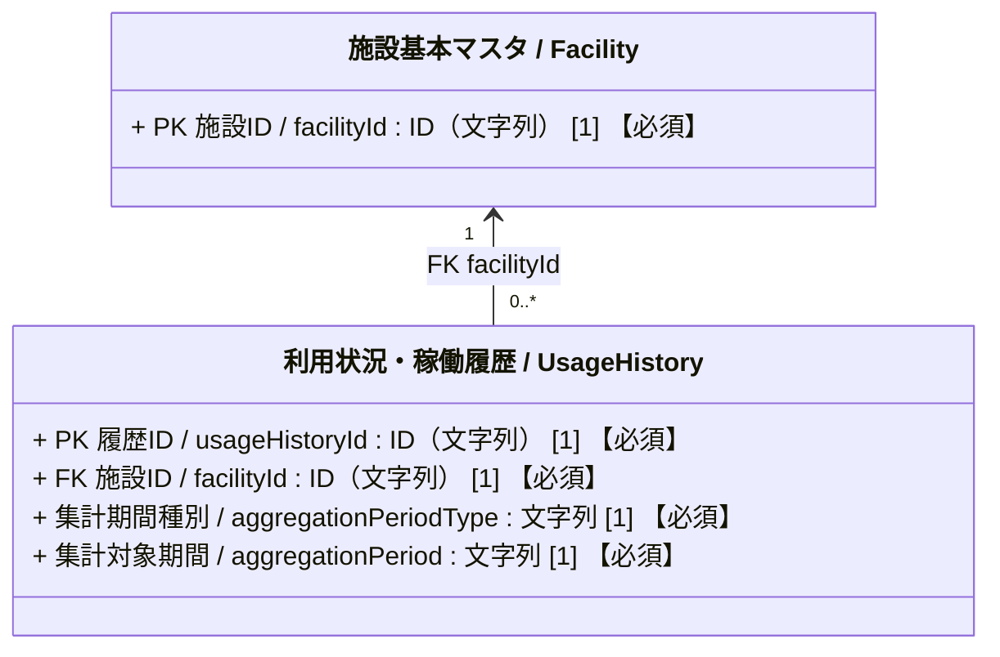
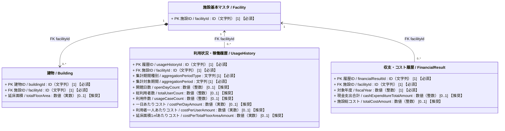

# 施設管理データモデル：利用状況・稼働履歴クラス図

作成日：2026-10-24  
更新日：2026-10-24  
バージョン：ver1.0
状態：検討用・データモデルCSV未反映

---

## 1. 目的と位置づけ

施設ごとの月次または年度の開館、利用者数、利用件数を記録する。日次・イベント別・建物別の利用記録はこの共通クラスの対象想定としていない。四半期・半期の値は、必要な月次記録が揃う場合に表示・分析時に集計する。費用に関する３つの指標は利用記録と財務記録等から求める導出値としている。

## 2. 利用状況・稼働履歴クラス図（Mermaid）
### 属性の多重度と収集区分の表記ルール

属性は `属性名 / 英語名 : 型 [多重度] 【収集区分】` と表記する。  
`[多重度]` はUML上の値の個数、`【収集区分】` は施設管理データモデルCSVの「必須」列に対応する本プロジェクト独自の表示であり、両者を明確に区別する。

| 収集区分 | 単一値属性の例 | 意味 |
| :--- | :--- | :--- |
| **必須** | `[1] 【必須】` | そのクラスのインスタンスが存在する場合、値を必ず保持する。 |
| **推奨** | `[0..1] 【推奨】` | 値がなくても成立するが、収集を推奨する。 |
| **任意** | `[0..1] 【任意】` | 値がなくても成立し、収集も任意とする（詳細拡張属性等）。 |

複数値属性は、必要な最小・最大件数に応じて `[0..*]` または `[1..*]` を用い、収集区分を併記する（例: `[0..*] 【推奨】`）。

### 2.1 簡易クラス図

### 2.2 詳細クラス図（属性および財務指標との関係）

`UsageHistory` と `FinancialResult` の間に直接の関連線を引かない。費用指標の算出時には、同じ施設・同じ対象年度の記録を照合する。`Building` は施設全体の対象延床面積の算定元を示すために再掲し、建物別の利用実績を表す関連線は引かない。

## 3. 整合条件と業務ルール

### 3.1 記録単位と集計対象期間

- １レコードは、１施設の１か月または１年度における利用・稼働実績の集計とする。日別元データ、イベント別実績、建物別実績は含めない。元データは施設ごとの運営・予約システム等で管理してもよく、本モデルへの登録に日次記録の存在は要求しない。
- `aggregationPeriodType` は「月次」「年度」の２値を想定している。`aggregationPeriod` の表記は月次 `YYYY-MM`、年度 `YYYY年度` を案とし、両者の組合せを検証する。年度の開始月は管理主体の共通設定で定義し、月次をどの年度に属させるか決める。
- 同じ施設・期間種別・対象期間のレコードを重複登録しない。月次と年度のレコードは併存できるが、同じ年度の年度値と月次値を無条件に加算しない。年度値を直接登録した場合はそれを年度の正本とするか、月次の再集計値を正本とするかを運用で定め、差があれば確認する。
- 四半期・半期は独立した履歴レコードを設けず、該当する３か月・６か月は別途算出する。月次が欠ける場合は「０」とみなさず、期間全体の集計値は未確定とする。年度値も月次から算出する場合は、対象年度の12か月の網羅性と重複を確認する。

### 3.2 利用・稼働実績

- `openDayCount` は集計期間中に実際に開館・運営した日数であり、予定開館日数ではない。期間内の日数を超えない非負整数とする。
- `totalUserCount` は延べ利用者数であり、実人数（重複を除いた人数）とは区別する。`usageCaseCount` は貸室等の件数・コマ数であり、人数とは区別する。両者の対象範囲と数え方は、施設種別によって追加定義が必要となる。

### 3.3 費用指標の導出と欠損値

- `costPerDayAmount` ＝ 同一施設・同一対象年度の `FinancialResult.cashExpenditureTotalAmount` ÷ `openDayCount`。
- `costPerUserAmount` ＝ 同一施設・同一対象年度の `FinancialResult.cashExpenditureTotalAmount` ÷ `totalUserCount`。
- `costPerTotalFloorAreaAmount` ＝ 同一施設・同一対象年度の `FinancialResult.totalCostAmount` ÷ その年度に対応する施設全体の対象延床面積。分母は同一施設に属する対象建物の `totalFloorArea` から重複なく集計する。面積の集計方法、年度中の増減や変更、対象面積がない施設の扱いは要確認。
- 財務記録は年度単位である。月次の `UsageHistory` に年間支出額をそのまま割り付けた結果を「月次の一日あたり・一人あたりコスト」として記録しない。
