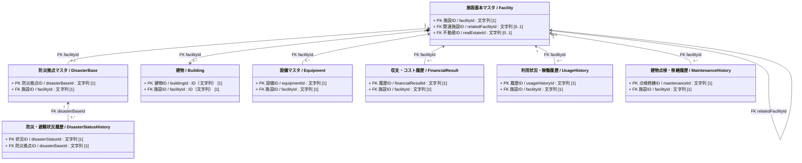

# 施設管理データモデル：全体関連図

作成日：2026-10-02  
更新日：2026-10-03  
バージョン：ver2.1  
状態：改定案（施設による建物の所有と複数棟対応）

## 対象と根拠

- 正本候補：`06_データモデルCSV/施設管理データモデルver4.csv` の7クラス相当・119項目。
- 作図規則：`00_ガイドライン/04_施設管理_クラス図作成ガイドライン.md`。
- この図にはPK、FKおよび主要な関係だけを示す。住所等の共通型、コードリスト、一般属性は個別図で検討する。建物は施設に所有される個別ID付きの管理対象として示す。
- Mermaid内部識別子と表示用英語クラス名は下書きの論理名である。正本CSVの「クラス英語名」にある物理テーブル名を改変したものではない。

## 全体関連図

`不動産ID / realEstateId` は外部IDであるため、現段階では参照先クラスを描いていない。`FK` 表記は正本CSVのKEY値を保持したもの。

## 全体関連図における設計方針と未反映事項

1. **論理クラス**: 施設管理CSVの7クラス相当に、施設が所有する建物クラスを追加した。建物の `buildingId` と `facilityId` はクラス図上の設計追加であり、正本CSVには未反映。
2. **多重度の確定**:
   - 施設 1 対 防災拠点 0..1。防災拠点は必ず1施設に属する。防災拠点側の `facilityId` には一意制約が必要。現行CSVの「1:N」という特記は要修正。
   - 施設 1 対 建物 0..*。現行の建物は必ず1施設に所有される。例外的に別施設で継続利用する場合は、旧施設の廃止前に付け替え、同じ `buildingId` を維持する。
   - 施設 1 対 設備 0..*（1施設に複数設備の配置を許容）
   - 施設 1 対 各種履歴 0..*（年度別・月別の時系列推移データを蓄積）
   - 関連施設は現行CSVの任意・単一FKとして暫定表示。複数の関連施設を扱う場合の中間クラス等は未設計。
3. **関係種別**: 施設と建物はコンポジションとする。施設の廃止時にその施設が所有する建物も廃止する。別施設で継続利用する建物は、旧施設の廃止前に所有先を移す。廃止済み建物の復活と旧施設との所属履歴の保存方法は別途設計する。その他の関係は関連（Association）とする。
