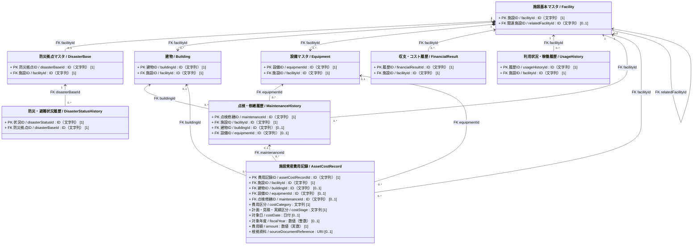

# 施設管理データモデル：全体関連図

作成日：2026-10-02  
更新日：2026-10-25  
バージョン：ver2.3  
状態：個別クラス図との整合を更新・データモデルCSV反映待ち

## 対象と根拠

- 正本候補：`06_データモデルCSV/施設管理データモデルver4.csv`。本図には個別クラス図で追加・変更した設計を含み、CSVとの整合は後続の改定で確認する。
- 作図規則：`00_ガイドライン/04_施設管理_クラス図作成ガイドライン.md`。
- この図にはPK、FKおよび主要な関係だけを示す。住所等の共通型、コードリスト、一般属性は個別図で検討する。建物と設備は施設に所有される個別ID付きの管理対象として示す。施設資産費用記録には、施設全体の年度別収支と区別するための主要属性も示す。
- 建物と設備の設置関係、設備の親子関係、設備単位／個体、および設備単位を対象とする点検・修繕履歴は、全体図では省略する。これらの構造と制約は `02_設備_クラス図.md` および `04_点検・修繕履歴_クラス図.md` を参照する。
- Mermaid内部識別子と表示用英語クラス名は下書きの論理名である。正本CSVの「クラス英語名」にある物理テーブル名を改変したものではない。

## 全体関連図

`FK` 表記は正本CSVのKEY値または個別クラス図で追加した参照関係を示す。

## 全体関連図における設計方針と未反映事項

1. **論理クラス**: 施設管理データモデルCSVを出発点とし、個別クラス図で設計した建物と `AssetCostRecord`（施設資産費用記録）を含む主要クラスを示す。CSVへの反映状況は後続の改定で確認する。
2. **多重度の確定**:
   - 施設 1 対 防災拠点 0..1。防災拠点は必ず1施設に属する。防災拠点側の `facilityId` には一意制約が必要。
   - 施設 1 対 建物 0..*。現行の建物は必ず1施設に所有される。例外的に別施設で継続利用する場合は、旧施設の廃止前に付け替え、同じ `buildingId` を維持する。
   - 施設 1 対 設備 0..*（1施設に複数設備の配置を許容）
   - 施設 1 対 各種履歴 0..*（年度別・月別の時系列推移データを蓄積）
   - 施設 1 対 施設資産費用記録 0..*。費用記録は必ず1施設に属し、建物・設備の一方、または施設全体（敷地・土地を含む）を帰属先とする。建物1棟・設備1件につき費用記録は0件以上とする。
   - 関連施設は現行CSVの任意・単一FKとして暫定表示。複数の関連施設を扱う場合の中間クラス等は未設計。
3. **関係種別**: 施設と建物および設備はコンポジションとする。施設の廃止時にその施設が所有する建物および設備も廃止する。別施設で継続利用する建物および設備は、旧施設の廃止前に所有先を移す。廃止済み建物の復活と旧施設との所属履歴の保存方法は別途設計する。その他の関係は関連（Association）とする。
4. **施設資産費用記録の制約**: `buildingId` と `equipmentId` は各々 `0..1` とし、同時には指定しない。両方未指定なら施設全体（敷地・土地を含む）への帰属を表す。指定した建物・設備は `facilityId` の施設に属するものとする。`costDate` と `fiscalYear` は少なくとも一方を指定し、両方ある場合は年度を一致させる。`maintenanceId` は点検・修繕に由来する費用の場合だけ指定する。費用区分と計画・見積・実績区分は `施設管理コード定義ver8.csv` を参照する。
5. **費用の集計境界**: `FinancialResult` は施設単位・年度単位の収支集計として維持し、`AssetCostRecord` は施設全体・建物・設備に帰属する個別費用明細として扱う。両者を無条件に加算しない。`MaintenanceHistory.maintenanceCostAmount` と費用記録の重複計上防止規則は後続の設計課題とする。複数対象への配賦と資産別の集計結果の保存も後続の設計課題とする。
