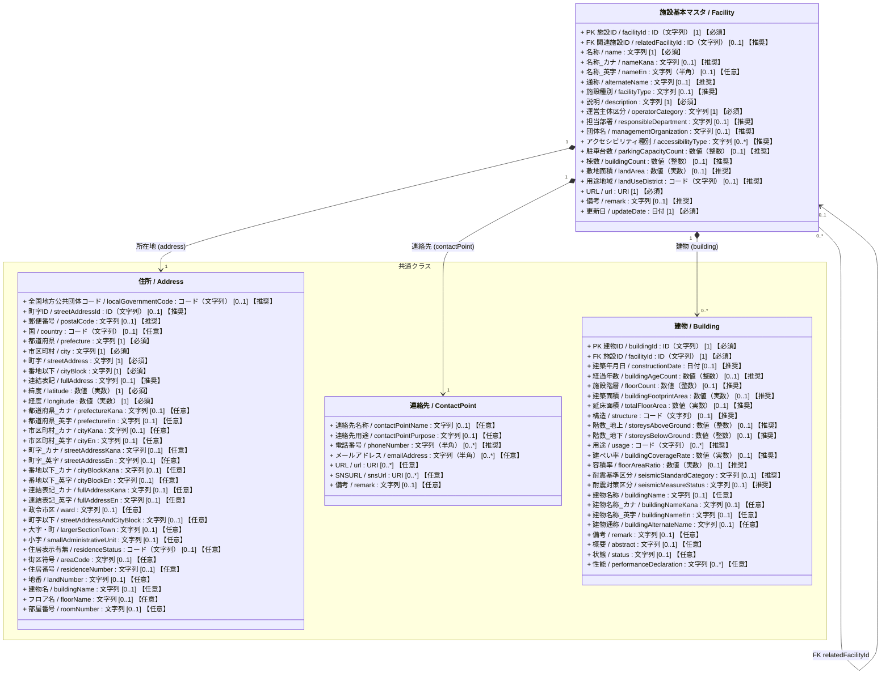

# 施設管理データモデル：施設基本クラス図（詳細）

作成日：2026-10-14  
更新日：2026-10-16  
バージョン：ver5.1
状態：改定案

---

## 1. 目的と位置づけ

本書は[施設基本クラス図の概要版](<./01_施設基本_クラス図.md>)を補足し、中心エンティティである **`施設基本マスタ (Facility)`** の属性、参照コードおよび設計根拠を示す。設計方針の補足は第5章にまとめる。  
※なお、設備（`Equipment` / `m_facility_equipments`）は、点検・修繕履歴や費用記録と深く連携する別マスタのため、後続の個別クラス図（`02_設備_クラス図.md` 等）にて詳細化する。

1. コアデータモデルとの連携
2. スマートシティ住所モデルとの整合
3. PLATEAU 3D都市モデル仕様との連携
4. 耐震基準と耐震対策状況の分離
5. アクセシビリティ・連絡先情報の整理
6. 多重度と収集区分の区別
7. 台帳履歴・組織管理

---

## 2. スタティック情報とダイナミック情報の概要

施設基本マスタおよび関連データを「スタティック情報（静的情報）」と「ダイナミック情報（動的情報）」に分類・整理する。
月1回から数年に1回程度の頻度で更新される運用・規程・契約等の情報（準動的情報）は、マスタとしての性質上「スタティック情報」に含めて管理する。

| 区分 | 主な内容 | 配置先 |
| :--- | :--- | :--- |
| スタティック情報 | 施設・建物の基本情報、所在地、管理体制、開館規定など | `Facility`、`Building` と共通クラス |
| ダイナミック情報 | 利用・稼働、収支、点検・修繕、防災・避難などの実績や状況 | 全体関連図で定義する各履歴クラス |

各属性と関係の詳細は第3・4章、静的・動的情報の詳しい一覧は第6章、元データモデルとの対応は巻末の第7章に示す。

---

## 3. 施設基本クラス図（属性付き・Mermaid）- ver5.1

### 属性の多重度と収集区分の表記

属性は `属性名 / 英語名 : 型 [多重度] 【収集区分】` と表記する。`[多重度]` はUML上の値の個数、`【収集区分】` は施設管理データモデルCSVの「必須」列に対応する本プロジェクト独自の表示であり、両者を混同しない。

| 収集区分 | 単一値属性の例 | 意味 |
| :--- | :--- | :--- |
| **必須** | `[1] 【必須】` | そのクラスのインスタンスが存在する場合、値を必ず保持する。 |
| **推奨** | `[0..1] 【推奨】` | 値がなくても成立するが、収集を推奨する。 |
| **任意** | `[0..1] 【任意】` | 値がなくても成立し、収集も任意とする（詳細拡張属性等）。 |

複数値属性は、必要な最小・最大件数に応じて `[0..*]` または `[1..*]` を用い、収集区分を別に併記する（例: `[0..*] 【推奨】`）。

### 3.1 簡易クラス図

### 3.2 詳細クラス図

```mermaid
classDiagram
    direction LR

    %% 施設基本マスタ（メインクラス）
    class Facility["施設基本マスタ / Facility"] {
        + PK 施設ID / facilityId : ID（文字列） [1] 【必須】
        + FK 関連施設ID / relatedFacilityId : ID（文字列） [0..1] 【推奨】
        %% + FK 不動産ID / realEstateId : ID（文字列） [0..1] 【推奨】
          %% "将来不動産ID"が利用可能になった際の対応
        + 名称 / name : 文字列 [1] 【必須】
        + 名称_カナ / nameKana : 文字列 [0..1] 【推奨】
        + 名称_英字 / nameEn : 文字列（半角） [0..1] 【任意】
        + 通称 / alternateName : 文字列 [0..1] 【推奨】
        + 施設種別 / facilityType : 文字列 [0..1] 【推奨】
          %% "公共施設分類"の種別から選択を想定
        + 説明 / description : 文字列 [1] 【必須】
        + 運営主体区分 / operatorCategory : 文字列 [1] 【必須】
        + 担当部署 / responsibleDepartment : 文字列 [0..1] 【推奨】
          %% "関連組織情報型"で用いることも可能
        + 団体名 / managementOrganization : 文字列 [0..1] 【推奨】
          %% "関連組織情報型"で用いることも可能
        + アクセシビリティ種別 / accessibilityType : 文字列 [0..*] 【推奨】
        + 駐車台数 / parkingCapacityCount : 数値（整数） [0..1] 【推奨】
          %% 単位:台
        + 棟数 / buildingCount : 数値（整数） [0..1] 【推奨】
          %% 単位:棟
        + 敷地面積 / landArea : 数値（実数） [0..1] 【推奨】
          %% 単位:㎡
          %% 敷地として"土地型"で用いることも可能
        + 用途地域 / landUseDistrict : コード（文字列） [0..1] 【推奨】
        + URL / url : URI [1] 【必須】
          %% 施設のWebページURLなど
        + 備考 / remark : 文字列 [0..1] 【推奨】
        + 更新日 / updateDate : 日付 [1] 【必須】
    }

    namespace 共通クラス {
        %% class Multilingual["多言語表記型 / MultilingualString"] {
        %%    <<DataType>>
        %%    + 日本語 / ja : 文字列 [1] 【必須】
        %%    + カナ / kana : 文字列 [0..1] 【推奨】
        %%    + 英字 / en : 文字列（半角） [0..1] 【推奨】
        %% }

        class Address["住所 / Address"] {
            %% 外部管理コード・ID類
            + 全国地方公共団体コード / localGovernmentCode : コード（文字列） [0..1] 【推奨】
            + 町字ID / streetAddressId : ID（文字列） [0..1] 【推奨】
            + 郵便番号 / postalCode : 文字列 [0..1] 【推奨】
            + 国 / country : コード（文字列） [0..1] 【任意】
            %% 基本住所
            + 都道府県 / prefecture : 文字列 [1] 【必須】
              %% 都道府県コードは全国地方公共団体コードに含める。都道府県コードでの取得可能。
              %% バリデーションはシステム保持もしくはWeb取得した全国地方公共団体コードで対応想定。
            + 市区町村 / city : 文字列 [1] 【必須】
              %% 市区町村コードは全国地方公共団体コードに含める。
              %% バリデーションはシステム保持もしくはWeb取得した全国地方公共団体コードで対応想定。
            + 町字 / streetAddress : 文字列 [1] 【必須】
            + 番地以下 / cityBlock : 文字列 [1] 【必須】
            + 連結表記 / fullAddress : 文字列 [0..1] 【推奨】
            %% 地理空間座標属性
            + 緯度 / latitude : 数値（実数） [1] 【必須】
            + 経度 / longitude : 数値（実数） [1] 【必須】
            %% 多言語構造化属性
            + 都道府県_カナ / prefectureKana : 文字列 [0..1] 【任意】
            + 都道府県_英字 / prefectureEn : 文字列 [0..1] 【任意】
            + 市区町村_カナ / cityKana : 文字列 [0..1] 【任意】
            + 市区町村_英字 / cityEn : 文字列 [0..1] 【任意】
            + 町字_カナ / streetAddressKana : 文字列 [0..1] 【任意】
            + 町字_英字 / streetAddressEn : 文字列 [0..1] 【任意】
            + 番地以下_カナ / cityBlockKana : 文字列 [0..1] 【任意】
            + 番地以下_英字 / cityBlockEn : 文字列 [0..1] 【任意】
            + 連結表記_カナ / fullAddressKana : 文字列 [0..1] 【任意】
            + 連結表記_英字 / fullAddressEn : 文字列 [0..1] 【任意】
            %% 非多言語構造化属性・詳細地番等
            + 政令市区 / ward : 文字列 [0..1] 【任意】
            + 町字以下 / streetAddressAndCityBlock : 文字列 [0..1] 【任意】
              %% "町字"と"番地以下"で作成可能。
            + 大字・町 / largerSectionTown : 文字列 [0..1] 【任意】
            + 小字 / smallAdministrativeUnit : 文字列 [0..1] 【任意】
            + 住居表示有無 / residenceStatus : コード（文字列） [0..1] 【任意】
            + 街区符号 / areaCode : 文字列 [0..1] 【任意】
            + 住居番号 / residenceNumber : 文字列 [0..1] 【任意】
            + 地番 / landNumber : 文字列 [0..1] 【任意】
            + 建物名 / buildingName : 文字列 [0..1] 【任意】
            + フロア名 / floorName : 文字列 [0..1] 【任意】
            + 部屋番号 / roomNumber : 文字列 [0..1] 【任意】
        }

        class ContactPoint["連絡先 / ContactPoint"] {
            + 連絡先名称 / contactPointName : 文字列 [0..1] 【任意】
            + 連絡先用途 / contactPointPurpose : 文字列 [0..1] 【任意】
            + 電話番号 / phoneNumber : 文字列（半角） [0..*] 【推奨】
            + メールアドレス / emailAddress : 文字列（半角） [0..*] 【任意】
            + URL / url : URI [0..*] 【任意】
            + SNSURL / snsUrl : URI [0..*] 【任意】
            + 備考 / remark : 文字列 [0..1] 【任意】
        }

        class RelatedOrganization["関連組織情報型 / RelatedOrganization"] {
            + 役割 / role : 文字列 [1] 【必須】
            + 名称 / name : 文字列 [1] 【必須】
            + 法人番号 / legalEntityNumber : ID（文字列） [0..1] 【推奨】
            + 地方公共団体コード / localGovernmentCode : コード（文字列） [0..1] 【推奨】
            + 管理期間_開始日 / startDate : 日付 [0..1] 【推奨】
            + 管理期間_終了日 / endDate : 日付 [0..1] 【推奨】
            + 運営主体区分 / operatorCategory : 文字列 [0..1] 【任意】
        }

        class Schedule["利用可能スケジュール / Schedule"] {
            + 利用可能曜日 / availableDay : 文字列 [0..*] 【推奨】
            + 開始時刻 / startTime : 時刻 [0..1] 【推奨】
            + 終了時刻 / endTime : 時刻 [0..1] 【推奨】
            + 利用可能日時説明 / availableDateTimeDescription : 文字列 [0..1] 【推奨】
            + 休館日 / closedDay : 文字列 [0..1] 【推奨】
            + 管理期間_開始日 / startDate : 日付 [0..1] 【推奨】
            + 管理期間_終了日 / endDate : 日付 [0..1] 【推奨】
        }

        class Building["建物 / Building"] {
            + PK 建物ID / buildingId : ID（文字列） [1] 【必須】
            + FK 施設ID / facilityId : ID（文字列） [1] 【必須】
            + 建築年月日 / constructionDate : 日付 [0..1] 【推奨】
              %% 着工日と竣工日を用いることも可能。
            + 経過年数 / buildingAgeCount : 数値（整数） [0..1] 【推奨】
              %% 単位:年
            + 施設階層 / floorCount : 数値（整数） [0..1] 【推奨】
              %% 単位:階
            + 建築面積 / buildingFootprintArea : 数値（実数） [0..1] 【推奨】
              %% 単位:㎡
            + 延床面積 / totalFloorArea : 数値（実数） [0..1] 【推奨】
              %% 単位:㎡
            + 構造 / structure : コード（文字列） [0..1] 【推奨】
            + 階数_地上 / storeysAboveGround : 数値（整数） [0..1] 【推奨】
              %% 単位:階
            + 階数_地下 / storeysBelowGround : 数値（整数） [0..1] 【推奨】
              %% 単位:階
            + 用途 / usage : コード（文字列） [0..*] 【推奨】
            + 建ぺい率 / buildingCoverageRate : 数値（実数） [0..1] 【推奨】
              %% 単位:％
            + 容積率 / floorAreaRatio : 数値（実数） [0..1] 【推奨】
              %% 単位:％
            + 耐震基準区分 / seismicStandardCategory : 文字列 [0..1] 【推奨】
            + 耐震対策区分 / seismicMeasureStatus : 文字列 [0..1] 【推奨】
            %% 建物名称　※施設名称と別に建物名称がある場合に利用
            + 建物名称 / buildingName : 文字列 [0..1] 【任意】
            + 建物名称_カナ / buildingNameKana : 文字列 [0..1] 【任意】
            + 建物名称_英字 / buildingNameEn : 文字列 [0..1] 【任意】
            + 建物通称 / buildingAlternateName : 文字列 [0..1] 【任意】
            %% 任意項目の建物クラス
            + 備考 / remark : 文字列 [0..1] 【任意】
            + 概要 / abstract : 文字列 [0..1] 【任意】
            + 状態 / status : 文字列 [0..1] 【任意】
            + 性能 / performanceDeclaration : 文字列 [0..*] 【任意】
              %% 耐震性能を除く、防火性能などの情報を記載
        }

        class Image["画像 / Image"] {
            + 画像 / image : URI [0..1] 【推奨】
            + 画像ライセンス / imageLicense : 文字列 [0..1] 【推奨】
            %% 任意項目の画像クラス
            + タイトル / title : 文字列 [0..1] 【任意】
            + キーワード / keywords : 文字列 [0..1] 【任意】
            + 公開日 / publicationDate : 日付 [0..1] 【任意】
            + 提供者 / provider : 文字列 [0..1] 【任意】
            + 作成者 / creator : 文字列 [0..1] 【任意】
        }
    }

    namespace コード定義 {
        class OperatorCategory["管理運営方式 / OperatorCategory"] {
            <<ControlledVocabulary>>
            %% コードリストID:01a0cf0e-d167-71ab-8bfb-98f483544ace (直営, 指定管理, 包括委託等)
        }

        class AccessibilityType["アクセシビリティ種別 / AccessibilityType"] {
            <<ControlledVocabulary>>
            %% コードリストID:01a0cf0e-d167-7352-94fb-407ae1b115ef
        }

        class PublicFacilityCategory["公共施設分類 / PublicFacilityCategory"] {
            <<ControlledVocabulary>>
            %% コードリストID:01a0cf0e-d167-7b61-a3ba-35025debf958
        }

        class BuildingStructureType["建物構造区分コード / BuildingStructureType"] {
            <<Enumeration>>
            %% コードリストID:01a0cf0e-d167-7baf-a1ee-3ec2b732cc61 (木造, RC, SRC, S等)
        }

        class BuildingUsage["建物用途分類 / BuildingUsage"] {
            <<Enumeration>>
            %% コードリストID:01a0cf0e-d167-7717-80a5-65c1ab78179c (PLATEAU 19区分)
        }

        class LandUseDistrict["地域地区および用途地域区分コード / LandUseDistrict"] {
            <<Enumeration>>
            %% コードリストID:01a0cf0e-d167-70bd-9ed5-c257d32a3fbe (都市計画法 13用途地域 / PLATEAU)
        }

        class SeismicStandardCategory["耐震基準区分 / SeismicStandardCategory"] {
            <<ControlledVocabulary>>
            %% コードリストID:01a0cf0e-d167-703a-b7ca-888c84835cbe (新耐震・旧耐震)
        }

        class SeismicMeasureStatus["耐震対策実施状態 / SeismicMeasureStatus"] {
            <<ControlledVocabulary>>
            %% コードリストID:01a0cf0e-d167-7f8a-b525-a2577f62cfa9 (実施・一部実施・未実施等)
        }

        class DayOfWeek["曜日コード / DayOfWeek"] {
            <<Enumeration>>
            %% コードリストID:01a0cf0e-d167-7eec-a7fa-c3772c1c80ec (月〜日, 祝日等)
        }
    }

    %% リレーション（施設が共通型と建物を所有）
    %% Facility "1" *--> "1" Multilingual : 名称 (facilityName)
    Facility "1" *--> "1" Address : 所在地 (address)
    Facility "1" *--> "1" ContactPoint : 連絡先 (contactPoint)
    Facility "1" *--> "0..*" RelatedOrganization : 運営・所管組織履歴 (relatedOrganization)
    Facility "1" *--> "0..*" Schedule : 利用可能スケジュール (schedule)
    Facility "1" *--> "0..*" Building : 建物 (building)
    Facility "1" *--> "0..1" Image : 画像 (image)
    Facility "0..*" --> "0..1" Facility : FK relatedFacilityId

    %% コードリスト参照（関連）
    Facility "0..*" --> "1" OperatorCategory : 現行/運営主体区分
    Facility "0..*" --> "0..*" AccessibilityType : アクセシビリティ
    Facility "0..*" --> "0..1" PublicFacilityCategory : 公共施設分類
    RelatedOrganization "0..*" --> "0..1" OperatorCategory : 歴代/運営主体区分
    Schedule "0..*" --> "0..*" DayOfWeek : 利用可能曜日
    Building "0..*" --> "0..1" BuildingStructureType : 構造区分
    Building "0..*" --> "0..*" BuildingUsage : 用途区分
    Facility "0..*" --> "0..1" LandUseDistrict : 用途地域
    Building "0..*" --> "0..1" SeismicStandardCategory : 耐震基準
    Building "0..*" --> "0..1" SeismicMeasureStatus : 耐震対策状況
```

---

## 4. クラスおよびリレーションの設計詳細

### 4.1 メインエンティティ（`Facility`）
- 施設の最上位の識別、種別、および現行の運営主体を管理。
- 元Excel（`m_facilities`）およびデータモデルver4との下位互換性・直接照合性を担保するため、現行の代表属性（`担当部署`、`団体名`、`運営主体区分`）を属性として保持しつつ、過去ログ・詳細履歴はコンポーネント側へ展開する。
- 施設名称については多言語共通型を分離せず、`name`（名称 【必須】）、`nameKana`（名称_カナ 【推奨】）、`nameEn`（名称_英字 【任意】）、`alternateName`（通称 【推奨】）を直接属性としてフラットに保持する。
- 総務省公共施設分類に準拠した種別として、`facilityType`（施設種別 【推奨】）を保持し、コードリスト `FacilityCategory` を参照する。
- 不動産ID（`realEstateId`）は将来運用を見据えた予約属性とし、現行モデルでは一時コメントアウトとする。
- 施設が提供するバリアフリー対応状況を集約するため、多重度 `[0..*]` の `accessibilityType`（アクセシビリティ種別 【推奨】）を保持する。
- 敷地面積（`landArea` 【推奨】）と用途地域（`landUseDistrict` 【推奨】）は施設の敷地に関する情報として保持する。

### 4.2 コアデータモデル共通クラス（Components）
1. **`MultilingualString` (多言語文字列型)**:
   - 日本語正式名（`ja`）、カナ読み（`kana`）、半角英字表記（`en`）、通称・愛称（`alias`）を集約する型。
   - 本モデルでは実務上の取り扱い単純化（ネスト排除）のため、`Facility` の直接属性（`name`, `nameKana`, `nameEn`, `alternateName`）へ展開・集約し、共通クラス定義およびリレーションはコメントアウト（退避）としている。
2. **`Address` (住所型)**:
   - スマートシティ共通住所モデル（`0305_住所_クラス図.md`）およびデジタル庁「GIF」を参照。
   - `localGovernmentCode`（全国地方公共団体コード 【推奨】）、`streetAddressId`（町字ID 【推奨】）を保持し、公的レジストリとの100%連携を担保。
   - 基本住所属性（`prefecture`, `city`, `streetAddress`, `cityBlock` 【必須】）に加えて、カナ・英字多言語構造化属性、ならびに大字・小字・地番・建物名・フロア名・部屋番号等の詳細構造化属性（【任意】）を統合保持。
   - 代表点座標（`latitude`, `longitude` 【必須】）を住所属性として内包。
3. **`Building` (建物)**:
   - スマートシティ参考モデル（`0402_建物_クラス図.md`）およびPLATEAU 3D都市モデル標準に準拠した物理的建築物スペックを集約。
   - 建築面積（`buildingFootprintArea` 【推奨】）、主要構造（`structure` 【推奨】）、階数（`storeysAboveGround` / `storeysBelowGround` 【推奨】）、用途分類（`usage` 【推奨】）、建ぺい率（`buildingCoverageRate` 【推奨】）、容積率（`floorAreaRatio` 【推奨】）を管理。
   - 耐震性については、昭和56年基準による「耐震基準区分（`seismicStandardCategory` 【推奨】）」と、耐震改修・補強の状況を示す「耐震対策区分（`seismicMeasureStatus` 【推奨】）」の2属性で厳密に管理。
   - 一意の建物ID（`buildingId` 【必須】）を持ち、現在の施設ID（`facilityId` 【必須】）を必須のFKとして持つ。1施設に0棟以上を許容し、コンポジション関係を保持。
4. **`RelatedOrganization` (関連組織情報型)**:
   - スマートシティ参考モデル（`0403_施設_クラス図.md`）および基底クラス `Thing` の Role パターンに準拠。
   - 歴代の指定管理者、所管課、委託先、所有者などの組織情報を多重度 `0..*` で保持。
   - 法人番号、地方公共団体コード、および適用期間（`startDate`, `endDate`）を持つことで、契約管理・台帳履歴との完全なトレーサビリティを確立。
5. **`Schedule` (利用可能スケジュール型)**:
   - 開館曜日（`availableDay` [0..*] 【推奨】）、開館開始/終了時刻（`startTime` / `endTime`: 時刻型 【推奨】）、開館時間説明（`availableDateTimeDescription` 【推奨】）、休館日、および契約・運用期間（`startDate`, `endDate` 【推奨】）を集約。
6. **`ContactPoint` (連絡先型)**:
   - 代表電話番号（`phoneNumber` 【推奨】）および公式WebサイトURL（`url` 【必須】）に加え、問い合わせ用メールアドレス（`emailAddress` 【任意】）や公式SNS（`snsUrl` 【任意】）を拡張保持。
7. **`Image` (画像型)**:
   - 施設外観の画像URL（`image` 【推奨】）と、CCライセンス等の著作権情報（`imageLicense` 【推奨】）をペアで管理。

### 4.3 参照コードリスト・統制語彙（Enumeration）
- **`OperatorCategory` (管理運営方式)**: 地方自治法第244条の2に基づく直営・指定管理等の区分（ID: `01a0cf0e-d167-71ab-8bfb-98f483544ace`）。
- **`AccessibilityType` (アクセシビリティ種別)**: 障害者・高齢者配慮設備等の種別コード（ID: `01a0cf0e-d167-7352-94fb-407ae1b115ef`）。
- **`FacilityCategory` (施設分類)**: 総務省更新費用推計ソフト分類に基づく公共施設分類（ID: `01a0cf0e-d167-7b61-a3ba-35025debf958`）。
- **`BuildingStructureType` (建物構造区分コード)**: 国交省PLATEAU仕様に基づく木造・RC・SRC・S等の標準コード（ID: `01a0cf0e-d167-7baf-a1ee-3ec2b732cc61`）。
- **`BuildingUsage` (建物用途分類)**: 国交省PLATEAU仕様に基づく建物用途19区分（ID: `01a0cf0e-d167-7717-80a5-65c1ab78179c`）。
- **`LandUseDistrict` (地域地区および用途地域区分コード)**: 都市計画法第8条およびPLATEAU仕様に基づく用途地域（ID: `01a0cf0e-d167-70bd-9ed5-c257d32a3fbe`）。
- **`SeismicStandardCategory` (耐震基準区分)**: 新耐震基準（1981年6月以降）適合区分（ID: `01a0cf0e-d167-703a-b7ca-888c84835cbe`）。
- **`SeismicMeasureStatus` (耐震対策実施状態)**: 消防庁防災拠点調査等に基づく耐震化実施状態（ID: `01a0cf0e-d167-7f8a-b525-a2577f62cfa9`）。
- **`DayOfWeek` (曜日コード)**: ISO 8601準拠の曜日コード（ID: `01a0cf0e-d167-7eec-a7fa-c3772c1c80ec`）。

---

## 5. 設計方針の詳細解説（補足）

「[1. 目的と位置づけ](#1-目的と位置づけ)」に掲げた7つの設計方針について、背景・具体的な該当属性・技術的判断の詳細を以下にまとめる。

### 5.1 コアデータモデル・共通型との連携
- **設計背景**: 施設管理に関わる多様な情報のうち、住所、スケジュール、連絡先、画像などの共通的なデータ構造を個別の型として分離・再利用可能に集約する。
- **詳細内容**:
  - 多言語表記（名称、名称_カナ、名称_英字）は、実務上の利用性や検索・平坦化の観点から `Facility` クラスの直接属性としてフラットに保持。
  - 建物情報は1施設に複数棟が存在する実態に対応するため、個別ID（`buildingId`）を付与した `Building` クラスとして分離し、施設が所有（コンポジション）する構成とする。

### 5.2 スマートシティ標準・アドレス連携
- **設計背景**: デジタル庁のGIFや、スマートシティ共通住所モデル（`0305_住所_クラス図.md`）との高い親和性を確保する。
- **詳細内容**:
  - 全国地方公共団体コード（`localGovernmentCode`）、町字ID（`streetAddressId`）、町字（`streetAddress`）、番地以下（`cityBlock`）を整備。
  - さらに、大字・小字・地番・建物名等の非多言語構造化属性や多言語（カナ・英字）属性を統合保持し、公的台帳連携から外国人向け多言語案内まで対応。

### 5.3 PLATEAU 3D都市モデル仕様との整合
- **設計背景**: 国土交通省が進める「Project PLATEAU」の3D都市モデル（建築物モデル `bldg` 等）とのデータ連携・相互運用を可能にする。
- **詳細内容**:
  - 敷地面積（`landArea`）、建築面積（`buildingFootprintArea`）、主要構造（`structure`）、階数（地上 `storeysAboveGround` / 地下 `storeysBelowGround`）、用途分類（`usage`）、建ぺい率（`buildingCoverageRate`）、容積率（`floorAreaRatio`）を標準属性化。

### 5.4 耐震管理の2系統分離
- **設計背景**: 建築基準法上の耐震性能基準と、自治体の実務における点検・耐震改修工事の実施状況が混同されやすい課題を解決する。
- **詳細内容**:
  - 昭和56年6月1日以降の新耐震かそれ以前の旧耐震かを識別する「耐震基準区分（`seismicStandardCategory`）」と、耐震診断や耐震補強工事の進捗を示す「耐震対策区分（`seismicMeasureStatus`）」の2属性に明示的に分離。

### 5.5 アクセシビリティ・連絡先情報の拡充
- **設計背景**: 市民・利用者の利便性向上やオープンデータ公開を見据え、バリアフリー情報および多様な問い合わせチャネルを整備する。
- **詳細内容**:
  - 施設が提供するバリアフリー・アクセシビリティ設備等の種別（`accessibilityType`）をコード配列として保持。
  - 連絡先（`ContactPoint`）には、従来の代表電話・公式Webに加え、メールアドレス（`emailAddress`）や公式SNS（`snsUrl`）を拡充。

### 5.6 データ収集区分の明示
- **設計背景**: データ整備の実務において、全自治体で最初から全属性を網羅することは困難であるため、収集優先度を明示する。
- **詳細内容**:
  - 施設管理データモデルver4の必須・推奨定義に対応した収集区分（【必須】【推奨】【任意】）を導入。
  - UML上のデータ構造定義（`[1]`, `[0..1]`, `[0..*]` 等の多重度）と実務上の収集要件（収集区分）を二重表記で明瞭に区別。

### 5.7 台帳履歴・組織管理のトレーサビリティ確保
- **設計背景**: 指定管理者制度の更新や所管課の統廃合に伴う契約・管理主体の変遷、および開館時間・休館日の改定履歴を追跡可能にする。
- **詳細内容**:
  - `RelatedOrganization`（運営・所管組織履歴）および `Schedule`（開館・契約期間履歴）において、期間属性（`startDate`, `endDate`）を持つRoleパターンを適用し、時系列での契約・台帳履歴のトレーサビリティを確立。

---

## 6. スタティック情報とダイナミック情報の詳細一覧

施設基本マスタ（データモデルver4の53項目）および関連・拡張データを分類する。月1回から数年に1回程度の頻度で更新される運用・規程・契約等の情報（準動的情報）は、マスタとしての性質上「スタティック情報」に含める。

| 区分 | 概念・更新サイクル | 該当属性・情報要素 | コアクラス / コンポーネント |
| :--- | :--- | :--- | :--- |
| **① スタティック情報 （静的情報）** | **固定スペックおよび運用・規程・台帳履歴情報** 更新頻度：1か月〜数年、または十年単位。建物の新築・改修や廃止がない限り不変の物理属性に加え、条例改正・指定管理更新・年度更新等で改定される情報を含む。 | **識別子**：施設ID (`facilityId`)、建物ID (`buildingId`)、関連施設ID (`relatedFacilityId`)、不動産ID (`realEstateId`、将来用) **名称・多言語**：名称 (`name`)、カナ (`nameKana`)、英字 (`nameEn`)、通称 (`alternateName`)、説明 (`description`)、施設種別 (`facilityType`) **所在地・空間座標**：自治体コード、町字ID、郵便番号、都道府県、市区町村、町字、番地以下、連結表記、住所カナ・英字表記、大字・小字、住居表示有無、街区符号、住居番号、地番、建物名、フロア名、部屋番号、緯度、経度 **敷地・建物**：敷地面積 (`landArea`)、用途地域 (`landUseDistrict`)、建築年月日、経過年数、施設階層、建築面積、延床面積、構造、地上・地下階数、棟数、用途、建ぺい率、容積率、耐震基準区分、耐震対策区分 **メディア・連絡先**：画像、画像ライセンス、URL、電話番号、メールアドレス、SNS **運営・所管組織履歴**：運営主体区分、担当部署、団体名、法人番号、自治体コード、管理期間 **利用規程・スケジュール履歴**：利用可能曜日、開館開始・終了時刻、開館時間説明、休館日 **運用キャパシティ・メタデータ**：駐車台数、アクセシビリティ種別、備考、更新日 | `Facility`、`Building`、`Address`、`RelatedOrganization`、`Schedule`、`ContactPoint`、`Image` |
| **② ダイナミック情報 （動的情報）** | **時系列・リアルタイムデータ** 更新頻度：常時・随時・月次・年次。全体関連図で履歴として分離する。 | **利用・稼働実績**：延べ利用者数、開館日数、利用コマ数 **財務・収支実績**：年間総収入、光熱水費、人件費、施設総コスト **保全・点検実績**：点検結果、劣化度、修繕工事実績 **防災・避難実績**：避難者数、開設ステータス | `UsageHistory`、`FinancialResult`、`MaintenanceHistory`、`DisasterStatusHistory` |

---

## 7. 元Excel（原本）およびデータモデルver4との整合性マッピング

以下は現行の`施設管理データモデルver4.csv`（施設基本マスタ53項目）とクラス図ver5.1の対応を確認するための表である。クラス図で変更した名称・配置先・収集区分などは、クラス図の検討後にCSVへ反映する予定であり、現段階で完全一致を意味するものではない。

### 7.1 データモデルver4（53項目）との対応表

| 内部管理ID | 日本語名（ver4） | プロパティ英語名 | 収集区分 | クラス図での配置先クラス | 整合性・設計意図 |
| :--- | :--- | :--- | :---: | :--- | :--- |
| PROP_FAC_001 | ID | `facilityId` | **必須** | `Facility` (PK) | 施設一意の主キー |
| PROP_FAC_002 | 関連施設ID | `relatedFacilityId` | **推奨** | `Facility` (FK) | 敷地内・関連施設への自己参照FK [0..1] |
| PROP_FAC_003 | 不動産ID | `realEstateId` | **推奨** | `Facility` (FK) | 国土交通省不動産ID連携キー [0..1]（※実証段階のためクラス図上は将来用として一時コメントアウト） |
| PROP_FAC_004 | 名称 | `name` | **必須** | `Facility.name` | 施設正式名称（直接属性として保持） |
| PROP_FAC_005 | 名称_カナ | `nameKana` | **推奨** | `Facility.nameKana` | カナ読み上げ・検索用インデックス（直接属性として保持） |
| PROP_FAC_006 | 名称_通称 | `alternateName` | **推奨** | `Facility.alternateName` | 通称・愛称（ネーミングライツ等、直接属性として保持） |
| PROP_FAC_007 | 全国地方公共団体コード | `localGovernmentCode` | **推奨** | `Address.localGovernmentCode` | 自治体識別コード（6桁） |
| PROP_FAC_008 | 町字ID | `streetAddressId` | **推奨** | `Address.streetAddressId` | アドレス・ベース・レジストリ町字ID |
| PROP_FAC_009 | 所在地_都道府県 | `prefecture` | **必須** | `Address.prefecture` | 都道府県コード / 名称 |
| PROP_FAC_010 | 所在地_市区町村 | `city` | **必須** | `Address.city` | 市区町村名 |
| PROP_FAC_011 | 所在地_町字 | `streetAddress` | **必須** | `Address.streetAddress` | 町字名（大字・町丁目） |
| PROP_FAC_012 | 所在地_番地以下 | `cityBlock` | **必須** | `Address.cityBlock` | 街区符号・地番・住居番号 |
| PROP_FAC_013 | 所在地_連結表記 | `fullAddress` | **推奨** | `Address.fullAddress` | 表示・印刷用フルアドレス |
| PROP_FAC_014 | 郵便番号 | `postalCode` | **推奨** | `Address.postalCode` | 7桁郵便番号（ハイフンあり） |
| PROP_FAC_015 | 電話番号 | `phoneNumber` | **推奨** | `ContactPoint.phoneNumber` | 代表連絡先電話番号 |
| PROP_FAC_016 | 緯度 | `latitude` | **必須** | `Address.latitude` | 世界測地系（実数） |
| PROP_FAC_017 | 経度 | `longitude` | **必須** | `Address.longitude` | 世界測地系（実数） |
| PROP_FAC_018 | 名称_英字 | `nameEn` | **任意** | `Facility.nameEn` | 半角英字表記（直接属性として保持。クラス図では実務配慮により【任意】設定） |
| PROP_FAC_019 | 説明 | `description` | **必須** | `Facility.description` | 施設目的・案内文 |
| PROP_FAC_020 | 施設種別 | `facilityType` | **推奨** | `Facility.facilityType` | 総務省更新費用推計ソフト施設分類（旧項目名: 種別情報 / typeInformation） |
| PROP_FAC_021 | 運営主体区分 | `operatorCategory` | **必須** | `Facility` / `RelatedOrganization` | 現行値は `Facility` で必須。`RelatedOrganization` では役割に応じて任意に保持 |
| PROP_FAC_022 | 担当部署 | `responsibleDepartment` | **推奨** | `Facility` / `RelatedOrganization` | 現行の所管部署、および組織履歴（role="所管課"） |
| PROP_FAC_023 | 団体名 | `managementOrganization` | **推奨** | `Facility` / `RelatedOrganization` | 現行の指定管理者、および組織履歴（role="指定管理者"） |
| PROP_FAC_024 | 管理期間_開始日 | `startDate` | **推奨** | `Schedule` / `RelatedOrganization` | 指定管理・運営契約の開始日 |
| PROP_FAC_025 | 管理期間_終了日 | `endDate` | **推奨** | `Schedule` / `RelatedOrganization` | 指定管理・運営契約の終了日 |
| PROP_FAC_026 | 通常利用可能曜日 | `availableDay` | **推奨** | `Schedule.availableDay` | 利用可能曜日 [0..*] |
| PROP_FAC_027 | 通常開館開始時刻 | `startTime` | **推奨** | `Schedule.startTime` | 開館時刻（ISO 8601 TIME） |
| PROP_FAC_028 | 通常開館終了時刻 | `endTime` | **推奨** | `Schedule.endTime` | 閉館時刻（ISO 8601 TIME） |
| PROP_FAC_029 | 開館時間説明 | `availableDateTimeDescription` | **推奨** | `Schedule.availableDateTimeDescription` | 時間変動・特別開館時間等の注記 |
| PROP_FAC_030 | 休館日 | `closedDay` | **推奨** | `Schedule.closedDay` | 定期休館日・年末年始情報 |
| PROP_FAC_031 | 建築年月日 | `constructionDate` | **推奨** | `Building.constructionDate` | 着工・竣工日 |
| PROP_FAC_032 | 経過年数 | `buildingAgeCount` | **推奨** | `Building.buildingAgeCount` | 築年数（導出属性） |
| PROP_FAC_033 | 施設階層 | `floorCount` | **推奨** | `Building.floorCount` | 総階数 |
| PROP_FAC_034 | 敷地面積 | `landArea` | **推奨** | `Facility.landArea` | 施設の敷地面積（㎡） |
| PROP_FAC_035 | 用途地域 | `landUseDistrict` | **推奨** | `Facility.landUseDistrict` | 施設の敷地に適用される用途地域コード |
| PROP_FAC_036 | 用途 | `usage` | **推奨** | `Building.usage` | PLATEAU 建物利用現況用途分類コード |
| PROP_FAC_037 | 建ぺい率 | `buildingCoverageRate` | **推奨** | `Building.buildingCoverageRate` | 建ぺい率（％） |
| PROP_FAC_038 | 容積率 | `floorAreaRatio` | **推奨** | `Building.floorAreaRatio` | 容積率（％） |
| PROP_FAC_039 | 建築面積 | `buildingFootprintArea` | **推奨** | `Building.buildingFootprintArea` | 建築面積（水平投影面積, ㎡） |
| PROP_FAC_040 | 延床面積 | `totalFloorArea` | **推奨** | `Building.totalFloorArea` | 延床面積（㎡） |
| PROP_FAC_041 | 構造 | `structure` | **推奨** | `Building.structure` | 建築構造区分コード |
| PROP_FAC_042 | 階数_地上 | `storeysAboveGround` | **推奨** | `Building.storeysAboveGround` | 地上階数（階） |
| PROP_FAC_043 | 階数_地下 | `storeysBelowGround` | **推奨** | `Building.storeysBelowGround` | 地下階数（階） |
| PROP_FAC_044 | 耐震基準区分 | `seismicStandardCategory` | **推奨** | `Building.seismicStandardCategory` | 新耐震基準適合区分（新耐震/旧耐震） |
| PROP_FAC_045 | 耐震対策区分 | `seismicMeasureStatus` | **推奨** | `Building.seismicMeasureStatus` | 耐震診断・改修実施状態コード |
| PROP_FAC_046 | 棟数 | `buildingCount` | **推奨** | `Facility.buildingCount` | 敷地内総棟数 |
| PROP_FAC_047 | 駐車台数 | `parkingCapacityCount` | **推奨** | `Facility.parkingCapacityCount` | 駐車収容可能台数（台） |
| PROP_FAC_048 | アクセシビリティ種別 | `accessibilityType` | **推奨** | `Facility.accessibilityType` | バリアフリー・アクセシビリティ種別 [0..*] |
| PROP_FAC_049 | URL | `url` | **必須** | `url` | 公式WebサイトURL |
| PROP_FAC_050 | 画像 | `image` | **推奨** | `Image.image` | 施設外観サムネイルURL |
| PROP_FAC_051 | 画像ライセンス | `imageLicense` | **推奨** | `Image.imageLicense` | 画像著作権・CCライセンス情報 |
| PROP_FAC_052 | 備考 | `remark` | **推奨** | `Facility.remark` | その他特記事項 |
| PROP_FAC_053 | 更新日 | `updateDate` | **必須** | `Facility.updateDate` | 情報更新日・公開日 |

---

### 7.2 （参考）共通クラス拡充属性（データモデルver4外の拡張定義）

モデルの汎用性とスマートシティ・アドレス連携を高めるため、共通コンポーネント側に以下の属性を【任意】または【必須】（キー属性）として拡充配置している。

| 共通クラス | 属性名（日本語 / 英語） | 収集区分 | 説明・設計意図 |
| :--- | :--- | :---: | :--- |
| `Building` | 建物ID (`buildingId`) | **必須** | 建物一意の主キー（1施設複数棟管理対応） |
| `Building` | 施設ID (`facilityId`) | **必須** | 親施設への外部キー（コンポジション） |
| `ContactPoint` | メールアドレス (`emailAddress`) | **任意** | 施設の代表問合せメールアドレス |
| `ContactPoint` | SNSURL (`snsUrl`) | **任意** | 公式SNSアカウントURL（Twitter/X, Facebook等） |
| `Address` | 国 (`country`) | **任意** | 国コード（多国籍・国際連携対応） |
| `Address` | カナ・英字表記（都道府県〜番地以下、連結表記） | **任意** | 音声読み上げ・多言語外国人向け住所表記 |
| `Address` | 行政区・街区地番（政令市区, 大字・町, 小字, 街区符号, 住居番号, 地番） | **任意** | 不動産・登記連携およびアドレス・ベース・レジストリ詳細階層連携 |
| `Address` | 施設内特定（住居表示有無, 建物名, フロア名, 部屋番号） | **任意** | 複合施設内の詳細所在特定 |
