# 施設管理データモデル：設備クラス図（詳細）

作成日：2026-10-16  
更新日：2026-10-18  
バージョン：ver1.0（詳細版）  
状態：クラス図確定・データモデルCSV反映待ち

---

## 1. 目的と位置づけ

本書は[設備クラス図（基本版）](./02_設備_クラス図.md)を補足し、設備種別別の追加属性を設備全体（`Equipment`）と設備単位（`EquipmentUnit`）のどちらへ置くか、設計判断・出典・現行CSVとの対応を記録する。基本構造と周辺履歴・共通クラスを含む図は基本版を参照する。設備種別の全件と選択基準は[設備用統制語彙リスト](./02_設備_クラス図_統制語彙コード.md)に分離する。

---

## 2. 設備全体・設備単位の種別別拡張クラス図（スマートシティ事例）

**設備全体に一つの値を持つもの**と**設備単位ごとに異なるもの**に分けた例である。
例えば、AED群の種別は `Equipment.equipmentTypeCode` で表せるため、追加の全体属性がない限りAED用の空のサブクラスを作らない。一方、各AEDの追加項目は `AEDUnit` に置く。
公衆トイレの便器数は設備全体側に置く。`PublicWifi` 等の拡張クラスも必要な項目がある場合だけ採用し、物理テーブルへの分割をこの図だけで確定しない。

```mermaid
classDiagram
    direction TB

    class Facility["施設基本マスタ / Facility"] {
        + PK 施設ID / facilityId : ID（文字列） [1] 【必須】
    }

    class Equipment["設備マスタ（設備群・システム全体） / Equipment"] {
        + PK 設備ID / equipmentId : ID（文字列） [1] 【必須】
        + FK 施設ID / facilityId : ID（文字列） [1] 【必須】
        + FK 建物ID / buildingId : ID（文字列） [0..1] 【任意】
        + FK 親設備ID / parentEquipmentId : ID（文字列） [0..1] 【任意】
        + 設備分類 / equipmentCategory : 文字列 [0..1] 【推奨】
        + 設備種別 / equipmentType : 文字列 [1] 【必須】
        + 数量 / equipmentQuantityCount : 数値（整数） [0..1] 【推奨】
          %% 同種設備を数える場合の全体数量。異種要素からなるシステムでは空欄可。型・単位は設備ごとに判断。
        + 設置場所 / installationLocationDescription : 文字列 [0..1] 【推奨】
        + 備考 / remark : 文字列 [0..1] 【推奨】
        %% 任意項目
        + 名称 / name : 文字列 [0..1] 【任意】
        + 名称_カナ / nameKana : 文字列 [0..1] 【任意】
        + 名称_英字 / nameEn : 文字列（半角） [0..1] 【任意】
        + 説明 / description : 文字列 [0..1] 【任意】
        + 状態 / status : 文字列 [0..1] 【任意】
          %% 設備群・システム全体の運用状態。下位要素の状態から単純に自動算出しない。
        + 一般利用可否 / generalUserAvailability : コード（文字列） [0..1] 【任意】
          %% 可否コード（0:否, 1:可, 2:非公開, 9:不明）を参照。
        + URL / url : URI [0..1] 【任意】
    }

    class EquipmentUnit["設備単位／個体 / EquipmentUnit"] {
        + PK 設備単位ID / equipmentUnitId : ID（文字列） [1] 【必須】
        + FK 設備ID / equipmentId : ID（文字列） [1] 【必須】
        + 構成設備種別 / componentType : 文字列 [0..1] 【推奨】
          %% 親と異種の構成設備（室外機・ダクト等）の場合に指定。同種の各AEDでは空欄可。
        + 名称 / name : 文字列 [0..1] 【任意】
        + 名称_カナ / nameKana : 文字列 [0..1] 【任意】
        + 名称_英字 / nameEn : 文字列（半角） [0..1] 【任意】
        + 型式 / modelNumber : 文字列 [0..1] 【任意】
        + 製造番号 / serialNumber : 文字列 [0..1] 【任意】
        + 設置日 / installationDate : 日付 [0..1] 【推奨】
        + 状態 / status : 文字列 [0..1] 【任意】
    }

    namespace 設備全体の種別別拡張例 {
        class PublicWifi["公衆無線LAN設備 / PublicWifi"] {
            + SSID / ssid : ID（文字列） [0..1] 【任意】
              %% 設備全体で共通のSSIDの場合。異なる場合は設備単位側に記録。
            + 認証方式 / authenticationMethod : 文字列 [0..1] 【任意】
              %% 設備全体で共通の場合。異なる場合は設備単位側に記録。
        }

        class FirefightingWaterSupply["消防水利設備群 / FirefightingWaterSupply"] {
            + 管理者区分 / administratorCategory : 文字列 [0..1] 【任意】
              %% 設備全体で共通の場合。個別に異なる場合は設備単位側に記録。
        }

        class PublicToilet["公衆トイレ / PublicToilet"] {
            + 男性トイレ総数 / maleToiletCount : 数値（整数） [0..1] 【任意】
              %% 単位:個
            + 男性トイレ数_小便器 / urinalMaleToiletCount : 数値（整数） [0..1] 【任意】
              %% 単位:個
            + 女性トイレ総数 / femaleToiletCount : 数値（整数） [0..1] 【任意】
              %% 単位:個
            + 男女共用トイレ総数 / unisexToiletCount : 数値（整数） [0..1] 【任意】
              %% 単位:個
            + バリアフリートイレ数 / multipurposeToiletCount : 数値（整数） [0..1] 【任意】
              %% 単位:個
            + 画像URL / imageUrl : URI [0..1] 【任意】
            + 設置位置区分 / locationCategory : 文字列 [0..1] 【任意】
              %% 公園内、駅前、道路沿い、施設内など。
            + 24時間利用可否 / allDayAvailability : コード（文字列） [0..1] 【任意】
              %% 可否コードを参照。
        }
    }

    namespace 設備単位の種別別拡張例 {
        class AEDUnit["AED単位 / AEDUnit"] {
            + 設置位置 / installationLocation : 文字列 [0..1] 【任意】
              %% AED設置場所における詳細位置（受付等）。
            + 画像URL / imageUrl : URI [0..1] 【任意】
              %% AED設置場所の位置が分かる俯瞰写真のURL。
            + 小児対応設備の有無 / pediatricSupport : コード（文字列） [0..1] 【任意】
              %% 小児用パッド等の有無。有無コードを参照。
            + 屋内外区分 / indoorOutdoorCategory : 文字列 [0..1] 【任意】
              %% 「屋外」「屋内」を記載。
            + 24時間利用可否 / allDayAvailability : コード（文字列） [0..1] 【任意】
              %% 可否コードを参照。
        }

        class PublicWifiAccessPoint["公衆無線LANアクセスポイント / PublicWifiAccessPoint"] {
            + SSID / ssid : ID（文字列） [0..1] 【任意】
              %% アクセスポイントごとに異なる場合だけ記録。
            + 提供エリア / areaServed : 文字列 [0..1] 【任意】
            + 認証方式 / authenticationMethod : 文字列 [0..1] 【任意】
              %% アクセスポイントごとに異なる場合だけ記録。
        }

        class FirefightingWaterSupplyUnit["消防水利設備単位 / FirefightingWaterSupplyUnit"] {
            + 種別 / hydrantType : コード（文字列） [0..1] 【任意】
              %% 消防水利施設種別を参照。
            + 口径 / hydrantDiameter : 数値（物理量） [0..1] 【任意】
              %% 単位:mm
            + 管理者区分 / administratorCategory : 文字列 [0..1] 【任意】
              %% 設備単位ごとに異なる場合だけ記録。
            + 利用可否 / availability : コード（文字列） [0..1] 【任意】
              %% 可否コードを参照。
        }
    }

    namespace 施設付帯設備事例 {
        class Entrance["出入口 / Entrance"] {
            + 名称 / name : 文字列 [0..1] 【任意】
            + 利用開始時刻 / useStartTime : 時刻 [0..*] 【任意】
              %% 施設の利用時間と別に開門・開扉時間を記載。
            + 利用終了時刻 / useEndTime : 時刻 [0..*] 【任意】
              %% 施設の利用時間と別に閉門・閉扉時間を記載。
            + 出入口区分 / entranceCategory : コード（文字列） [0..1] 【任意】
            + 車両利用可否 / vehicleUseAvailability : コード（文字列） [0..1] 【任意】
            + 車高制限 / vehicleHeightLimit : 数値（物理量） [0..1] 【任意】
              %% 単位:m
            + 車幅制限 / vehicleWidthLimit : 数値（物理量） [0..1] 【任意】
              %% 単位:m
            + 備考 / remark : 文字列 [0..1] 【任意】
        }
    }

    namespace 共通クラス {
        class CommonLocation["位置情報型 / CommonLocation"] {
            + 位置 / locationPoint : ジオメトリ（点） [0..1] 【任意】
            + 緯度 / latitude : 数値（実数） [0..1] 【任意】
            + 経度 / longitude : 数値（実数） [0..1] 【任意】
            + 階数 / level : 文字列 [0..1] 【任意】
              %% 単位:階
            + 標高 / elevation : 数値（物理量） [0..1] 【任意】
              %% 単位:m
            + 位置説明 / locationDescription : 文字列 [0..1] 【任意】
        }
    }

    namespace コード定義 {
        class EquipmentCategory["設備分類 / EquipmentCategory"] {
            <<ControlledVocabulary>>
            %% コードリストID:01a147bb-824f-7dcd-a2ae-768e7a7e3c2c
            %% 官庁営繕「部位別分類」の設備区分＋利用支援区分
            電気設備 : 電灯・動力設備, 受変電設備, 自家発電・蓄電設備, 通信・情報設備, その他電気設備
            機械設備 : 空気調和設備, 換気設備, 給排水・衛生設備, ガス・燃料設備, その他機械設備
            消防・防災設備 : 消防用設備, 非常用電灯設備, 防火・排煙設備, 救命・避難設備, 防災・備蓄設備, その他消防・防災設備
            搬送・移動支援設備 : 搬送・昇降設備, その他搬送・移動支援設備
            その他 : 子育て・休養室設備, 視覚・聴覚支援設備, 駐車場設備, 外構・出入口設備, その他
        }

        class EquipmentType["設備種別リスト（統制語彙） / EquipmentType"] {
            <<ControlledVocabulary>>
            %% コードリストID:01a147bb-824f-7dcd-a2ae-768e7a7e3c2c
            %% 建物系設備の統制語彙リスト（リストにない場合は文字列入力）
        }

        class AvailabilityCode["可否コード / AvailabilityCode"] {
            <<Enumeration>>
            %% コードリストID:01a0cf0e-d167-7afd-996e-aec8d3c118d1
            0 : 否
            1 : 可
            2 : 非公開
            9 : 不明
        }

        class StatusCode["有無コード / StatusCode"] {
            <<Enumeration>>
            %% コードリストID:01a0cf0e-d167-70d5-a01f-29f4445821a1
            0 : 無
            1 : 有
            2 : 非公開
            9 : 不明
        }

        class FirefightingWaterSupplyType["消防水利施設種別 / FirefightingWaterSupplyType"] {
            <<ControlledVocabulary>>
            %% 総務省消防庁「消防水利の基準」・自治体標準オープンデータセット準拠
            %% （消火栓, 私設消火栓, 防火水そう, プール, 井戸等 10区分）
        }

        class EntranceCategory["出入口区分 / EntranceCategory"] {
            <<ControlledVocabulary>>
            %% 入口, 出口, 出入口, 搬出入口 等
        }
    }

    %% 施設との所有・付帯関係
    Facility "1" *--> "0..*" Equipment : FK facilityId
    Equipment "0..1" <-- "0..*" Equipment : FK parentEquipmentId
    Equipment "1" *--> "0..*" EquipmentUnit : FK equipmentId
    Facility "1" *--> "0..*" Entrance : 出入口 (entrance)

    %% 種別別の追加属性。全体側と設備単位側を分ける。
    Equipment <|-- PublicWifi : 全体の追加属性
    Equipment <|-- FirefightingWaterSupply : 全体の追加属性
    Equipment <|-- PublicToilet : 全体の追加属性
    EquipmentUnit <|-- AEDUnit : 各AEDの追加属性
    EquipmentUnit <|-- PublicWifiAccessPoint : 各APの追加属性
    EquipmentUnit <|-- FirefightingWaterSupplyUnit : 各水利設備の追加属性

    %% 位置情報との関連
    Equipment "1" *--> "0..1" CommonLocation : 設置位置
    Entrance "1" *--> "0..1" CommonLocation : 設置位置
    EquipmentUnit "1" *--> "0..1" CommonLocation : 設置位置

    %% コード参照
    Equipment "0..*" --> "0..1" EquipmentType : 設備種別
    AEDUnit "0..*" --> "0..1" StatusCode : 小児対応設備の有無
    AEDUnit "0..*" --> "0..1" AvailabilityCode : 24時間利用可否
    FirefightingWaterSupplyUnit "0..*" --> "0..1" FirefightingWaterSupplyType : 種別
    FirefightingWaterSupplyUnit "0..*" --> "0..1" AvailabilityCode : 利用可否
    PublicToilet "0..*" --> "0..1" AvailabilityCode : 24時間利用可否
    Entrance "0..*" --> "0..1" EntranceCategory : 出入口区分
    Entrance "0..*" --> "0..1" AvailabilityCode : 車両利用可否
```

---

## 3. 種別固有項目の配置判断

| 設備種別 | `Equipment`：設備全体で一つの値 | `EquipmentUnit`：台・基・構成要素ごとに変わる値 | 判断条件 |
| :--- | :--- | :--- | :--- |
| AED | `equipmentTypeCode = AED`、全体の名称・台数・状態 | 詳細設置位置、位置写真、小児対応、屋内外区分、24時間利用可否 | 複数台の値が異なり得るため、既存のAED追加項目は原則として各台側。単位未登録時は全体の説明・備考に概要を残せるが、個別値とはみなさない。 |
| 公衆無線LAN | 全体で共通のSSID・認証方式 | 各アクセスポイントの提供エリア。SSID・認証方式が異なる場合は各APにも記録 | 同じ属性を両層に置く場合、個別値があれば個別値を優先し、全体値は共通設定として扱う。 |
| 消防水利施設 | 全体で共通の管理者区分 | 各消火栓・水槽の種別、口径、利用可否。管理者が異なる場合は個別にも記録 | 水利設備の種別と口径は設備全体に単一値を仮定しない。 |
| 公衆トイレ | 対象トイレ区画の便器数、画像、設置位置区分、24時間利用可否 | 便器・機器等を個別管理する場合にだけ、その型式・状態・履歴 | 複数の区画で数や利用時間が違う場合は、まず `Equipment` レコードを区画単位に分けるか検討する。便器数を個体へ機械的に移さない。 |
| 空調設備 | 空調システム全体の種別・名称・状態 | 集中管理システム、室外機、室内機、ダクト等の `componentType`・状態・履歴 | 異種構成要素の件数を全体の `equipmentQuantityCount` と単純比較しない。 |

`Equipment.equipmentTypeCode` が設備全体の種別を定める。`AEDUnit` 等の種別別拡張を使う場合、その親 `Equipment` の種別が対応していることを制約とする。拡張クラスは論理上の追加属性の置き場であり、実装で必ず継承テーブルを作る意味ではない。`Entrance` は施設付帯設備として本表の二層構造に無理に組み込まない。

---

## 4. 主要クラスおよびリレーション仕様

1. **`Equipment` と `EquipmentUnit` の識別・粒度**：`equipmentId` は設備群・設備システム全体のPK、`facilityId` は親施設の必須FKとする。`EquipmentUnit` は必要な場合だけ登録する下位の設備個体・構成要素であり、`equipmentUnitId` を一意のPK、`equipmentId` を必須FKとする。AED群なら各AED、空調システムなら集中管理システム・室外機・室内機・ダクト等を表現できる。`equipmentQuantityCount` は同種設備を数える場合の全体数量で、異種要素からなるシステムでは空欄を許容する。個体の全数登録を行う場合だけ数量と個体件数の一致を確認し、構成要素件数との単純比較はしない。
2. **`Facility` との所有関係**：現行の全体関連図に合わせ、施設―設備はコンポジションとする。また、スマートシティモデルの「4.4.1 設備（基本形）」にある**「スケジュール（利用可能曜日・開始終了時刻等）」および「設備住所（`Address`）」は、上位の `Facility` 側で保持・管理するため、`Equipment` には重複して持たせない**。
3. **`Building` との設置関係**：任意の `buildingId` を採用する。屋外設備等は建物を持たず、施設には必ず属する。建物と設備の関係は関連とし、二重のコンポジションにはしない。単一建物に属する設備群は建物IDで紐づける。複数建物にまたがるシステムの表現方法は後続の設計課題とする。
4. **設備分類（中分類）と設備種別（具体リスト＋文字列入力）の2階層設計**：
   - **`equipmentCategory`（設備分類 / 中分類）**：官庁営繕「部位別分類」の設備区分等をベースとした中分類コード（`電気設備`、`機械設備`、`消防・防災設備`、`搬送・移動支援設備`、`その他`）を保持する。これにより、`MaintenanceHistory`（点検・修繕履歴）の `対象部位` との紐づけや分野別コスト集計を確実に行える。
   - **`equipmentTypeCode`（設備種別 / 全体）**：型を `文字列` とし、**基本は設備種別リスト（`pcd:EquipmentType`）から選択、リストに該当する語彙がない場合は自由な文字列を直接入力できるオープン統制語彙方式**とする。このリストはコード定義へ反映済み。空調全体に属する室外機・ダクトのように親と異なる構成要素を区別する場合は、下位の任意属性 `componentType` に記録する。AED各台のように親の種別を引き継ぐ場合は空欄にできる。`componentType` のコード化は未確定であり、既存の `EquipmentType` と同一リストを無条件には参照しない。
5. **設置場所と位置情報型（`CommonLocation`）**：
   - 基本的な館内設置場所や利用条件の記述は `Equipment.installationLocationDescription`（文字列 【推奨】）で保持する。
   - 屋外設備（AED、消火栓、公衆トイレ等）やフロアマップ連携等で詳細な座標・階数・標高が必要な場合は、共通クラス `CommonLocation`（【任意】）を内包して表現する。
6. **スマートシティ拡張の共通クラス参照（`【任意】`）**：
   - **`ContactPoint`（連絡先）**：施設の代表連絡先とは別に、設備固有の管理窓口・保守連絡先がある場合のみ利用する。
   - **`RelatedOrganization`（関連組織情報型）**：設備固有の所有者、管理主体、保守委託事業者等を施設の管理組織とは別に記録する必要がある場合に利用する。
7. **状態と履歴との関係**：`Equipment.status` は設備群・システム全体の運用状態、`EquipmentUnit.status` は個体・構成要素の状態とする。全体状態は運用判断により記録し、下位状態から無条件に自動算出しない。点検・修繕履歴は `equipmentId` で全体を参照し、特定の設備単位に関する記録には `equipmentUnitId` も指定する。両方指定した場合は親子関係を一致させる。設備単位IDなしは全体単位の記録を意味する。履歴側の設備単位FKは今回の設計追加案であり、CSV反映は後続フェーズとする。

---

## 5. 建物系施設向け「設備種別リスト（統制語彙リスト案）」の設計

※本章の統制語彙リスト案は、`06_データモデルCSV/施設管理コード定義ver6.csv`へマージ済である。

### 5.1 設計方針（案2「リスト選択＋文字列入力」× 案1「中分類＋具体リスト」）

1. **オープン統制語彙方式（リスト選択＋自由記述）**:
   - 定番の建築設備・防災設備・バリアフリー設備は統制語彙リストから選択することで表記揺れを防ぐ。
   - 一方で、多目的ホールの「舞台設備」「調光卓」や専門施設の特殊機器など、リストにない設備は**そのまま具体的な文字列を入力可能**とする。
2. **中分類（部位・機能分類）と具体設備の階層化・アトミック化**:
   - リスト自体を **「大分類（設備領域） → 中分類（官庁営繕・部位別分類等に準拠） → 具体設備ラベル（単一概念・括弧書きなし）」** の階層で整理する。
   - 物理的な設備構成や法定点検区分が異なるもの（例：`通信設備` と `放送設備`、`監視カメラ設備` と `入退室管理設備`、`給水設備`・`排水設備`・`給湯設備`、`冷温熱源設備` と `冷却塔設備` 等）は1つのラベルに複合せずアトミックに分割し、日本語ラベルには `（）` の補足書きを含めず別名・説明列で補完する。
   - どの具体設備を選んでも（あるいは各中分類の「その他〇〇設備」や自由記述を選んでも）、上位の中分類（`equipmentCategory`）および点検・修繕履歴の `対象部位`（`部位別分類`）に集約できる構造とする。

### 5.2 既存コード体系・官庁営繕基準からの抽出・除外および重複整理ルール

1. **PLATEAU コードリスト（不採用）**:
   - `BuildingInstallation_function.xml`（バルコニー、ポーチ、出窓、ドーマー等の3D外観造形部材）および `CityFurniture_function.xml`（道路標示、区画線、道路標識、電柱、信号機等の道路インフラ）は、建物系施設の維持管理・運営対象と乖離するため参照元から除外した。
2. **国土交通省 官庁営繕基準（`部位別分類`・『保全台帳様式2』・『建築保全業務共通仕様書』・『公共建築工事標準仕様書』）からの抽出・除外**:
   - **除外した項目（9項目）**：建物の躯体・建築部位にあたる `屋根`、`外壁`、`外部建具`、`建物外部その他`、`内壁・柱・梁`、`天井`、`床・階段`、`内部建具`、`建物内部その他`、および `植栽・屋上緑化`。これらは `Building`（建物）側の点検部位であり、設備マスタの対象外とする。
   - **採用・補強した項目**：`部位別分類` の設備系16区分をベースに、『保全台帳及び保全計画書の様式の取扱いについて』（様式2「点検及び確認記録」の法定点検17区分）、『建築保全業務共通仕様書（令和5年版）』、『公共建築工事標準仕様書（電気・機械）』で独立した点検・管理対象となる `情報通信設備`、`放送設備`、`監視カメラ設備`、`入退室管理設備`、`映像・音響設備`、`舞台機構・舞台照明設備`、`冷温熱源設備`、`冷却塔設備`、`給水設備`、`排水設備`、`給湯設備`、`雨水利用等設備`、`ガス設備`、`燃料設備`、`機械式駐車設備`、`非常用照明設備`、`誘導灯設備`、`小荷物専用昇降機` 等をアトミックな具体設備として展開。
3. **`アクセシビリティ種別`（ID: `01a0cf0e-d167-7352-94fb-407ae1b115ef`）・『官庁施設のユニバーサルデザインに関する基準』からの抽出・除外**:
   - **除外した項目（設備にそぐわない14項目）**：
     - **利用可否・ルール系（5項目）**：`車椅子利用可否`、`補助犬同伴可否`、`飲食可否`、`ベビーカー利用可否`、`乳幼児向け飲食持込可否`（施設の運用ルールであり物理設備ではない）
     - **備品貸出系（4項目）**：`車椅子貸出`、`ツエ貸出`、`補聴支援器具貸出`、`ベビーカー貸出`（貸出サービス・可動備品であり建築・施設設備ではない）
     - **人的・ソフト支援系（3項目）**：`手話通訳`、`筆談対応`、`字幕`（人的・ソフト対応）
     - **家具・コーナー系（2項目）**：`子供用イス`、`飲食コーナー`（および `乳幼児向け飲食コーナー`）
   - **採用した項目（物理設備・室設備にあたる20項目）**：昇降・段差解消設備（`エレベータ`、`バリアフリー対応エレベーター`、`エスカレータ`、`階段昇降機・段差解消機`、`スロープ`）、トイレ類（`バリアフリートイレ`、`子供トイレ`、`乳児用設備対応トイレ`）、視覚・聴覚案内設備（`点字ブロック`、`点字触知案内板`、`音声案内設備`、`補聴支援設備`）、子育て・休養室設備（`授乳室`、`おむつ替え設備`、`静養室・救護室`）、`優先駐車場`。
4. **内閣府EEI `施設設備`（ID: `01a0cf0e-d167-7197-b204-bb3500539824`）・`通信設備種別`・官庁営繕BCP指針・スマートシティ4.4からの統合と重複整理**:
   - `太陽光発電設備`、`蓄電池設備`、`耐震性貯水槽`、`非常用・マンホールトイレ`、`入浴設備`、`厨房設備`、`無線LANアクセスポイント`、`AED`、`消防水利施設` を上記の中分類体系へ統合した。
   - **重複・類似語彙（`空気調和設備` vs `冷房設備`・`暖房設備` 等）の使い分け**：
     - 冷暖房兼用の一般的なエアコンや空調システム一式は **`空気調和設備`** を選択し、二重登録は行わない（内閣府EEI連携時は冷房・暖房の両方が「有」と自動判定する）。
     - 体育館や避難所等で冷房のみ（スポットクーラー等）・暖房のみ（ストーブ・床暖房等）の単機能設備である場合、または避難所管理等で単独登録する場合に限って **`冷房設備`**・**`暖房設備`** を選択する。

---

### 5.3 設備種別リスト（統制語彙リスト案）

- **リスト名**：`設備種別`（英語リスト名：`EquipmentType` / プレフィックス：`pcd`）
- **区分**：`統制語彙リスト`（リスト選択を基本とし、該当がない場合は具体設備名の文字列直接入力を許容）
- 詳細一覧（定義・選択基準・法定点検対応・出典）および重複語彙の使い分けルールは、[02_設備_クラス図_統制語彙コード.md](./02_設備_クラス図_統制語彙コード.md) に記載。

---

## 6. 現行CSV項目およびスマートシティ項目との対応

### 6.1 `施設管理データモデルver4.csv`（`m_facility_equipments`）との対応

| 内部管理ID | 項目 | 設備図での配置 | 収集区分 | 備考 |
| :--- | :--- | :--- | :---: | :--- |
| `PROP_EQP_001` | 設備ID | `Equipment.equipmentId` | **必須** | PK。CSVの型「文字列」は図で `ID（文字列）` と具体化。 |
| `PROP_EQP_002` | 施設ID | `Equipment.facilityId` | **必須** | `Facility.facilityId` へのFK。 |
| `（設計追加）` | 建物ID | `Equipment.buildingId` | **任意** | `Building.buildingId` へのFK（屋外設備等は空欄）。スマートシティの `relatedBuilding` に対応。 |
| `（設計追加）` | 設備分類 | `Equipment.equipmentCategory` | **推奨** | 部位別分類等に準拠した設備の中分類。`MaintenanceHistory.maintenanceTargetPart`（対象部位）との連携および集計を担保。 |
| `PROP_EQP_003` | 設備種別 | `Equipment.equipmentTypeCode` | **必須** | 型を `文字列`（オープン統制語彙）とし、4.3節の「設備種別リスト」から選択、なければ具体設備名を文字列直接入力。 |
| `PROP_EQP_004` | 数量 | `Equipment.equipmentQuantityCount` | **推奨** | 同種設備を数える場合の全体数量。異種の構成要素からなるシステムでは空欄可。計数値への型修正と単位の扱いはCSV反映時に確認。 |
| `PROP_EQP_005` | 設置場所 | `Equipment.installationLocationDescription` | **推奨** | 建物内の階・室等を含む自由記述。 |
| `PROP_EQP_006` | 備考 | `Equipment.remark` | **推奨** | 設備に関する補足事項。 |

`EquipmentUnit` と履歴側の `equipmentUnitId` は今回の設計追加案であり、現行データモデルCSVの既存項目ではない。設備単位ID、親設備ID、任意の構成要素種別、名称、型式、製造番号、設置日、状態を後続のCSV改定時に検討する。設備種別のコード定義への反映と、設備単位をデータモデルCSVへ反映する作業は別である。
