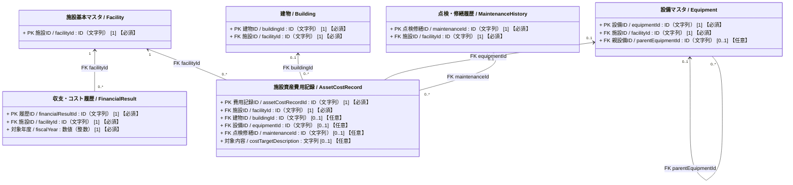

# 施設管理データモデル：収支・コスト履歴クラス図（詳細）

作成日：2026-10-19  
更新日：2026-10-20  
バージョン：ver1.1（詳細版）  
状態：クラス図改定・データモデルCSV再反映待ち

---

## 1. 目的と対象

本書は[収支・コスト履歴クラス図（基本版）](./03_収支・コスト履歴_クラス図.md)を補足し、施設の収支および運営コストと整備・保全・除却費用を管理する各クラスの属性仕様、公会計基準・国土交通省保全基準との対応関係、統制語彙コード定義、およびデータモデルCSVとの対応を記録する。

施設単位・年度単位の収支および運営コストの集計を `FinancialResult`、施設・建物・設備に帰属する個別の整備・保全・除却費用を `AssetCostRecord` として区別する。

- **`FinancialResult`（収支・コスト履歴）**：総務省「統一的な基準による地方公会計」の行政コスト計算書（PL）の科目構造を基礎とし、1施設・1会計年度あたりの収入・現金支出・減価償却費・総コスト・純施設コストを管理する（施設カルテやセグメント分析における「施設別行政コスト計算書」に相当）。
- **`AssetCostRecord`（施設資産費用記録）**：国土交通省「国家機関の建築物等の保全の現況」「保全台帳及び保全計画書の様式の取扱いについて」および公会計の固定資産台帳・投資活動支出等の明細を基礎とし、施設全体（敷地・土地を含む）・建物・設備群・主要機器に帰属する新設・更新・改修・修繕・保守点検・撤去等の個別費用（実績および計画・見積）を管理する。「資産」は費用の帰属対象を指し、すべての記録が会計上の資産計上に該当する意味ではない。

---

## 2. 全体構造

### 属性の多重度と収集区分の表記ルール

属性は `属性名 / 英語名 : 型 [多重度] 【収集区分】` と表記する。  
`[多重度]` はUML上の値の個数、`【収集区分】` は施設管理データモデルCSVの「必須」列に対応する本プロジェクト独自の表示であり、両者を明確に区別する。

| 収集区分 | 単一値属性の例 | 意味 |
| :--- | :--- | :--- |
| **必須** | `[1] 【必須】` | そのクラスのインスタンスが存在する場合、値を必ず保持する。 |
| **推奨** | `[0..1] 【推奨】` | 値がなくても成立するが、収集を推奨する。 |
| **任意** | `[0..1] 【任意】` | 値がなくても成立し、収集も任意とする（詳細拡張属性等）。 |

複数値属性は、必要な最小・最大件数に応じて `[0..*]` または `[1..*]` を用い、収集区分を併記する（例: `[0..*] 【推奨】`）。

### 2.1 簡易クラス図

`FinancialResult` と `AssetCostRecord` の間に所有関係や必須の集計線は引かない。年度収支集計（PLベースの期間損益・運営コスト）と個別資産費用明細（資本的支出や将来計画額を含む整備・保全・除却費用）は粒度・会計上の性質が異なり、金額を無条件に加算できないためである。

### 2.2 詳細クラス図　属性および統制語彙を含むクラス図

```mermaid
classDiagram
    direction TB

    class Facility["施設基本マスタ / Facility"] {
        + PK 施設ID / facilityId : ID（文字列） [1] 【必須】
    }

    class FinancialResult["収支・コスト履歴 / FinancialResult"] {
        + PK 履歴ID / financialResultId : ID（文字列） [1] 【必須】
        + FK 施設ID / facilityId : ID（文字列） [1] 【必須】
        + 対象年度 / fiscalYear : 数値（整数） [1] 【必須】
          %% 単位:年度。西暦YYYY(ISO8601)への正規化。
        + 施設利用収入額 / revenueUsageFeeAmount : 数値（整数） [0..1] 【推奨】
          %% 単位:円。公会計PL「経常収益＞使用料及び手数料」相当。
        + その他収入額 / revenueOtherAmount : 数値（整数） [0..1] 【推奨】
          %% 単位:円。公会計PL「経常収益＞その他」相当。
        + 合計収入額 / revenueTotalAmount : 数値（整数） [0..1] 【推奨】
          %% 単位:円。施設利用収入額＋その他収入額（公会計PL「経常収益」相当）。
        + 修繕支出額 / expenditureRepairAmount : 数値（整数） [0..1] 【推奨】
          %% 単位:円。公会計PL「業務費用＞物件費等＞維持補修費」相当。
        + 光熱水費支出額 / expenditureUtilityAmount : 数値（整数） [0..1] 【推奨】
          %% 単位:円。公会計PL「物件費」のうち電気・ガス・水道料金。
        + 維持管理支出額 / expenditureManagementAmount : 数値（整数） [0..1] 【推奨】
          %% 単位:円。公会計PL「物件費」のうち保守点検・清掃・警備等の業務委託費等。
        + 人件費支出額 / expenditurePersonnelAmount : 数値（整数） [0..1] 【推奨】
          %% 単位:円。公会計PL「業務費用＞人件費」相当。
        + その他支出額 / expenditureOtherAmount : 数値（整数） [0..1] 【推奨】
          %% 単位:円。公会計PL「物件費」等のうち上記以外の消耗品費・賃借料（借地料等）・雑支出。
        + 現金支出合計 / cashExpenditureTotalAmount : 数値（整数） [0..1] 【推奨】
          %% 単位:円。上記5つの現金支出科目の合計。
        + 減価償却費 / nonCashDepreciationAmount : 数値（整数） [0..1] 【推奨】
          %% 単位:円。公会計PL「業務費用＞物件費等＞減価償却費」（非現金支出）相当。
        + 施設総コスト / totalCostAmount : 数値（整数） [0..1] 【推奨】
          %% 単位:円。現金支出合計＋減価償却費（公会計PL「経常費用」相当のフルコスト）。
        + 純施設コスト / fiscalBalanceAmount : 数値（整数） [0..1] 【推奨】
          %% 単位:円。施設総コスト－合計収入額（公会計PL「純経常行政コスト」＝実質公費負担額相当）。
    }

    class Building["建物 / Building"] {
        + PK 建物ID / buildingId : ID（文字列） [1] 【必須】
        + FK 施設ID / facilityId : ID（文字列） [1] 【必須】
    }
    class Equipment["設備マスタ / Equipment"] {
        + PK 設備ID / equipmentId : ID（文字列） [1] 【必須】
        + FK 施設ID / facilityId : ID（文字列） [1] 【必須】
        + FK 親設備ID / parentEquipmentId : ID（文字列） [0..1] 【任意】
    }
    class MaintenanceHistory["点検・修繕履歴 / MaintenanceHistory"] {
        + PK 点検修繕ID / maintenanceId : ID（文字列） [1] 【必須】
        + FK 施設ID / facilityId : ID（文字列） [1] 【必須】
        + 費用額 / maintenanceCostAmount : 数値（整数） [0..1] 【推奨】
          %% 単位:円。費用記録との役割分担・二重計上防止は第4章参照。
    }
    class AssetCostRecord["施設資産費用記録 / AssetCostRecord"] {
        + PK 費用記録ID / assetCostRecordId : ID（文字列） [1] 【必須】
        + FK 施設ID / facilityId : ID（文字列） [1] 【必須】
        + FK 建物ID / buildingId : ID（文字列） [0..1] 【任意】
          %% 設備IDと排他。建物・設備とも空欄の場合は施設全体（敷地・土地を含む）への帰属を表す。
        + FK 設備ID / equipmentId : ID（文字列） [0..1] 【任意】
          %% 建物IDと排他。
        + FK 点検修繕ID / maintenanceId : ID（文字列） [0..1] 【任意】
        + 対象内容 / costTargetDescription : 文字列 [0..1] 【任意】
          %% 主要部位・施工箇所・一括工事の対象などを補足。設備単位IDは直接持たない。
        + 費用区分 / costCategory : 文字列 [1] 【必須】
          %% AssetCostCategory（費用区分）を参照。光熱水費等の運営費全般は対象外。
        + 計画・見積・実績区分 / costStage : 文字列 [1] 【必須】
          %% MaintenanceInformationCategory（維持管理計画実績区分）を共通参照。
        + 対象日 / costDate : 日付 [0..1] 【任意】
        + 対象年度 / fiscalYear : 数値（整数） [0..1] 【任意】
          %% 現行の全体関連図の型を維持。FinancialResultの年度型とは要調整。
        + 費用額 / amount : 数値（実数） [1] 【必須】
          %% 単位:円。整数・小数の扱いはCSV反映時に確認。
        + 根拠資料 / sourceDocumentReference : URI [0..1] 【任意】
    }

    namespace コード定義 {
        class AssetCostCategory["費用区分 / AssetCostCategory"] {
            <<ControlledVocabulary>>
            %% コードリストID:01a15660-22c0-7a4b-9c1d-3e8f4a2b6d90
            %% 大分類:整備・保全・除却費用（詳細は施設管理コード定義ver8.csv参照）
            取得・整備 : 新設・取得費
            更新・改修 : 更新費
            更新・改修 : 改修費
            維持・保全 : 修繕費
            維持・保全 : 保守・点検費
            廃棄・除却 : 撤去・解体費
            その他 : その他費用
        }

        class MaintenanceInformationCategory["維持管理計画実績区分 / MaintenanceInformationCategory"] {
            <<ControlledVocabulary>>
            %% コードリストID:01a0cf0e-d167-711c-9dbe-8fee8d6dc4d9
            実績
            実施計画
            中長期計画
        }
    }

    Facility "1" <-- "0..*" FinancialResult : FK facilityId
    Facility "1" <-- "0..*" AssetCostRecord : FK facilityId
    Building "0..1" <-- "0..*" AssetCostRecord : FK buildingId
    Equipment "0..1" <-- "0..*" Equipment : FK parentEquipmentId
    Equipment "0..1" <-- "0..*" AssetCostRecord : FK equipmentId
    MaintenanceHistory "0..1" <-- "0..*" AssetCostRecord : FK maintenanceId

    %% 統制語彙への参照
    AssetCostRecord "0..*" --> "1" AssetCostCategory : 費用区分 (costCategory)
    AssetCostRecord "0..*" --> "1" MaintenanceInformationCategory : 計画・見積・実績区分 (costStage)
```

---

## 3. 主要クラスおよびリレーション仕様

| クラス | 物理テーブル名 | 1レコードの粒度・意味 | 主な参照元・基準 |
| :--- | :--- | :--- | :--- |
| **`FinancialResult`** （収支・コスト履歴） | `t_financial_results` | 1施設の1対象年度に係る収入・現金支出・非現金支出（減価償却費）・フルコスト・純施設コストの集計レコード | 総務省「統一的な基準による地方公会計」行政コスト計算書（PL）／施設別行政コスト計算書 |
| **`AssetCostRecord`** （施設資産費用記録） | `t_asset_cost_records` | 1施設全体（敷地・土地を含む）、1建物、または設備群・主要機器に帰属する、特定の費用区分・計画実績段階・時点の個別費用レコード | 国土交通省「国家機関の建築物等の保全の現況」「保全台帳及び保全計画書の様式の取扱いについて」／公会計固定資産台帳・CF投資活動支出明細 |

1. **`Facility`（施設基本マスタ）との関連**：
   - `FinancialResult` と `AssetCostRecord` はいずれも `facilityId`（【必須】）により対象施設へ紐づく。
2. **`Building`・`Equipment` との関連**：
   - `AssetCostRecord` は、費用が発生した具体的な対象に応じて `buildingId`（建物）または `equipmentId`（設備群・主要機器）を任意で参照する。費用は最も具体的な `Equipment` レコードに帰属させ、設備個体IDは直接持たない。
   - 敷地・土地や施設全体の外構・一括工事など、特定の建物・設備に限定されない費用は `buildingId`・`equipmentId` をともに未指定（NULL）として `Facility` 全体へ帰属させる。
3. **`MaintenanceHistory`（点検・修繕履歴）との関連**：
   - 点検・調査・診断・保守・修繕・更新・改修等の保全業務履歴と紐づく費用明細については、`AssetCostRecord.maintenanceId` から該当する `MaintenanceHistory` を参照できる。

---

## 4. 粒度と整合条件

### 4.1 帰属先と対象範囲の整合条件（土地・敷地を含む）
- **建物・設備・施設全体（敷地・土地）への帰属規則**：
  - `AssetCostRecord` は `facilityId` を必須とし、`buildingId` と `equipmentId` は同時に指定しない（排他制約）。
  - **`buildingId` と `equipmentId` の両方を未指定（NULL）とした場合は、特定の1建物・1設備に限定されない「施設全体（敷地・土地・外構全体を含む）」に帰属する費用**（例：敷地造成費・用地取得費、複数棟一括の設計監理費・解体工事費等）を表す。
  - `equipmentId` には費用を帰属させる最も具体的な設備群・主要機器を指定する。設備の親子は同一施設に属し、自己参照・循環を禁止する。親子の費用を無条件に合算せず、指定した建物・設備の所属施設は `facilityId` と一致させる。
  - 建物の部位、設備の構成部分や一括工事の対象は `costTargetDescription` で補足できる。個体の詳細は点検・修繕履歴や根拠資料に記録できるが、履歴のない取得・撤去費用も認める。
- **対象日と対象年度**：
  - `costDate` と `fiscalYear` は少なくとも一方を指定する。両方を指定する場合、日付が属する会計年度と年度値を一致させる。会計年度の開始月は現段階では固定しない。
- **点検・修繕履歴との紐づけ**：
  - `maintenanceId` は点検・修繕履歴（`MaintenanceHistory`）に由来する費用に限り指定する。参照先の点検・修繕履歴も同じ施設に属することを確認する。

### 4.2 公会計基準（財務書類4表）との対応と計算・集計規則
- **`FinancialResult` の科目構造と算出関係**：
  - 総務省「統一的な基準による地方公会計」の行政コスト計算書（PL）の科目構造（`05_参考` 参照）に準拠し、施設単位で発生する科目を保持する。
  - （社会保障給付・補助金等の移転費用や地方債支払利息など、自治体全体にのみ帰属する科目は対象外）。
  - 項目間の基本的な計算関係は以下のとおりとする。ただし、元の個別値が未取得（NULL）のときに欠測をゼロとみなして自動補完しない。
    1. `合計収入額 (revenueTotalAmount)` ＝ `施設利用収入額` ＋ `その他収入額`（公会計PLの「経常収益」相当）
    2. `現金支出合計 (cashExpenditureTotalAmount)` ＝ `修繕支出額` ＋ `光熱水費支出額` ＋ `維持管理支出額` ＋ `人件費支出額` ＋ `その他支出額`（公会計PLの「業務費用」のうち人件費・維持補修費・物件費等の現金支出相当）
    3. `施設総コスト (totalCostAmount)` ＝ `現金支出合計` ＋ `減価償却費 (nonCashDepreciationAmount)`（公会計PLの「経常費用」相当のフルコスト）
    4. `純施設コスト (fiscalBalanceAmount)` ＝ `施設総コスト` － `合計収入額`（公会計PLの「純経常行政コスト」相当：プラス値が収入で賄えない実質的な公費負担額を表す）
  - **公会計指標との連携**：`合計収入額 ÷ 施設総コスト` により、施設単位の「受益者負担比率」を導出できる。
- **`FinancialResult` と `AssetCostRecord` を無条件に合算しない理由および外部統計との区分差**：
  - `AssetCostRecord` には、PL（収益的支出）に当たる費用だけでなく、CF（投資活動支出 ＞ 公共施設等整備費支出）およびBS（有形固定資産 ＞ 事業用資産の取得価額加算 → 翌年度以降の減価償却対象）に当たる初期投資・更新・改修費用や、将来計画・見積段階の金額が含まれる。また、同一の費用区分であっても資本的支出か収益的支出かは個別の会計判断による。
  - `AssetCostRecord.costCategory`（`費用区分`）と `MaintenanceHistory` の `維持管理業務種別` には代表的な対応関係があるが、業務と費用は1対1に固定しない（更新工事に伴う設計費や既存物の撤去費を含める範囲等は集計規則で定める）。
  - 国土交通省「国家機関の建築物等の保全の現況」（令和8年3月）における集計区分（修繕費に改修工事費も含めて集計する扱い、および清掃費・警備費等を含む「維持管理費等」）や、地方財政状況調査の「維持補修費」は、本モデルの `AssetCostCategory`（`修繕費`、`保守・点検費`）と範囲が異なるため直接対応しない。
  - そのため、`AssetCostRecord.amount` を `FinancialResult` の年度費用（`修繕支出額`、`維持管理支出額` 等）へ自動加算しない。集計連携を行う場合は、`costStage = 実績`、対象年度の一致、会計上の収益的支出範囲、帰属先、および `MaintenanceHistory.maintenanceCostAmount` との重複排除規則を揃える必要がある。

---

## 5. 統制語彙コード定義（`施設管理コード定義ver8.csv` 対応）

### 5.1 費用区分（`pcd:AssetCostCategory`）
- **コードリストID**：`01a15660-22c0-7a4b-9c1d-3e8f4a2b6d90`
- **大分類**：`整備・保全・除却費用`
- **対象範囲・同義語整理方針**：
  - 施設・建物・設備の整備・保全・除却に係る個別費用を対象とし、光熱水費等の運営費全般は対象外（`FinancialResult` 側で管理）とする。
  - 内訳例（建設費、設備更新費、耐震改修費、補修費、法定点検費、解体工事費等）や、会計上の評価額（取得価額、除却費）、決算統計区分（維持補修費）、保全方式区分（事後保全費）は厳密な同義語ではないため「日本語ラベル別名」には登録せず（空欄）、備考欄にて内訳例・非同義語として位置づける。

| 中分類 | 日本語ラベル | 英語ラベル | 説明 | 備考（内訳例・非同義語・会計や統計との関係） | 定義出典 |
| :--- | :--- | :--- | :--- | :--- | :--- |
| **取得・整備** | **新設・取得費** | AcquisitionCost | 施設・建物・設備の新築・新設・初期取得、企画・設計・工事監理、敷地造成・用地取得に係る初期投資費用。 | 建設費・建築工事費・設備新設費・設計監理費・用地取得費等を内訳例とする。取得価額は会計上の評価額であり同義語とは扱わない。資産計上・キャッシュフロー区分は個別の会計判断による。（※本モデルで施設全体・敷地に帰属する場合は `buildingId`/`equipmentId` を空欄とする） | 参考：国土交通省「国家機関の建築物等の保全の現況」（令和8年3月、ライフサイクル段階の参考）／総務省「統一的な基準による地方公会計マニュアル」（会計処理の参考）。本リストは独自分類。 |
| **更新・改修** | **更新費** | RenewalCost | 老朽化した施設・建物・設備・機器等を取り替え、必要な機能を確保するための費用。 | 設備更新費・建替費・全面更新費等は対象や規模による内訳例であり同義語とは扱わない。設計・既存物の撤去費を含める範囲は集計規則で定める。資産計上・支出区分は個別の会計判断による。（※維持管理業務種別「更新」との代表的な対応例だが、業務と費用は1対1に固定しない） | 参考：国土交通省「インフラ長寿命化計画（行動計画）」（令和6年4月改訂、更新費の定義）／総務省「統一的な基準による地方公会計マニュアル」（会計処理の参考）。本リストは独自分類。 |
| **更新・改修** | **改修費** | ImprovementCost | 耐震化・バリアフリー化・省エネ化等により、建物・設備の機能・性能を当初の水準より高める改修工事の費用。 | 長寿命化改修費・耐震改修費・省エネ改修費・大規模改修費等は内訳例であり同義語とは扱わない。資本的支出に当たる範囲は個別の会計判断による。（※維持管理業務種別「改修」との代表的な対応例だが、業務と費用は1対1に固定しない） | 参考：国土交通省「国家機関の建築物等の保全の現況」（令和8年3月、表2-1の改修の定義）／総務省「統一的な基準による地方公会計マニュアル」（会計処理の参考）。本リストは独自分類。 |
| **維持・保全** | **修繕費** | RepairCost | 劣化・不具合のある建物・設備の機能・性能を当初の水準まで回復させるための費用。 | 補修費・小破修繕費等は内訳例であり同義語とは扱わない。維持補修費は地方財政状況調査のより広い決算区分、事後保全費は保全方法に基づく区分であり、いずれも同義語とは扱わない。年度収支へ集計する際は実績・年度・帰属先・重複排除の規則が必要。国土交通省の令和8年3月版調査では修繕費に改修工事費も含めて集計しており、本区分に直接対応しない。（※維持管理業務種別「修繕」との代表的な対応例） | 参考：国土交通省「国家機関の建築物等の保全の現況」（令和8年3月、表2-1及び第4章の集計方法）／総務省「統一的な基準による地方公会計マニュアル」（会計処理の参考）。本リストは独自分類。 |
| **維持・保全** | **保守・点検費** | MaintenanceInspectionCost | 日常・定期の点検、調査・診断、保守管理等の実施や業務委託に係る費用。 | 保守管理費・法定点検費・調査診断費・維持管理委託費等は内訳例であり同義語とは扱わない。年度収支へ集計する際は実績・年度・帰属先・重複排除の規則が必要。国土交通省の保全実態調査の維持管理費等には清掃費・警備費等も含まれ、本区分に直接対応しない。（※維持管理業務種別「点検・調査・診断・保守」との代表的な対応例） | 参考：国土交通省「国家機関の建築物等の保全の現況」（令和8年3月、第4章の維持管理費等の集計方法）／総務省「統一的な基準による地方公会計マニュアル」（会計処理の参考）。本リストは独自分類。 |
| **廃棄・除却** | **撤去・解体費** | DisposalCost | 施設・建物・設備の取り壊し、撤去及び廃棄物処分に係る費用。 | 解体工事費・廃棄処分費等は内訳例であり同義語とは扱わない。除却費は帳簿上の資産除却額を意味する場合があるため同義語から外す。更新工事に伴う撤去費を含める範囲は集計規則で定め、会計処理は個別に判断する。（※維持管理業務種別「撤去」との代表的な対応例だが、業務と費用は1対1に固定しない） | 参考：国土交通省「インフラ長寿命化計画（行動計画）」（令和6年4月改訂、更新費の定義で撤去に言及）／「国家機関の建築物等の保全の現況」（令和8年3月、ライフサイクル段階の参考）。本リストは独自分類。 |
| **その他** | **その他費用** | OtherCost | 他の費用区分に分類できない、施設・建物・設備の整備・保全・除却に係る個別費用。 | 光熱水費等の運営費全般は対象外とする。「その他」は対象が不明確なため同義語として登録しない。 | 施設管理用の独自分類。国の資料をこの受皿区分の定義根拠とはしない。 |

### 5.2 維持管理計画実績区分（`pcd:MaintenanceInformationCategory`）
- **コードリストID**：`01a0cf0e-d167-711c-9dbe-8fee8d6dc4d9`
- **共通利用**：新規の `CostStage` コードは作成せず、点検・修繕履歴（`MaintenanceHistory.maintenanceDataCategory`）と本クラスの `costStage`（計画・見積・実績区分）で同一の統制語彙リストを共通参照する。

| 日本語ラベル | 日本語ラベル別名 | 英語ラベル | 説明 | 備考 |
| :--- | :--- | :--- | :--- | :--- |
| **実績** | 記録 ; 台帳 ; 保全台帳 ; 点検記録 ; 決算実績 | Actual | 点検・修繕等の実施記録、または確定した費用実績（決算・支払実績） | 保全業務の計画・記録及び費用の計画・見積・実績管理で共通利用 |
| **実施計画** | 年度保全計画 ; 実施計画 ; 年度計画 ; 予算 ; 見積 | ImplementationPlan | 当年度・次年度等の具体的な実施計画、または予算要求・見積段階の金額 | 保全業務の計画・記録及び費用の計画・見積・実績管理で共通利用 |
| **中長期計画** | 中長期保全計画 ; 長寿命化計画 ; 長期修繕計画 ; LCC推計 | MediumToLongTermPlan | 中長期保全計画・長寿命化計画に基づく将来計画、またはライフサイクルコスト（LCC）試算額 | 保全業務の計画・記録及び費用の計画・見積・実績管理で共通利用 |

---

## 6. データモデルCSVとの対応と検討事項

### 6.1 `FinancialResult`（`t_financial_results`）の項目対応表

| 内部管理ID | 日本語名 | 英語名 | 収集区分 | 型・単位 | 公会計基準（行政コスト計算書 PL）との対応・備考 |
| :--- | :--- | :--- | :---: | :--- | :--- |
| `PROP_FIN_001` | 履歴ID | `financialResultId` | **必須** | `ID（文字列）` | PK。収支・コスト履歴レコードを一意に識別するID。 |
| `PROP_FIN_002` | 施設ID | `facilityId` | **必須** | `ID（文字列）` | FK。`Facility.facilityId` を参照。 |
| `PROP_FIN_003` | 対象年度 | `fiscalYear` | **必須** | `文字列`（年度） | 会計対象年度（ISO 8601のYYYYを基本とする）。 |
| `PROP_FIN_004` | 施設利用収入額 | `revenueUsageFeeAmount` | **推奨** | `数値（整数）`（円） | 経常収益 ＞ 使用料及び手数料（施設使用料・利用料金収入）。 |
| `PROP_FIN_005` | その他収入額 | `revenueOtherAmount` | **推奨** | `数値（整数）`（円） | 経常収益 ＞ その他（目的外使用料、自販機設置手数料、広告料収入等の雑入）。 |
| `PROP_FIN_006` | 合計収入額 | `revenueTotalAmount` | **推奨** | `数値（整数）`（円） | 経常収益合計（`施設利用収入額` ＋ `その他収入額`）。 |
| `PROP_FIN_007` | 修繕支出額 | `expenditureRepairAmount` | **推奨** | `数値（整数）`（円） | 業務費用 ＞ 物件費等 ＞ 維持補修費（収益的支出としての修繕費）。 |
| `PROP_FIN_008` | 光熱水費支出額 | `expenditureUtilityAmount` | **推奨** | `数値（整数）`（円） | 業務費用 ＞ 物件費等 ＞ 物件費のうち電気・ガス・上下水道・燃料費。 |
| `PROP_FIN_009` | 維持管理支出額 | `expenditureManagementAmount` | **推奨** | `数値（整数）`（円） | 業務費用 ＞ 物件費等 ＞ 物件費のうち保守点検・清掃・警備・指定管理委託料等の管理業務費。 |
| `PROP_FIN_010` | 人件費支出額 | `expenditurePersonnelAmount` | **推奨** | `数値（整数）`（円） | 業務費用 ＞ 人件費（施設運営・管理に従事する職員人件費・按分人件費）。 |
| `PROP_FIN_011` | その他支出額 | `expenditureOtherAmount` | **推奨** | `数値（整数）`（円） | 業務費用 ＞ 物件費等のうち上記以外の消耗品費・賃借料（借地料等）・保険料等。 |
| `PROP_FIN_012` | 現金支出合計 | `cashExpenditureTotalAmount` | **推奨** | `数値（整数）`（円） | 上記5つの現金支出科目の合計。 |
| `PROP_FIN_013` | 減価償却費 | `nonCashDepreciationAmount` | **推奨** | `数値（整数）`（円） | 業務費用 ＞ 物件費等 ＞ 減価償却費（非現金支出）。 |
| `PROP_FIN_014` | 施設総コスト | `totalCostAmount` | **推奨** | `数値（整数）`（円） | 経常費用相当のフルコスト（`現金支出合計` ＋ `減価償却費`）。 |
| `PROP_FIN_015` | 純施設コスト | `fiscalBalanceAmount` | **推奨** | `数値（整数）`（円） | 純経常行政コスト相当（`施設総コスト` － `合計収入額`＝実質公費負担額）。 |

### 6.2 `AssetCostRecord`（`t_asset_cost_records`）の項目対応表

| 項目（日本語名） | 英語名 | 収集区分 | 型・単位 | 参照コード・設計意図 |
| :--- | :--- | :---: | :--- | :--- |
| 費用記録ID | `assetCostRecordId` | **必須** | `ID（文字列）` | PK。施設資産費用記録を一意に識別するID。 |
| 施設ID | `facilityId` | **必須** | `ID（文字列）` | FK。`Facility.facilityId` を参照。 |
| 建物ID | `buildingId` | **任意** | `ID（文字列）` | FK。`Building.buildingId` を参照（`equipmentId` と排他。両方空欄時は施設全体・敷地への帰属）。 |
| 設備ID | `equipmentId` | **任意** | `ID（文字列）` | FK。設備群又は主要機器の `Equipment.equipmentId` を参照（`buildingId` と排他）。 |
| 点検修繕ID | `maintenanceId` | **任意** | `ID（文字列）` | FK。`MaintenanceHistory.maintenanceId` を参照（保全履歴に由来する費用の場合に指定）。 |
| 対象内容 | `costTargetDescription` | **任意** | `文字列` | 建物の部位、設備の構成部分、施工箇所や一括工事の対象を補足する設計追加項目。 |
| 費用区分 | `costCategory` | **必須** | `文字列` | 統制語彙 `AssetCostCategory`（`費用区分`）を参照。 |
| 計画・見積・実績区分 | `costStage` | **必須** | `文字列` | 統制語彙 `MaintenanceInformationCategory`（`維持管理計画実績区分`）を共通参照。 |
| 対象日 | `costDate` | **任意** | `日付` | 費用発生日・契約日・見積日等（`fiscalYear` と少なくとも一方を指定）。 |
| 対象年度 | `fiscalYear` | **任意** | `数値（整数）` | 対象会計年度（`costDate` と少なくとも一方を指定）。 |
| 金額 | `amount` | **必須** | `数値（実数）`（円） | 当該費用の金額。 |
| 根拠資料 | `sourceDocumentReference` | **任意** | `URI` | 契約書・見積書・保全計画書等の根拠資料URI。 |

### 6.3 今後の他クラス図・CSV連携時の留意事項
1. `FinancialResult` の対象年度（`fiscalYear`：文字列）と `AssetCostRecord` の対象年度（`fiscalYear`：整数）、および金額の型（整数／実数）の統一要否。
2. 点検・修繕履歴（`MaintenanceHistory`）のクラス図詳細化時における、`maintenanceCostAmount`（費用額）と `AssetCostRecord` の運用上の役割分担および二重計上防止規則の明記。
3. `純施設コスト` の英語論理名 `fiscalBalanceAmount` に対する英語別名（`netFacilityCostAmount` 等）の付与要否。
4. データモデルCSVへの `Equipment.parentEquipmentId`・`AssetCostRecord.costTargetDescription` の追加と、`AssetCostRecord.equipmentUnitId` の削除。設備個体への点検・修繕履歴の参照は設備図側で維持する。

---

## 7. 関連資料

- [収支・コスト履歴クラス図（基本版）](./03_収支・コスト履歴_クラス図.md)
- [施設基本クラス図](./01_施設基本_クラス図.md) / [施設基本クラス図（詳細）](./01_施設基本_クラス図_詳細.md)
- [設備クラス図](./02_設備_クラス図.md) / [設備クラス図（詳細）](./02_設備_クラス図_詳細.md)
- [全体関連図](./施設管理_全体関連図.md)
- コード定義正本：`06_データモデルCSV/施設管理コード定義ver8.csv`
- データモデル定義：`06_データモデルCSV/施設管理データモデルver4.csv`
- 作成ガイドライン：`00_ガイドライン/04_施設管理_クラス図作成ガイドライン.md`

