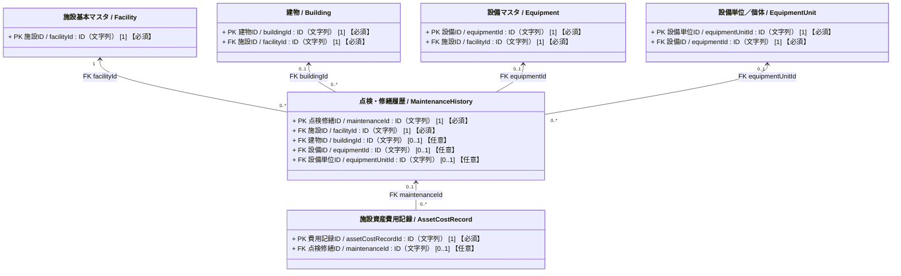

# 施設管理データモデル：点検・修繕履歴クラス図（詳細）

作成日：2026-10-22  
更新日：2026-10-24  
バージョン：ver1.0（詳細版）  
状態：クラス図改定・データモデルCSV反映待ち

---

## 1. 目的と位置づけ

本クラス図は、施設、建物、設備群・システム全体、および設備単位／個体に対する**保全・維持管理業務（点検、調査、診断、保守、修繕、更新、改修、撤去等）の計画および実績**を記録・管理するクラス図である。

現行データモデルCSVの物理テーブル `t_maintenance_histories` を基礎とし、論理クラス名は全体関連図および既存クラス図に合わせて `MaintenanceHistory`（点検・修繕履歴）とする。

維持管理実務においては、日常点検・定期点検から中長期修繕計画、緊急修繕、機器更新まで幅広い業務が発生する。本モデルでは、これらを「どの管理単位（アセット）に対して」「何の業務を」「どの段階（計画・実績）で」実施したかを統一的に追跡できる構造とする。

保全業務に伴って発生する個別費用明細は `AssetCostRecord`（施設資産費用記録）と連携し、施設単位・年度単位の収支集計である `FinancialResult`（収支・コスト履歴）との間で適切な集計境界を保つ。

---

## 2. 点検・修繕履歴クラス図（Mermaid）

### 属性の多重度と収集区分の表記ルール

属性は `属性名 / 英語名 : 型 [多重度] 【収集区分】` と表記する。  
`[多重度]` はUML上の値の個数、`【収集区分】` は施設管理データモデルCSVの「必須」列に対応する本プロジェクト独自の表示であり、両者を明確に区別する。

| 収集区分 | 単一値属性の例 | 意味 |
| :--- | :--- | :--- |
| **必須** | `[1] 【必須】` | そのクラスのインスタンスが存在する場合、値を必ず保持する。 |
| **推奨** | `[0..1] 【推奨】` | 値がなくても成立するが、収集を推奨する。 |
| **任意** | `[0..1] 【任意】` | 値がなくても成立し、収集も任意とする（詳細拡張属性等）。 |

複数値属性は、必要な最小・最大件数に応じて `[0..*]` または `[1..*]` を用い、収集区分を併記する（例: `[0..*] 【推奨】`）。

---

### 2.1 簡易クラス図

点検・修繕履歴が対象とする「4つの保全対象アセット（施設・建物・設備・設備単位）」と、保全業務から発生する「施設資産費用記録」との関係を示す。

---

### 2.2 詳細クラス図（属性および統制語彙を含むクラス図）

```mermaid
classDiagram
    direction TB

    class Facility["施設基本マスタ / Facility"] {
        + PK 施設ID / facilityId : ID（文字列） [1] 【必須】
    }
    class Building["建物 / Building"] {
        + PK 建物ID / buildingId : ID（文字列） [1] 【必須】
        + FK 施設ID / facilityId : ID（文字列） [1] 【必須】
    }
    class Equipment["設備マスタ / Equipment"] {
        + PK 設備ID / equipmentId : ID（文字列） [1] 【必須】
        + FK 施設ID / facilityId : ID（文字列） [1] 【必須】
    }
    class EquipmentUnit["設備単位／個体 / EquipmentUnit"] {
        + PK 設備単位ID / equipmentUnitId : ID（文字列） [1] 【必須】
        + FK 設備ID / equipmentId : ID（文字列） [1] 【必須】
    }

    class MaintenanceHistory["点検・修繕履歴 / MaintenanceHistory"] {
        + PK 点検修繕ID / maintenanceId : ID（文字列） [1] 【必須】
        + FK 施設ID / facilityId : ID（文字列） [1] 【必須】
        + FK 建物ID / buildingId : ID（文字列） [0..1] 【任意】
        + FK 設備ID / equipmentId : ID（文字列） [0..1] 【任意】
        + FK 設備単位ID / equipmentUnitId : ID（文字列） [0..1] 【任意】
        + 計画日_実施日 / maintenanceEventDate : 日付 [1] 【必須】
          %% 計画レコードでは計画策定日、実績レコードでは実施日。将来の実施予定日ではない。
        + データ区分 / maintenanceDataCategory : 文字列 [1] 【必須】
          %% 維持管理計画実績区分を参照。業務種別とは別の軸。
        + 業務種別 / maintenanceActivityType : 文字列 [1] 【必須】
        + 対象部位 / maintenanceTargetPart : 文字列 [0..1] 【推奨】
        + 劣化度スコア / deteriorationScore : 文字列 [0..1] 【推奨】
          %% 分野・施設種別ごとの個別基準による部位・設備の劣化評価（例：学校施設のA〜D等）。
        + 総合評価ステータス / overallConditionStatus : コード（文字列） [0..1] 【推奨】
          %% 施設管理健全度区分（1〜4,9）を参照。分野横断で共通利用する総合的な健全度判定。
        + 対応内容詳細 / maintenanceActionDescription : 文字列 [0..1] 【推奨】
        + 費用額 / maintenanceCostAmount : 数値（整数） [0..1] 【推奨】
          %% 単位:円。当該保全業務1件の総額（簡易記録用）。費用区分別の内訳管理はAssetCostRecordで行う。
    }

    class AssetCostRecord["施設資産費用記録 / AssetCostRecord"] {
        + PK 費用記録ID / assetCostRecordId : ID（文字列） [1] 【必須】
        + FK 施設ID / facilityId : ID（文字列） [1] 【必須】
        + FK 建物ID / buildingId : ID（文字列） [0..1] 【任意】
        + FK 設備ID / equipmentId : ID（文字列） [0..1] 【任意】
        + FK 点検修繕ID / maintenanceId : ID（文字列） [0..1] 【任意】
        + 対象内容 / costTargetDescription : 文字列 [0..1] 【任意】
        + 費用区分 / costCategory : 文字列 [1] 【必須】
        + 計画・見積・実績区分 / costStage : 文字列 [1] 【必須】
        + 費用額 / amount : 数値（実数） [1] 【必須】
          %% 単位:円
        + 対象日 / costDate : 日付 [0..1] 【任意】
        + 対象年度 / fiscalYear : 数値（整数） [0..1] 【任意】
          %% 単位:年度。西暦YYYY(ISO8601)への正規化。
        + 根拠資料 / sourceDocumentReference : URI [0..1] 【任意】
    }

    namespace コード定義 {
        class MaintenanceInformationCategory["維持管理計画実績区分 / MaintenanceInformationCategory"] {
            <<ControlledVocabulary>>
            %% コードリストID:01a0cf0e-d167-711c-9dbe-8fee8d6dc4d9
            実績
            実施計画
            中長期計画
        }
        class MaintenanceActivityType["維持管理業務種別 / MaintenanceActivityType"] {
            <<ControlledVocabulary>>
            %% コードリストID:01a0cf0e-d167-7aa5-abce-e672cdb12900
            点検
            調査
            診断
            保守
            修繕
            更新
            改修
            撤去
        }
        class BuildingPartClassification["部位別分類 / BuildingPartClassification"] {
            <<ControlledVocabulary>>
            %% コードリストID:01a0cf0e-d167-72db-97bb-6828f3e54bbe
            %% 詳細は施設管理コード定義ver8参照
        }
        class SchoolFacilityDeteriorationRating["学校施設劣化状況評価 / SchoolFacilityDeteriorationRating"] {
            <<Enumeration>>
            %% コードリストID:01a0cf0e-d167-7168-bd37-1ae2aa1e59f7
            A : 概ね良好
            B : 部分的に劣化
            C : 広範囲に劣化
            D : 早急に対応する必要がある
        }
        %%class RoadBridgeConditionCategory["道路橋健全性診断区分 / RoadBridgeConditionCategory"] {
        %%    <<Enumeration>>
        %%    %% コードリストID:01a0cf0e-d167-7fc5-856b-2c3aa3a71b7b
        %%    Ⅰ : 健全
        %%    Ⅱ : 予防保全段階
        %%    Ⅲ : 早期処置段階
        %%    Ⅳ : 緊急処置段階
        %%}
        %%class SewerageEquipmentConditionRating["下水道設備健全度 / SewerageEquipmentConditionRating"] {
        %%    <<Enumeration>>
        %%    %% コードリストID:01a0cf0e-d167-7321-b5aa-69b89db588a3
        %%    5 : 問題なし
        %%    4 : 劣化の兆候あり
        %%    3 : 劣化進行・機能確保
        %%    2 : 機能発揮困難
        %%    1 : 機能停止
        %%}
        class OverallConditionStatus["施設管理健全度区分 / OverallConditionStatus"] {
            <<Enumeration>>
            %% コードリストID:01a0cf0e-d167-7498-b569-6096123100e5
            1 : 健全
            2 : 予防保全段階
            3 : 早期措置段階
            4 : 緊急措置段階
            9 : 判定対象外・未評価
        }
    }

    %% 保全対象アセットとの関連
    Facility "1" <-- "0..*" MaintenanceHistory : FK facilityId
    Building "0..1" <-- "0..*" MaintenanceHistory : FK buildingId（追加案）
    Equipment "0..1" <-- "0..*" MaintenanceHistory : FK equipmentId（追加案）
    EquipmentUnit "0..1" <-- "0..*" MaintenanceHistory : FK equipmentUnitId（追加案）

    %% 費用記録との関連
    MaintenanceHistory "0..1" <-- "0..*" AssetCostRecord : FK maintenanceId

    %% コード定義・統制語彙への参照
    MaintenanceHistory "0..*" --> "1" MaintenanceInformationCategory : maintenanceDataCategory
    MaintenanceHistory "0..*" --> "1" MaintenanceActivityType : maintenanceActivityType
    MaintenanceHistory "0..*" --> "0..1" BuildingPartClassification : maintenanceTargetPart
    MaintenanceHistory "0..*" --> "0..1" SchoolFacilityDeteriorationRating : deteriorationScore（学校施設例示）
    MaintenanceHistory "0..*" --> "0..1" OverallConditionStatus : overallConditionStatus（要劣化度スコアとの違い）
```

---

## 3. 整合条件と業務ルール

`MaintenanceHistory` は施設に属する独立した履歴レコードであり、`Facility`・`Building`・`Equipment`・`EquipmentUnit` を参照する。施設・建物の静的情報は施設基本図、設備群と設備単位の構造は設備図、個別費用明細は収支・コスト履歴図をそれぞれ正とする。本図は保全業務の記録粒度と、それらのクラスへの参照条件を定義する。

### 3.1 保全対象アセットの指定規則（排他および親子整合制約）

保全・維持管理の対象範囲を正確に特定するため、外部キーの指定に以下のルールを適用する。

1. **`facilityId` は常に必須**：
   - すべての点検・修繕履歴は、必ず特定の1施設に属する。
2. **`buildingId` と `equipmentId` の排他関係**：
   - 1レコードにおいて、`buildingId` と `equipmentId` は同時に指定しない（排他制約）。
   - **両方とも未指定（NULL）の場合**：特定の1建物・1設備に限定されない施設全体、敷地・屋外・グラウンド・外構等を対象とする保全業務を表す（例：敷地除草、施設全体の状況調査）。
   - **`buildingId` を指定する場合**：建物全体、または建築躯体・屋根・外壁・内装等の建築部位を対象とする保全業務を表す。
   - **`equipmentId` を指定する場合**：設備群・設備システム全体（空調設備システム、自家発電装置、受変電設備等）を対象とする保全業務を表す。
     - ※設備が建物内に設置されている場合であっても、保全対象が設備である場合は `equipmentId` を指定し、`buildingId` は重複指定しない（二重帰属の防止）。
3. **`equipmentUnitId` の指定規則**：
   - 設備図で任意登録する特定の設備単位・個体（室外機No.1、特定AED等）に絞って点検・修繕を行う場合に指定する。
   - `equipmentUnitId` を指定する場合は、必ずその親設備である `equipmentId` も指定し、所属施設（`facilityId`）と一致させる。
4. **同一施設の整合性**：
   - 指定された建物、設備、設備単位は、すべて `facilityId` が示す同一施設に属していなければならない。設備単位の親設備IDは履歴の `equipmentId` と一致させる。

---

### 3.2 計画と実績の記録ルール（フェーズ・業務種別の直交管理）

1. **1レコードの粒度**：
   - 1レコードは、1施設の管理対象について、1つの維持管理業務種別と1つの計画・実績段階を持つ記録とする。対象を特定の建物・設備に限定しない施設全体の記録も認める。
   - 同一の業務であっても「実施計画」「中長期計画」「実績」は段階が異なるため別レコードとする。計画と実績を結ぶIDは現行図にないため、同一案件として自動照合できるとは扱わない。
2. **「段階区分」と「業務種別」の分離**：
   - `maintenanceDataCategory` は記録の段階（`実績`、`実施計画`、`中長期計画`）を表す。「データ区分」という現行名称は暫定的に維持し、業務の種類とは区別する。
   - `maintenanceActivityType` は業務の種類（`点検`、`調査`、`診断`、`保守`、`修繕`、`更新`、`改修`、`撤去`）を表す。維持管理業務種別は独自の統制語彙であり、国がその8区分を一体のコードとして規定したものとは扱わない。
   - 両者を独立させることで、「中長期計画における更新」「実施計画における修繕」「実績における点検」などを直交的に表現できる。
3. **`maintenanceEventDate`（計画日_実施日）の意味**：
   - データ区分が「実績」の場合は実際の業務実施日、「実施計画」または「中長期計画」の場合はその計画を策定した日を格納する。計画レコードの日付を将来の実施予定日と読み替えない。
   - 現行CSV由来の単一日付・【必須】を維持する。計画の改定ごとに別レコードを残すか、既存レコードを更新するかは未確定とする。将来の実施予定日・年度・期間が必要なら、この日付とは別属性で扱う。

---

### 3.3 劣化度判定・健全度評価の適用範囲と使い分け

`deteriorationScore`（劣化度スコア）と `overallConditionStatus`（総合評価ステータス）は、**「個別分野ごとの詳細評価」か「全施設共通の分野横断評価」か**という役割で使い分ける（課題・検討事項を含む）。

1. **劣化度スコア（`deteriorationScore`）― 分野別・個別基準による評価**：
   - 建築・学校施設・インフラ等の分野や点検基準ごとに定められた、部位・設備単位の個別評価値（文字列）を格納する。
   - クラス図のコード定義（ver8）に示した `A〜D` は「学校施設劣化状況評価」の例示であり、全施設共通の数値スコアではない（英語名に `Score` とあっても値は文字列ランクとする）。道路橋や下水道設備など他分野の施設・設備では、それぞれのコード定義（健全性診断区分等）や基準値を参照できるようにしている。
2. **総合評価ステータス（`overallConditionStatus`）― 分野横断の共通健全度区分**：
   - コード定義ver8の `施設管理健全度区分` の5値（`1:健全`、`2:予防保全段階`、`3:早期措置段階`、`4:緊急措置段階`、`9:判定対象外・未評価`）を参照する。
   - 個別分野の評価値（`deteriorationScore`）を置き換えるものではなく、異なる分野・施設種別を横断して「どの段階の措置が必要か」を共通尺度で把握・集計するための総合評価ステータスである。
   - CSVの説明は施設全体の総合評価を想定している。建物・設備を対象とする履歴にもこの属性を設定するかは未確定であり、対象範囲を拡張したことにはしない。学校施設のA～Dとの自動換算もしない。
3. **保全点検対象部位（`maintenanceTargetPart`）の収集区分**：
   - 現行CSVでは【必須】だが、施設全体・敷地や特定機器を対象とする場合に「部位別分類」の値が適合しないことがあるため、本図では【推奨】へ変更する案を採用した。適合する値がないときは無理に別部位へ分類せず、具体的な箇所・内容を `maintenanceActionDescription` に記す。CSVへの変更は未反映。

---

### 3.4 費用額の役割分担と二重計上防止（`03_収支・コスト履歴_クラス図.md` との連携）

本クラスの `費用額 (maintenanceCostAmount)` は、[03_収支・コスト履歴_クラス図.md](03_収支・コスト履歴_クラス図.md) の `AssetCostRecord`（施設資産費用記録）および `FinancialResult`（収支・コスト履歴）と以下のように役割を分担し、リンクする。

1. **`MaintenanceHistory.maintenanceCostAmount`（保全業務単位の費用額）**：
   - 現行CSVから継承する項目であり、**1件の点検・修繕等の保全業務にかかった（または見込まれる）業務単位の総額**を簡易に記録する。
   - 計画額か実績額かは同じレコードの `データ区分 (maintenanceDataCategory)`（`中長期計画`・`実施計画`・`実績`）と合わせて読み取る（見積額・契約額・支払額のいずれに当たるかは入力元の定義による）。
   - あくまで「業務履歴の付帯情報」であるため、会計・ライフサイクル上の費用区分（更新費・改修費・修繕費・撤去費等の内訳）は持たない。
2. **`AssetCostRecord.amount`（施設資産費用記録とのリンクと内訳管理）**：
   - [03_収支・コスト履歴_クラス図.md](03_収支・コスト履歴_クラス図.md) の `AssetCostRecord` は、施設・建物・設備に帰属する費用を **「費用区分（`costCategory`：新設・取得費、更新費、改修費、修繕費、保守・点検費、撤去・解体費等）」および「計画・見積・実績区分（`costStage`）」ごとに管理する費用専門のクラス** である。
   - 保全業務（`MaintenanceHistory`）に伴って発生した費用を `AssetCostRecord` に記録する場合は、任意の外部キー `maintenanceId` を指定して当該点検・修繕履歴とリンクさせる（新設・取得費など保全履歴に由来しない費用の場合は `maintenanceId` を空欄とする。また、1件の大規模改修・複合工事の履歴に対して、`AssetCostRecord` 側で「更新費」「改修費」「撤去・解体費」や対象建物・設備ごとの複数明細に分けて記録するケース、または1対1で記録するケースがある）。
   - なお、`AssetCostRecord` 自体は `equipmentUnitId`（設備単位ID）を持たないため、特定の設備個体に対する費用である場合は、リンク先の `MaintenanceHistory.equipmentUnitId` または `AssetCostRecord.costTargetDescription`（対象内容）・根拠資料から個体情報を辿る。
3. **二重計上防止の原則（集計時の注意）**：
   - **同一業務の重複加算の禁止**：ある保全業務について `MaintenanceHistory.maintenanceCostAmount` に業務総額が入り、かつ `maintenanceId` でリンクされた `AssetCostRecord.amount` にその費用記録が入っている場合、**両者は同じ保全業務の費用を表しているため、単純に合算すると二重計上になる**。明細（`AssetCostRecord`）が存在する業務については、同一範囲・同一段階の `maintenanceCostAmount` を重ねて加算してはならない。
   - **年間決算額（`FinancialResult`）との重複加算の禁止**：[03_収支・コスト履歴_クラス図.md](03_収支・コスト履歴_クラス図.md) の `FinancialResult`（年度の `修繕支出額`・`維持管理支出額` 等）は、1施設・1会計年度の決算ベースの合計値である。`MaintenanceHistory` や `AssetCostRecord` の個別費用は、その内訳または資本的支出（固定資産への計上分）に当たるため、`FinancialResult` の金額と無条件に合算しない。
   - ※なお、`AssetCostRecord` の明細が作られていない簡易な保全履歴の `maintenanceCostAmount` を施設別コスト集計へどう補完利用するか、および複数明細の合計額と `maintenanceCostAmount` の照合ルールについては今後の運用・集計設計事項とする。

---

## 4. 現行CSVとの対応とコード定義

### 4.1 データモデルCSV・同義語辞書との対応

現行データモデルver4の `t_maintenance_histories` にある9項目は内部管理IDで追跡する。表の「図の表示名」は第2章の表記と一致させ、同義語詳細辞書ver3の優先名・原本定義名は別名として参照する。既存CSV、同義語辞書およびコード定義CSVは、この図の作成により変更されない。

| 内部管理ID | CSV項目名 | 図の表示名 | 英語名 | 型 | 多重度 | 収集区分 | 設計判断 |
| :--- | :--- | :--- | :--- | :--- | :---: | :---: | :--- |
| `PROP_MNT_001` | 点検修繕ID | 点検修繕ID | `maintenanceId` | ID（文字列） | `[1]` | 【必須】 | PK。一意の保全業務レコードID。 |
| `PROP_MNT_002` | 施設ID | 施設ID | `facilityId` | ID（文字列） | `[1]` | 【必須】 | FK。所属施設への必須参照。 |
| `PROP_MNT_003` | 実施日_計画日 | 計画日_実施日 | `maintenanceEventDate` | 日付 | `[1]` | 【必須】 | 計画レコードでは策定日、実績レコードでは業務実施日。予定日・対象年度は含めない。 |
| `PROP_MNT_004` | データ区分 | データ区分 | `maintenanceDataCategory` | 文字列 | `[1]` | 【必須】 | 維持管理計画実績区分を参照。業務種別ではない。 |
| `PROP_MNT_005` | 対象部位 | 対象部位 | `maintenanceTargetPart` | 文字列 | `[0..1]` | 【推奨】 | 部位別分類を参照。CSVの【必須】からの変更案。 |
| `PROP_MNT_006` | 劣化度スコア | 劣化度スコア | `deteriorationScore` | 文字列 | `[0..1]` | 【推奨】 | 学校施設劣化状況評価A～Dを適用する場合の文字列ランク。 |
| `PROP_MNT_007` | 総合評価ステータス | 総合評価ステータス | `overallConditionStatus` | コード（文字列） | `[0..1]` | 【推奨】 | 施設管理健全度区分を参照。評価対象の拡張は未確定。 |
| `PROP_MNT_008` | 対応内容詳細 | 対応内容詳細 | `maintenanceActionDescription` | 文字列 | `[0..1]` | 【推奨】 | 指摘事項・対応内容・対象箇所を自由記述。 |
| `PROP_MNT_009` | 費用額 | 費用額 | `maintenanceCostAmount` | 数値（整数） | `[0..1]` | 【推奨】 | 単位は円。費用明細との二重計上を防ぐ。 |
| *設計追加* | — | 建物ID | `buildingId` | ID（文字列） | `[0..1]` | 【任意】 | FK。建物・躯体部位を対象とする場合に指定。 |
| *設計追加* | — | 設備ID | `equipmentId` | ID（文字列） | `[0..1]` | 【任意】 | FK。設備群・システム全体を対象とする場合に指定。 |
| *設計追加* | — | 設備単位ID | `equipmentUnitId` | ID（文字列） | `[0..1]` | 【任意】 | FK。特定個体機器を対象とする場合に指定。 |
| *設計追加* | — | 業務種別 | `maintenanceActivityType` | 文字列 | `[1]` | 【必須】 | 維持管理業務種別の8語彙を参照。履歴の段階区分とは独立。 |

設計追加の4属性には元CSVの内部管理IDを流用しない。CSVの `PROP_MNT_003` にある英語別名 `maintenanceActivityType` は、追加する業務種別の英語名と衝突するため、CSV改定時の確認対象とする。

### 4.2 参照するコード・統制語彙

| 属性 | リスト名・英語名 | コードリストID | 適用上の注意 |
| :--- | :--- | :--- | :--- |
| `maintenanceDataCategory` | 維持管理計画実績区分 / `MaintenanceInformationCategory` | `01a0cf0e-d167-711c-9dbe-8fee8d6dc4d9` | 実績・実施計画・中長期計画。`AssetCostRecord.costStage` も同じリストを参照する。 |
| `maintenanceActivityType` | 維持管理業務種別 / `MaintenanceActivityType` | `01a0cf0e-d167-7aa5-abce-e672cdb12900` | 点検・調査・診断・保守・修繕・更新・改修・撤去。本モデルの独自統制語彙。 |
| `maintenanceTargetPart` | 部位別分類 / `BuildingPartClassification` | `01a0cf0e-d167-72db-97bb-6828f3e54bbe` | 対象に適合する部位がある場合に使用。 |
| `deteriorationScore` | 学校施設劣化状況評価 / `SchoolFacilityDeteriorationRating` | `01a0cf0e-d167-7168-bd37-1ae2aa1e59f7` | 学校施設向けA～Dの分類値。数値スコアと混同しない。 |
| `overallConditionStatus` | 施設管理健全度区分 / `OverallConditionStatus` | `01a0cf0e-d167-7498-b569-6096123100e5` | 分野横断用の独自区分。原評価値を上書きしない。 |

値、定義、出典の正本は `06_データモデルCSV/施設管理コード定義ver8.csv` とし、図中の列挙は参照用とする。符号が空欄の統制語彙に、この図だけで符号を新設しない。

---

## 5. 検討事項・今後の確認課題

1. **クラスと日付の名称**：`MaintenanceHistory` は調査・診断・保守・更新・改修・撤去も含む。「点検・修繕履歴」という表示名を継続するか、「保全履歴」等に改めるかを決める。`maintenanceEventDate` は計画策定日にも用いるため、名称の適切さをCSV改定時に確認する。「計画日_実施日」の段階別定義は3.2に従う。
2. **計画の予定時期と改定履歴**：計画策定日とは別に、業務の予定日・予定年度・対象期間を必要とするか。計画改定時に旧計画を残すか。同一業務の中長期計画、実施計画、実績を結び付けるキーを設けるか。
3. **指摘事項と対応業務の連結**：点検・診断で発見した複数の不具合と、その後の修繕・更新をどう対応付けるか。単純な履歴間自己参照で足りるか、指摘事項を独立レコードにするかは未判断。
4. **複数対象・評価の粒度**：1件の点検・工事が複数棟・複数設備にまたがる場合の分割と束ね方、`overallConditionStatus` を施設以外の対象に適用する条件、学校以外の分野別評価値の保存先を決める。
5. **費用とCSVの同期**：履歴側の費用額だけがある場合の集計方法、明細との照合、計画・実績段階の一致条件を定める。追加FK・業務種別、対象部位の収集区分変更、および同義語辞書との名称対応は、個別図が固まった後にデータモデルCSVへ反映する。

---

## 6. 参照資料

- [施設基本クラス図](./01_施設基本_クラス図.md)
- [施設基本クラス図（詳細）](./01_施設基本_クラス図_詳細.md)
- [設備クラス図](./02_設備_クラス図.md)
- [設備クラス図（詳細）](./02_設備_クラス図_詳細.md)
- [収支・コスト履歴クラス図](./03_収支・コスト履歴_クラス図.md)
- [収支・コスト履歴クラス図（詳細）](./03_収支・コスト履歴_クラス図_詳細.md)
- [施設管理_全体関連図](./施設管理_全体関連図.md)
- [施設管理_クラス図作成ガイドライン](../00_ガイドライン/04_施設管理_クラス図作成ガイドライン.md)
- `06_データモデルCSV/施設管理データモデルver4.csv`（`PROP_MNT_001`〜`PROP_MNT_009`）
- `06_データモデルCSV/施設管理コード定義ver8.csv`（維持管理業務種別、維持管理計画実績区分、部位別分類、学校施設劣化状況評価、施設管理健全度区分）
- `06_データモデルCSV/施設管理同義語詳細辞書ver3.csv`
