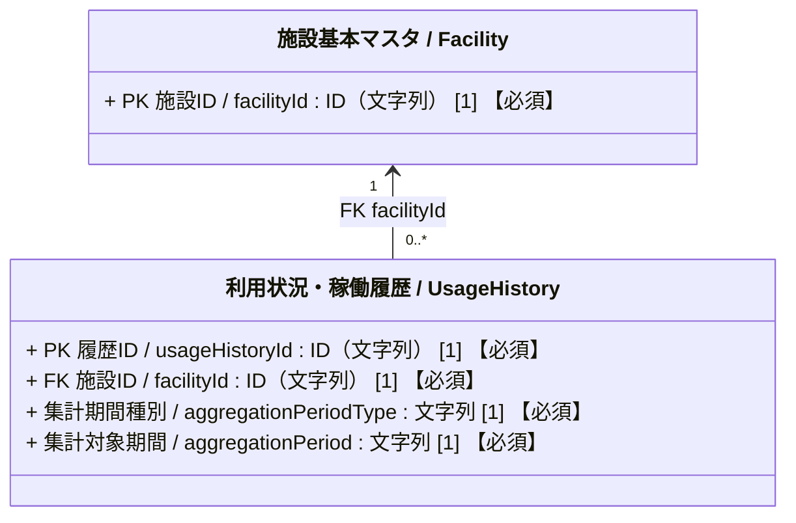
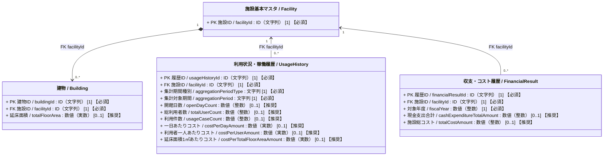

# 施設管理データモデル：利用状況・稼働履歴クラス図

作成日：2026-10-24  
更新日：2026-10-24  
バージョン：ver1.0（詳細版）
状態：検討用・データモデルCSV未反映

---

## 1. 目的と位置づけ

建物系施設について、施設ごとの月次または年度の開館、利用者数、利用件数を記録する。日次・イベント別・建物別の利用記録はこの共通クラスの対象としない。四半期・半期の値は、必要な月次記録が揃う場合に表示・分析時に集計する。施設単位・年度単位の収支・コストを管理する `FinancialResult` とは記録の粒度を区別する。費用に関する３つの指標は利用記録と財務記録等から求める導出値であり、独立した支出明細ではない。

この案は、入力Excelの `t_usage_histories`、現行データモデルCSVの `PROP_USG_001`～`PROP_USG_009` を基礎とする。現行CSVと異なる提案、および計算条件が未確定の箇所は第３・４章に明記する。

## 2. 利用状況・稼働履歴クラス図（Mermaid）

### 属性の多重度と収集区分の表記ルール

属性は `属性名 / 英語名 : 型 [多重度] 【収集区分】` と表記する。  
`[多重度]` はUML上の値の個数、`【収集区分】` は施設管理データモデルCSVの「必須」列に対応する本プロジェクト独自の表示であり、両者を明確に区別する。

| 収集区分 | 単一値属性の例 | 意味 |
| :--- | :--- | :--- |
| **必須** | `[1] 【必須】` | そのクラスのインスタンスが存在する場合、値を必ず保持する。 |
| **推奨** | `[0..1] 【推奨】` | 値がなくても成立するが、収集を推奨する。 |
| **任意** | `[0..1] 【任意】` | 値がなくても成立し、収集も任意とする（詳細拡張属性等）。 |

複数値属性は、必要な最小・最大件数に応じて `[0..*]` または `[1..*]` を用い、収集区分を併記する（例: `[0..*] 【推奨】`）。

### 2.1 簡易クラス図

### 2.2 詳細クラス図（属性および財務指標との関係）

`UsageHistory` と `FinancialResult` の間には現行CSV上のFKがないため、直接の関連線を引かない。費用指標の算出時には、同じ施設・同じ対象年度の記録を照合する。`Building` は施設全体の対象延床面積の算定元を示すために再掲し、建物別の利用実績を表す関連線は引かない。

## 3. 整合条件と業務ルール

### 3.1 記録単位と集計対象期間

- １レコードは、１施設の１か月または１年度における利用・稼働実績の集計とする。日別元データ、イベント別実績、建物別実績は含めない。元データは施設ごとの運営・予約システム等で管理してもよく、本モデルへの登録に日次記録の存在は要求しない。
- `aggregationPeriodType` は「月次」「年度」の２値とする。`aggregationPeriod` の表記は月次 `YYYY-MM`、年度 `YYYY年度` を案とし、両者の組合せを検証する。年度の開始月は管理主体の共通設定で定義し、月次をどの年度に属させるか決める。
- 同じ施設・期間種別・対象期間のレコードを重複登録しない。月次と年度のレコードは併存できるが、同じ年度の年度値と月次値を無条件に加算しない。年度値を直接登録した場合はそれを年度の正本とするか、月次の再集計値を正本とするかを運用で定め、差があれば確認する。
- 四半期・半期は独立した履歴レコードを設けず、該当する３か月・６か月の月次値が揃う場合に算出する。月次が欠ける場合は「０」とみなさず、期間全体の集計値は未確定とする。年度値も月次から算出する場合は、対象年度の12か月の網羅性と重複を確認する。

### 3.2 利用・稼働実績

- `openDayCount` は集計期間中に実際に開館・運営した日数であり、予定開館日数ではない。期間内の日数を超えない非負整数とする。
- `totalUserCount` は延べ利用者数であり、実人数（重複を除いた人数）とは区別する。`usageCaseCount` は貸室等の件数・コマ数であり、人数とは区別する。両者の対象範囲と数え方は、施設種別によって追加定義が必要となる。
- 現行CSVでは `usageCaseCount` の多重度が `[0..*]` だが、原本の説明は「総利用コマ数・件数」であり、集計レコード当たりの単一の計数値と読むのが自然である。本案では暫定的に `[0..1]` とした。貸室別・用途別に複数件数を保持したい場合は、内訳の子クラスを別途設計する。

### 3.3 費用指標の導出と欠損値

- `costPerDayAmount` ＝ 同一施設・同一対象年度の `FinancialResult.cashExpenditureTotalAmount` ÷ `openDayCount`。
- `costPerUserAmount` ＝ 同一施設・同一対象年度の `FinancialResult.cashExpenditureTotalAmount` ÷ `totalUserCount`。
- `costPerTotalFloorAreaAmount` ＝ 同一施設・同一対象年度の `FinancialResult.totalCostAmount` ÷ その年度に対応する施設全体の対象延床面積。分母は同一施設に属する対象建物の `totalFloorArea` から重複なく集計する。面積の集計方法、年度中の増減や変更、対象面積がない施設の扱いは要確認。
- 財務記録は年度単位である。月次の `UsageHistory` に年間支出額をそのまま割り付けた結果を「月次の一日あたり・一人あたりコスト」として記録しない。本案では３つの費用指標を年度別利用記録についてのみ算出し、月次レコードでは未算出とする。
- 分母が未取得・０の場合、分子が未取得の場合、または対象期間が一致しない場合は、値を未算出とする。０円や０人を欠損値の代用にしない。丸め方と導出値の保存・再計算方法は物理設計で決める。

## 4. 現行定義との対応と検討事項

| 現行CSVの内部管理ID | CSV項目名（図の表示名） | 英語名 | 図の型（CSVの型） | 多重度 | 収集区分 | 本案の扱い・検討事項 |
| :--- | :--- | :--- | :--- | :---: | :---: | :--- |
| `PROP_USG_001` | 履歴ID | `usageHistoryId` | ID（文字列）（CSV: 文字列） | `[1]` | 【必須】 | PK。必須・単一値を維持。 |
| `PROP_USG_002` | 施設ID | `facilityId` | ID（文字列）（CSV: 文字列） | `[1]` | 【必須】 | FK。所属施設への必須参照・単一値を維持。 |
| *新設案（ID未採番）* | 集計期間種別 | `aggregationPeriodType` | 文字列 | `[1]` | 【必須】 | 必須・単一値（「月次」「年度」）。正本CSVとコード定義への反映時にID・管理方法を決める。 |
| `PROP_USG_003` | 集計対象期間 | `aggregationPeriod` | 文字列 | `[1]` | 【必須】 | 必須・単一値を維持。月次（`YYYY-MM`）・年度（`YYYY年度`）の表記規則と年度起点を定める。 |
| `PROP_USG_004` | 開館日数 | `openDayCount` | 数値（整数）（CSV: 数値(物理量)） | `[0..1]` | 【推奨】 | 推奨・単一値を維持。単位:日。型を `数値(物理量)` から `数値（整数）` へ精緻化提案。施設種別ごとの数え方を整理。 |
| `PROP_USG_005` | 総利用者数 | `totalUserCount` | 数値（整数） | `[0..1]` | 【推奨】 | 推奨・単一値を維持。単位:人（延べ利用者数）。施設種別ごとの数え方を整理。 |
| `PROP_USG_006` | 利用件数 | `usageCaseCount` | 数値（整数）（CSV: 数値(物理量)） | `[0..1]` | 【推奨】 | 単位:件。型を `数値（整数）`、多重度を現行CSVの `[0..*]` から `[0..1]`（推奨・単一値）へ修正提案。内訳保持時は子クラスを別途検討。 |
| `PROP_USG_007` | 一日あたりコスト | `costPerDayAmount` | 数値（実数）（CSV: 数値(物理量)） | `[0..1]` | 【推奨】 | 推奨・導出値（`現金支出合計 ÷ 開館日数`）。単位:円／開館日。型を `数値（実数）` へ精緻化提案。年度記録のみ算出。 |
| `PROP_USG_008` | 利用者一人あたりコスト | `costPerUserAmount` | 数値（実数）（CSV: 数値(物理量)） | `[0..1]` | 【推奨】 | 推奨・導出値（`現金支出合計 ÷ 総利用者数`）。単位:円／人。型を `数値（実数）` へ精緻化提案。年度記録のみ算出。 |
| `PROP_USG_009` | 延床面積1㎡あたりコスト | `costPerTotalFloorAreaAmount` | 数値（実数）（CSV: 数値(物理量)） | `[0..1]` | 【推奨】 | 推奨・導出値（`施設総コスト ÷ 対象延床面積`）。単位:円／㎡。型を `数値（実数）` へ精緻化提案。算出元・期間一致・分母0・丸め・保存要否を確認。 |

現行のコード定義ver8には、上記９属性または新設案 `aggregationPeriodType` が直接参照するコードリストはない。現段階では２値の設計上の制約として示し、正本CSVへの反映時に統制語彙・コードリスト化の要否を判断する。同義語詳細辞書ver3にある優先名と原本定義名の差は、本案ではCSVの表示名を維持し、CSV・辞書の一括更新時に調整する。

## 5. 参照資料

- `01_インプット/公共施設with防災・ファシマネ属性.xlsx`、`t_usage_histories` シート２～10行
- `02_クラス図/施設管理_全体関連図.md`
- `02_クラス図/01_施設基本_クラス図.md` および詳細版
- `02_クラス図/03_収支・コスト履歴_クラス図.md` および詳細版
- `02_クラス図/04_点検・修繕履歴_クラス図.md` および詳細版（表記・構成）
- `06_データモデルCSV/施設管理データモデルver4.csv`、`PROP_USG_001`～`PROP_USG_009`
- `06_データモデルCSV/施設管理コード定義ver8.csv`
- `06_データモデルCSV/施設管理同義語詳細辞書ver3.csv`
- `00_ガイドライン/04_施設管理_クラス図作成ガイドライン.md`
