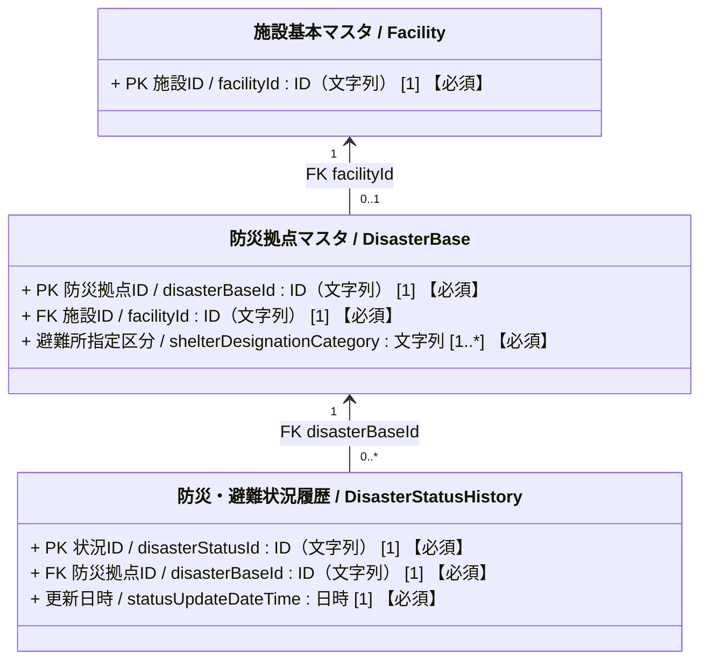
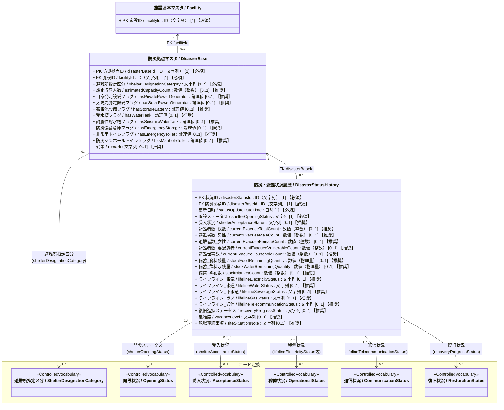

# 施設管理データモデル：防災拠点クラス図

作成日：2026-10-24  
更新日：2026-10-24  
バージョン：ver1.0  
状態：反映版

## 1. 目的と対象

施設管理の対象施設が住民避難を前提とした防災拠点として担う役割と平時の設備・受入能力を、静的情報である `DisasterBase` に保持する。災害時に変化する開設、受入、避難者数、備蓄およびライフラインの状況は、動的情報である `DisasterStatusHistory` に時点ごとの履歴として保持する。

本図は建物系施設を中心とする施設管理モデルであり、避難所、指定緊急避難場所・一時滞在施設等への指定も `DisasterBase` の役割として扱う。SmartCity の避難所クラス図は静的／動的情報の分離を考えるための参照資料とし、EEI の全項目を本モデルへ実装する前提にはしない。

## 2. クラス図

### 属性の多重度と収集区分の表記ルール

属性は `属性名 / 英語名 : 型 [多重度] 【収集区分】` と表記する。  
`[多重度]` はUML上の値の個数、`【収集区分】` は施設管理データモデルCSVの「必須」列に対応する本プロジェクト独自の表示であり、両者を明確に区別する。

| 収集区分 | 単一値属性の例 | 意味 |
| :--- | :--- | :--- |
| **必須** | `[1] 【必須】` | そのクラスのインスタンスが存在する場合、値を必ず保持する。 |
| **推奨** | `[0..1] 【推奨】` | 値がなくても成立するが、収集を推奨する。 |
| **任意** | `[0..1] 【任意】` | 値がなくても成立し、収集も任意とする（詳細拡張属性等）。 |

複数値属性は、必要な最小・最大件数に応じて `[0..*]` または `[1..*]` を用い、収集区分を併記する（例: `[0..*] 【推奨】`）。

### 2.1 全体構造

### 2.2 詳細クラス図（静的情報と動的情報）

## 3. 整合条件と業務ルール

### 3.1 施設と防災拠点

- 施設は防災拠点として指定されないことがあるため、`Facility` から見た `DisasterBase` は `0..1` とする。`DisasterBase` が存在するとき、`facilityId` は必須であり、1施設につき最大1件に制限するため一意制約を設ける。
- `DisasterBase` は `Facility` を参照する独立レコードとし、継承やコンポジションにはしない。住所、名称、建物の基本情報は施設・建物側を参照し、防災拠点に重複保持しない。
- 1施設が複数の役割を兼ねる場合は `shelterDesignationCategory` の複数値で表す。複数値の物理的な保持方法は、単一文字列への連結を前提にせず、後続の物理設計で決める。
- `estimatedCapacityCount` は平時に設定する想定上限であり、災害時点の避難者数とは異なる。設備の有無フラグは平時の保有・設置状況であって、災害時に実際に使用できるかは状況履歴のライフライン状態で表す。フラグの未入力は「無」と同義にしない。

### 3.2 防災・避難状況履歴

- 1レコードは、1防災拠点の1回の状況報告・更新を表す。`disasterBaseId` と `statusUpdateDateTime` は必須とし、同一拠点の複数の更新を履歴として残す。現在状況を表示するときは、単純な上書きではなく対象拠点の最新の有効な履歴を選ぶ。
- `shelterOpeningStatus` は開設・閉鎖等、`shelterAcceptanceStatus` は新規受入の可否・混雑・一時中断・受入終了を表す別の軸である。「受入終了」に満員・受入停止を正規化し、施設の閉鎖は開設状況で判断する。
- 避難者数の各値は非負整数とする。要配慮者数は総数の内数であり、男性・女性の人数と加算しない。男性数と女性数だけで総数を必ず再現できるとは限らないため、欠損や集計対象の違いを確認する。
- 平時の設備フラグと災害時のライフライン状態は別に管理する。電気・水道・下水道・ガスは「稼働状況」、通信は「通信状況」の統制語彙を参照する。`recoveryProgressStatus` は現行CSVの複数値を維持するが、復旧対象と状態の対応付けは未設計である。

## 4. 正本候補との対応と継続検討事項

| 対象 | 本案での扱い | 継続検討事項 |
| :--- | :--- | :--- |
| `m_disaster_bases` | `DisasterBase`。施設に対する静的な役割・収容能力・設備有無を保持。避難所指定区分は `PROP_DIS_003` の複数値で表し、重複フラグは設けない。 | 複数値の物理的な保持方法を後続の設計で決める。 |
| `t_disaster_status_histories` | `DisasterStatusHistory`。時点ごとの動的な運用状況を保持。混雑度と現場連絡事項は別属性とし、復旧進捗は `PROP_DST_018` で表す。 | 複数の復旧状況を記録する場合、復旧対象と各状態の対応付けを設計する。 |
| 施設と防災拠点 | `Facility` 1 対 `DisasterBase` 0..1。拠点が存在する場合、`facilityId` は必須。 | 1施設につき防災拠点を最大1件に制限する一意制約を物理設計で定める。 |
| 備蓄・報告日時 | 現行CSVの属性を維持 | 食料残量の単位（個数／日数分）を確定する。現行の「更新日時」が報告時刻か現場での確認時刻かを決め、両方必要な場合のみ属性を分ける。 |
| 設備マスタとの関係 | 本案では新たな関連線を引かない | 防災用設備フラグと設備マスタの登録情報を二重の正本にしない運用を検討する。 |
| 日本語クラス名 | 図と現行データモデルCSVでは「防災・避難状況履歴」を採用 | 同義語詳細辞書ver3の `CLASS_DST` は「避難所状況履歴」を基準名としている。辞書の基準名と適用範囲を見直す。 |

参照した入力と定義：`01_インプット/公共施設with防災・ファシマネ属性.xlsx`、`06_データモデルCSV/施設管理データモデルver4.csv`、`06_データモデルCSV/施設管理コード定義ver8.csv`、`06_データモデルCSV/施設管理同義語詳細辞書ver3.csv`、`00_ガイドライン/04_施設管理_クラス図作成ガイドライン.md`、`02_クラス図/施設管理_全体関連図.md`。静的／動的情報の構成に関する参照図：`05_参考/SmartCity_クラス図/0413_緊急情報防災情報_クラス図.md`。EEIは参照資料であり、本案の全属性を規定する正本とはしない。
